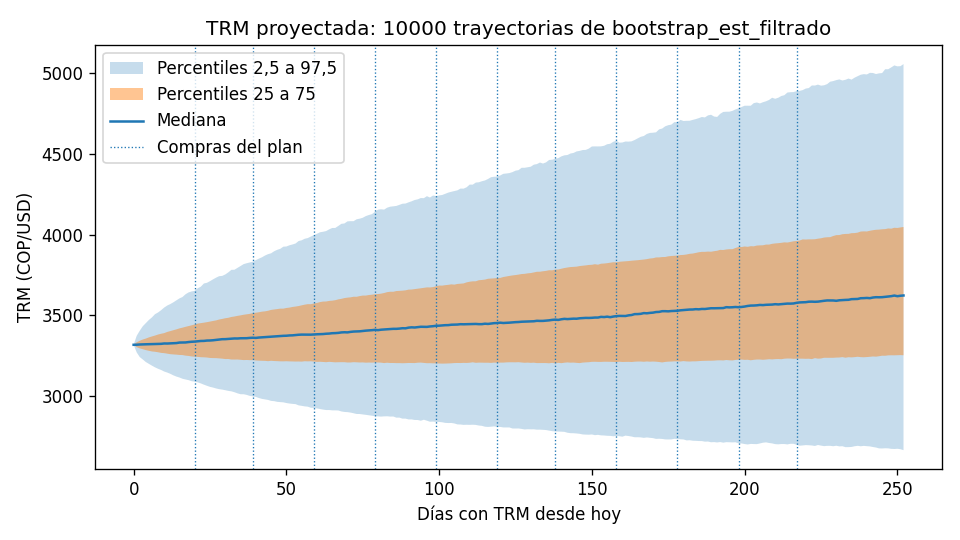

# Caso: compra de dólares para una meta — comprar hoy vs. compras escalonadas

Reporte generado por `python -m laboratorio.motor compra_dolares`. Los rangos describen
incertidumbre (histórica y simulada); no son pronóstico ni asesoría financiera. Cada cifra
termina en un código `#hash` que remite al apéndice con su fuente y su hash SHA-256. Bajo cada
bloque de cifras se dice qué evaluación fuera de muestra lo respalda, o «sin respaldo fuera de muestra».

## Planteamiento

- Meta: 10.000 USD `#8397039538`. Plan A: comprarlos todos hoy. Plan B: 12 `#b3a2ac0f21` compras
  iguales, una cada 1 `#e8f3aef896` mes(es), la primera hoy.
- TRM de hoy (2026-11-14 `#a5fb52d5f6`): 3.316,70 COP/USD `#ac9d82649e`.
- Costo del Plan A (cierto): 33.167.000 COP `#bcc9c6d182`. Presupuesto: 34.825.350 COP `#9e8597da5c`
  (costo de comprar hoy más un margen de 5,0 % `#61136fa9f8`).
- Las cifras de meta, número de compras, margen y ventanas son valores ilustrativos del autor.

## 1. Escenarios deterministas del Plan B

La TRM sigue `TRM0·exp(g·m/12)`; g (logarítmica anual) toma los percentiles 5, 50 y 95 de la
variación anual observada desde la flotación. Diferencia = costo de B menos costo de A (positivo = B más caro).

| Escenario | Deriva anual g | Costo Plan B | Costo medio | Diferencia vs. A | ¿Se pasa del presupuesto? |
|---|---:|---:|---:|---:|---|
| Optimista | -0,1804 `#4f72a5af0e` | 30.576.089 COP `#74e6cef07d` | 3.057,61 COP/USD `#6c3fe66e33` | -2.590.911 COP `#af7626ded0` | No `#c20c4b5ae2` |
| Base | 0,0145 `#9055dd1622` | 33.388.447 COP `#4ecc594836` | 3.338,84 COP/USD `#4ef718cbbf` | 221.447 COP `#ff69fa5242` | No `#a0818850a9` |
| Estrés | 0,2566 `#4b75c3bec3` | 37.408.078 COP `#90f47bdfd2` | 3.740,81 COP/USD `#36e7807a2f` | 4.241.078 COP `#86d2b88bd7` | Sí `#746c357c7e` |

Respaldo: sin respaldo fuera de muestra (las derivas son supuestos; no es un pronóstico evaluado).

## 2. Reproducción histórica con nombre

Se aplican al Plan B, desde la TRM de hoy, los movimientos reales de cada ventana.

| Ventana | Inicio | Fin | TRM fin / TRM inicio | Costo Plan B | Diferencia vs. A | ¿Se pasa? |
|---|---|---|---:|---:|---:|---|
| Año 2015 | 2015-01-02 `#70cff49fb1` | 2015-12-02 `#88be7f0d0f` | 1,309 `#a2f36a27c8` | 37.574.195 COP `#4328d795ce` | 4.407.195 COP `#4796a6e03e` | Sí `#aa3d2d39c2` |
| Fin de 2022 | 2022-10-03 `#74bb16f98f` | 2023-09-03 `#b816d0365c` | 0,885 `#ecb3c57cf2` | 32.896.331 COP `#0aea3f60d0` | -270.669 COP `#0ec85949f2` | No `#e6f1919d87` |

Respaldo: sin respaldo fuera de muestra (repite dos episodios del pasado; no es un pronóstico).

## 3. Todas las ventanas históricas del régimen de flotación

Hay 6.243 `#397a9593d2` ventanas de inicio. La más barata empieza el 2009-02-25 `#eda09685c2`
y la más cara el 2008-06-19 `#b83b928b2b`. Se traslapan: equivalen a solo
29 `#181604e73f` ventanas sin traslape, así que los percentiles extremos
descansan en pocos episodios.

| Medida del Plan B | Valor | Diferencia vs. A |
|---|---:|---:|
| Costo esperado (media) | 33.660.196 COP `#eeb75ecf7b` | 493.196 COP `#36dfa5f819` |
| Mediana | 33.482.930 COP `#4bb0a8601f` | |
| Percentil 5 | 30.234.177 COP `#cd85d2879a` | |
| Percentil 95 | 38.822.363 COP `#aa745b31ec` | 5.655.363 COP `#ec552e8bb7` |
| Mínimo | 27.040.921 COP `#0d877ee4f5` | |
| Máximo | 43.559.893 COP `#d9066ae016` | |
| Probabilidad de superar el presupuesto | 25,5 % `#fd7ded8225` | |
| Probabilidad de salir más barato que comprar hoy | 44,0 % `#ab4c750b5d` | |

Respaldo: sin respaldo fuera de muestra (frecuencias del pasado con ventanas traslapadas; nunca se evaluó como pronóstico).

## 4. Monte Carlo por bloques

Se simulan 10.000 trayectorias de la TRM (semilla 20240501) con
`bootstrap_est_filtrado`, el motor fijado en el prerregistro antes de la prueba final. Es un bootstrap
estacionario (Politis-Romano): remuestrea por bloques de longitud media
25,2 días `#d0ce0a55a7` (Politis-White) los rendimientos diarios divididos por la volatilidad
de su momento, y los reescala con la volatilidad de hoy (0,739 % diario `#60af116737`), que
vuelve poco a poco a la de largo plazo (0,673 % diario `#9b37f64747`). La sensibilidad usa
`bootstrap_est` (los rendimientos tal cual, sin filtrar). El tiempo avanza en días con
TRM: la última compra cae a 217 días con TRM `#32ef644023` (el prerregistro decía «unos 230»;
la serie trae unas 20 observaciones por mes, no 21).

**Por qué toda la historia y no solo la flotación.** El remuestreo usa las
8.387 `#375fa7aa02` observaciones de la serie, desde 1991-12-02 `#a1606147c7` (banda cambiaria
incluida); la sección 3, en cambio, solo usa ventanas desde 1999-09-25 `#2650ef76b0`. Tres motivos:
(a) es exactamente el modelo que se evaluó en la prueba final: con otra muestra, las coberturas
medidas que se citan en la sección 5 no respaldarían estas cifras; (b) la banda aporta la
crisis de 1997-1999, uno de los pocos episodios de estrés que hay; (c) el motor remuestrea
choques ya divididos por la volatilidad de su época, así que el nivel de volatilidad de los
años de banda no se traslada a hoy: la escala la pone la volatilidad actual. En la sensibilidad
sin filtrar el motivo (c) no aplica.

**Lo que esa decisión cuesta: la deriva.** El promedio histórico de los choques (incluida la
depreciación sostenida de los años noventa) sí entra en las trayectorias. La mediana simulada
de la TRM a 252 días queda 9,2 % `#5751a6dc04` por encima de la de hoy
(4,9 % `#9cb2f0596c` en la sensibilidad), mientras que el escenario base de la sección 1,
que solo mira la flotación, supone una deriva logarítmica anual de 0,0145 `#9055dd1622`. Esa
deriva empuja hacia arriba el costo esperado y la probabilidad de superar el presupuesto frente
a las ventanas históricas. No es un pronóstico de dirección: es una propiedad del modelo
evaluado, que se deja a la vista y no se corrige aquí porque el motor quedó fijado antes de
la prueba final.

| Medida del Plan B | Monte Carlo (motor) | Sensibilidad (sin filtrar) | Ventanas históricas | Evaluación que la respalda |
|---|---:|---:|---:|---|
| Costo esperado (media) | 34.721.406 COP `#702b229397` | 33.998.678 COP `#fa52bfcde2` | 33.660.196 COP `#eeb75ecf7b` | sin respaldo fuera de muestra |
| Mediana | 34.463.192 COP `#1a112a5ca8` | 33.895.816 COP `#66525e9652` | 33.482.930 COP `#4bb0a8601f` | sin respaldo fuera de muestra |
| Percentil 5 | 30.078.346 COP `#bca23562cf` | 30.372.435 COP `#20cf50cda8` | 30.234.177 COP `#cd85d2879a` | sin respaldo fuera de muestra |
| Percentil 95 | 40.189.139 COP `#760ee96e28` | 38.397.630 COP `#60e4276de7` | 38.822.363 COP `#aa745b31ec` | sin respaldo fuera de muestra |
| Probabilidad de superar el presupuesto | 45,4 % `#8ace034dae` | 33,4 % `#dda8d22edf` | 25,5 % `#fd7ded8225` | sin respaldo fuera de muestra |
| Probabilidad de salir más barato que comprar hoy | 33,1 % `#85b8066e9b` | 36,8 % `#23a6449437` | 44,0 % `#ab4c750b5d` | sin respaldo fuera de muestra |

Diferencia frente al Plan A: costo esperado 1.554.406 COP `#2b981fec70`; percentil 95
7.022.139 COP `#3d14b4ee81`. Error de Monte Carlo (solo por simular un número finito de trayectorias;
no mide el error del modelo): ± 30.981 COP `#1babdd36e2` en la media y a lo sumo
± 0,50 puntos porcentuales `#6c367e4404` en las probabilidades.

**Respaldo de estas cifras: indirecto.** Ninguna tiene una evaluación directa fuera de muestra.
El caso reparte la compra en 12 `#b3a2ac0f21` cuotas: la última cae a
217 días con TRM `#32ef644023` y la cifra que se reporta es el costo total, una suma sobre toda
la trayectoria. La prueba final no evalúa ni ese horizonte ni esa suma: evalúa el rendimiento
acumulado a 1, 5, 21, 63, 126 y 252 días, cada uno por separado. Dos límites: ese horizonte queda entre 126 y 252 días, que en la prueba final son solo descriptivos (cobertura medida del intervalo del 95 %: 0,992 `#8eb0487e7c` con 11 `#f7300827fa` ventanas independientes y 0,932 `#0d31aa7e14` con 5 `#b104476181`); y
acertar cada horizonte por separado no garantiza acertar la trayectoria completa de la que
depende el costo total.

## 5. Abanico de la TRM y evaluación que lo respalda

Límites = percentiles 2,5 y 97,5 de las trayectorias del motor (la banda del 95 %), en los
horizontes que evaluó la prueba final. «Cobertura medida» = fracción de las veces, entre 2020 y
2026, en que la TRM real cayó dentro de la banda del 95 % del mismo modelo (lo ideal es 0,95).
El intervalo de confianza usa el n efectivo (ventanas sin traslape).

| Horizonte (días con TRM) | Límite inferior | Mediana | Límite superior | Evaluación que la respalda | Advertencia |
|---:|---:|---:|---:|---|---|
| 1 | 3.269,72 COP/USD `#541f90666e` | 3.317,16 COP/USD `#cc8e090b93` | 3.372,33 COP/USD `#936ee02fff` | prueba final, cobertura medida 0,950 `#28a02f28e8` (n efectivo 1.564 `#c5f1986a5f`; intervalo de confianza 0,94 `#86c5faede0` a 0,96 `#845f4732d4`) | no hace falta |
| 5 | 3.198,56 COP/USD `#c740236e24` | 3.320,37 COP/USD `#f882ad467b` | 3.470,74 COP/USD `#bbc0f7abbb` | prueba final, cobertura medida 0,961 `#3c37d0aca4` (n efectivo 313 `#a20f4904b4`; intervalo de confianza 0,93 `#bb698b3584` a 0,98 `#015455a51d`) | no hace falta |
| 21 | 3.083,83 COP/USD `#1e5b42ed4c` | 3.338,63 COP/USD `#4fda77a3ac` | 3.667,15 COP/USD `#e5dd4bdffc` | prueba final, cobertura medida 0,968 `#d8dba7230c` (n efectivo 74 `#4bd67bbded`; intervalo de confianza 0,91 `#765a6e2b1d` a 1,00 `#fa7a2ce15d`) | no hace falta |
| 63 | 2.912,19 COP/USD `#c544f90b93` | 3.385,28 COP/USD `#0b46e0ec64` | 4.021,60 COP/USD `#c8b809a55d` | prueba final, cobertura medida 0,960 `#d6a3976628` (n efectivo 25 `#655aca83ca`; intervalo de confianza 0,80 `#8f51695a76` a 1,00 `#b1e5ca77d5`) | **siempre**: solo 25 `#655aca83ca` ventanas independientes; que la cobertura nominal quepa en el intervalo no prueba que la banda esté bien calibrada |
| 126 | 2.798,08 COP/USD `#2160cade1d` | 3.457,93 COP/USD `#137af5dfc8` | 4.399,47 COP/USD `#61b9c14862` | prueba final, descriptiva, cobertura medida 0,992 `#8eb0487e7c` (n efectivo 11 `#f7300827fa`; intervalo de confianza 0,72 `#aed83b9e6d` a 1,00 `#5a38bd1b00`) | **siempre**: solo 11 `#f7300827fa` ventanas independientes; que la cobertura nominal quepa en el intervalo no prueba que la banda esté bien calibrada |
| 252 | 2.663,60 COP/USD `#7d4fd1e47e` | 3.622,36 COP/USD `#f4f608d0ff` | 5.056,59 COP/USD `#9f716920d9` | prueba final, descriptiva, cobertura medida 0,932 `#0d31aa7e14` (n efectivo 5 `#b104476181`; intervalo de confianza 0,48 `#22a368e675` a 1,00 `#45f3a6cc0b`) | **siempre**: solo 5 `#b104476181` ventanas independientes; que la cobertura nominal quepa en el intervalo no prueba que la banda esté bien calibrada |

**Modelo de referencia.** Solo a 1 día un modelo superó a su línea base en la prueba final: `lightgbm_cuantiles` (CRPS/base 0,977 `#50e61dadcf`, 1.564 `#b4ea9c9b1b` orígenes). Su cola superior quedó subcubierta en la prueba final: el VaR superior del 5 % se superó el 6,8 % `#5a77d0c1ea` de los días y el del 1 % el 1,85 % `#f99b0421b8` (Kupiec p = 0,002 `#0f6f98eeba` y 0,002 `#b422f01fa7`). Este caso no lo usa para simular ni calcula su banda: se cita como referencia de ese horizonte. En los demás horizontes ningún modelo se distinguió de las líneas base y no se cita ninguno.

## Limitaciones

- No se modela el rendimiento del dinero mientras espera (costo de oportunidad ni tasas COP/USD).
- La distribución histórica usa solo el pasado del régimen de flotación y supone que se
  repetirá; el Monte Carlo remuestrea choques ya ocurridos: ninguno de los dos contiene
  episodios más grandes que los vistos.
- Los percentiles extremos dependen de pocos episodios (ver ventanas sin traslape).
- El costo total simulado no tiene evaluación directa fuera de muestra (sección 4).
- La TRM es la de la Superfinanciera (una fila por vigencia); el precio real de compra
  incluye comisiones y diferencial que no se modelan.

## Ficha de la corrida

- Corrida: `200b84c2c1a1`; caso `compra_dolares`; semilla: 20240501; trayectorias:
  10.000; motor `bootstrap_est_filtrado`, sensibilidad `bootstrap_est`.
- Hash de datos `61582127a13b93d8afff0d6fa9751914c330e9e73c2787f584fa139f494a5f64`
- Hash de supuestos `e26cfb6730179e94360fdf1f59c77945de48ea6950a79c7d7355c9e4abb2e912`
- Hash de código `eb779fe22e24b1622ccea9ed4677d74e59560a5fcf832ed4d270aab8af283097`
- Hash de entrada `200b84c2c1a1879b3f03d5fc18f11f3cc006986b0e2e9786875f5f9313f93873`
- Hash de resultado `7fece992d7b0b36a2cb4b4a81f5da10da700778e61b12048e5a579b544bed0bc`

## Apéndice: fuente y hash de cada cifra

| Cifra | Origen | Fuente / fórmula | Hash SHA-256 |
|---|---|---|---|
| `#9cb2f0596c` | calculo | 100 × (mediana de la TRM simulada a 252 pasos / TRM_hoy − 1), 10000 trayectorias de bootstrap_est (semilla 20240501, 252 pasos) | `9cb2f0596c651076dedef6489c8c28d32889458f14bc18ebcd81af17b13bad4f` |
| `#5751a6dc04` | calculo | 100 × (mediana de la TRM simulada a 252 pasos / TRM_hoy − 1), 10000 trayectorias de bootstrap_est_filtrado (semilla 20240501, 252 pasos) | `5751a6dc048dbcb8b71296f9b5975ed2039581195213c740e3f4ef8b2b5d536b` |
| `#60af116737` | calculo | 100 × desvío diario EWMA(0,94) en la última observación | `60af11673799490e6128da8fc025e57d5d3a47eb60c34372121545b27da2c5b2` |
| `#23a6449437` | calculo | 100 × fracción de trayectorias con costo < costo hoy, 10000 trayectorias de bootstrap_est (semilla 20240501, 252 pasos) | `23a644943705f6625996a9f23eefb9edc4d9afc6cbf1fc34e82b50490dad8a3b` |
| `#85b8066e9b` | calculo | 100 × fracción de trayectorias con costo < costo hoy, 10000 trayectorias de bootstrap_est_filtrado (semilla 20240501, 252 pasos) | `85b8066e9b2eac37aff197128a5b104b6dcc9012bd96ba88b3292b15c801388c` |
| `#dda8d22edf` | calculo | 100 × fracción de trayectorias con costo > presupuesto, 10000 trayectorias de bootstrap_est (semilla 20240501, 252 pasos) | `dda8d22edf0a8a44971e6b5e67c0c50a3d4c74b0ea64da26686a0aabc8f05f26` |
| `#8ace034dae` | calculo | 100 × fracción de trayectorias con costo > presupuesto, 10000 trayectorias de bootstrap_est_filtrado (semilla 20240501, 252 pasos) | `8ace034dae4618267502623a4aa38681845eb877f756a7a19744d32663c42a1b` |
| `#ab4c750b5d` | calculo | 100 × fracción de ventanas con costo < costo hoy | `ab4c750b5da2956d4e0811415cba2e6128675756d07c1040ed85387c6bfa3b50` |
| `#fd7ded8225` | calculo | 100 × fracción de ventanas con costo > presupuesto | `fd7ded8225cdc21d7d449139499f6a483c1f8f328f320a2074734d983c8da7d2` |
| `#6c367e4404` | calculo | 100 × máximo de √(p(1−p)/trayectorias) entre las dos probabilidades, 10000 trayectorias de bootstrap_est_filtrado (semilla 20240501, 252 pasos) | `6c367e44044e485962c05cbded0b5f559f6cc902ea5dba747fe1189d86eee0b8` |
| `#9b37f64747` | calculo | 100 × raíz de la media de r² en toda la historia | `9b37f647474a5dc060afe4f4d49c2f0fea13bbc6ee11f231cba2e8c4e0366f41` |
| `#5a77d0c1ea` | calculo | 100 × tasa de excesos del VaR | `5a77d0c1ea21e4d5521f0916ea4376d422c8776bbe96cd0acb9cf68e0b639f41` |
| `#f99b0421b8` | calculo | 100 × tasa de excesos del VaR | `f99b0421b8dfd9d735055d0346e48a89536152a83dc5976dc4e260a5285fc0a1` |
| `#a2f36a27c8` | calculo | TRM(inicio + horizonte) / TRM(inicio) | `a2f36a27c80cade8ffa6fee92d6966db3e333db4178c22398c89023a537fd72f` |
| `#ecb3c57cf2` | calculo | TRM(inicio + horizonte) / TRM(inicio) | `ecb3c57cf29270d201de3f17ce269daf27d36bfb36f2c17bdb2b26bdeabbfd02` |
| `#541f90666e` | calculo | TRM_hoy × exp(cuantil 0.025 del rendimiento acumulado a 1 pasos), 10000 trayectorias de bootstrap_est_filtrado (semilla 20240501, 252 pasos) | `541f90666e218484f9b23a9012030bffe2ebb9df5a61f9b171733ed75ed93cc2` |
| `#2160cade1d` | calculo | TRM_hoy × exp(cuantil 0.025 del rendimiento acumulado a 126 pasos), 10000 trayectorias de bootstrap_est_filtrado (semilla 20240501, 252 pasos) | `2160cade1de2c858e5cbd9d8afcdfed009b157c54a10ceff726a009b4d9f00c4` |
| `#1e5b42ed4c` | calculo | TRM_hoy × exp(cuantil 0.025 del rendimiento acumulado a 21 pasos), 10000 trayectorias de bootstrap_est_filtrado (semilla 20240501, 252 pasos) | `1e5b42ed4c7479039555061f49a47e60a426527659d5a3e754b8772c63407743` |
| `#7d4fd1e47e` | calculo | TRM_hoy × exp(cuantil 0.025 del rendimiento acumulado a 252 pasos), 10000 trayectorias de bootstrap_est_filtrado (semilla 20240501, 252 pasos) | `7d4fd1e47e6709866cd7acfff8f56bd0f797c40d9b1159b71390a965c232619c` |
| `#c740236e24` | calculo | TRM_hoy × exp(cuantil 0.025 del rendimiento acumulado a 5 pasos), 10000 trayectorias de bootstrap_est_filtrado (semilla 20240501, 252 pasos) | `c740236e24a74c7e89491de35806a9cb70dd068260f539ba8110fc05914b42ec` |
| `#c544f90b93` | calculo | TRM_hoy × exp(cuantil 0.025 del rendimiento acumulado a 63 pasos), 10000 trayectorias de bootstrap_est_filtrado (semilla 20240501, 252 pasos) | `c544f90b93b3d4efc0b6c3534cf492782a55614ce7267d37b9e29dae3419619c` |
| `#cc8e090b93` | calculo | TRM_hoy × exp(cuantil 0.5 del rendimiento acumulado a 1 pasos), 10000 trayectorias de bootstrap_est_filtrado (semilla 20240501, 252 pasos) | `cc8e090b938e5f276016d8e7572a8bf69e9fc56fed82b5eeba1252ca5c94470c` |
| `#137af5dfc8` | calculo | TRM_hoy × exp(cuantil 0.5 del rendimiento acumulado a 126 pasos), 10000 trayectorias de bootstrap_est_filtrado (semilla 20240501, 252 pasos) | `137af5dfc837925e016ac30f78c4d154875de211671d8bd86317ad3d6eb58cc8` |
| `#4fda77a3ac` | calculo | TRM_hoy × exp(cuantil 0.5 del rendimiento acumulado a 21 pasos), 10000 trayectorias de bootstrap_est_filtrado (semilla 20240501, 252 pasos) | `4fda77a3ac39a555c89da69e2ced5ef4e42519bc635548135bffb7ec201f9ea3` |
| `#f4f608d0ff` | calculo | TRM_hoy × exp(cuantil 0.5 del rendimiento acumulado a 252 pasos), 10000 trayectorias de bootstrap_est_filtrado (semilla 20240501, 252 pasos) | `f4f608d0ffacfad0f29e17e5a33e77f60cf5274f158ada56a4bf7252b31139a7` |
| `#f882ad467b` | calculo | TRM_hoy × exp(cuantil 0.5 del rendimiento acumulado a 5 pasos), 10000 trayectorias de bootstrap_est_filtrado (semilla 20240501, 252 pasos) | `f882ad467be1b8f208029c926f9e66f7e19371cadd37e49dae206dcdfb20d49c` |
| `#0b46e0ec64` | calculo | TRM_hoy × exp(cuantil 0.5 del rendimiento acumulado a 63 pasos), 10000 trayectorias de bootstrap_est_filtrado (semilla 20240501, 252 pasos) | `0b46e0ec640e24410fc819ef24e5dbdd540b9d74421b6e8b68aba7416285ef9c` |
| `#936ee02fff` | calculo | TRM_hoy × exp(cuantil 0.975 del rendimiento acumulado a 1 pasos), 10000 trayectorias de bootstrap_est_filtrado (semilla 20240501, 252 pasos) | `936ee02fff672e9bab12293fa61e58f7cc7d56fd00dab1f21b80871e4a400800` |
| `#61b9c14862` | calculo | TRM_hoy × exp(cuantil 0.975 del rendimiento acumulado a 126 pasos), 10000 trayectorias de bootstrap_est_filtrado (semilla 20240501, 252 pasos) | `61b9c148622d06f7f951a560cbdcb471f5cbe94dcbf2d82cf5a99cb574d4c64f` |
| `#e5dd4bdffc` | calculo | TRM_hoy × exp(cuantil 0.975 del rendimiento acumulado a 21 pasos), 10000 trayectorias de bootstrap_est_filtrado (semilla 20240501, 252 pasos) | `e5dd4bdffc717d5b1bf6187874af71c49e7d95a77b3f680729dd4caecb400346` |
| `#9f716920d9` | calculo | TRM_hoy × exp(cuantil 0.975 del rendimiento acumulado a 252 pasos), 10000 trayectorias de bootstrap_est_filtrado (semilla 20240501, 252 pasos) | `9f716920d9cc4feb3f88a871bbd6c5aa9f8036eea7b01deea6a093ec503c9e44` |
| `#bbc0f7abbb` | calculo | TRM_hoy × exp(cuantil 0.975 del rendimiento acumulado a 5 pasos), 10000 trayectorias de bootstrap_est_filtrado (semilla 20240501, 252 pasos) | `bbc0f7abbbe2837bb78df6e5947083c906333209cfd037cc11b8e2bbf348b3d1` |
| `#c8b809a55d` | calculo | TRM_hoy × exp(cuantil 0.975 del rendimiento acumulado a 63 pasos), 10000 trayectorias de bootstrap_est_filtrado (semilla 20240501, 252 pasos) | `c8b809a55d34073cf8ed24da7c108a41b33e1ecbfbefa3d0c08c732561e472cd` |
| `#6c3fe66e33` | calculo | costo / meta_usd | `6c3fe66e33cb3ab867a5169fd8d92eb4bacba3393a9fdaec54af1908b03a7aad` |
| `#4ef718cbbf` | calculo | costo / meta_usd | `4ef718cbbf2447a74d60c0738e565b44863ba9a3b02c60cbe857a5d2d27eb723` |
| `#36e7807a2f` | calculo | costo / meta_usd | `36e7807a2f9dcdf5e60227814b2e621d3f059b63c6d6d9d6569fe391a3699a6a` |
| `#c20c4b5ae2` | calculo | costo > presupuesto | `c20c4b5ae2f93262a5e26d1029d82d4aa92edc65613e7129ac4379f209d815ef` |
| `#a0818850a9` | calculo | costo > presupuesto | `a0818850a967d8ec13a12d1b051d4388cb0e807871e019e79cde334083a45f54` |
| `#746c357c7e` | calculo | costo > presupuesto | `746c357c7e8030ed3f40305fdd58bcc392df96a9d136e7bc3c55b1a17d0ec0a8` |
| `#aa3d2d39c2` | calculo | costo > presupuesto | `aa3d2d39c29a1e1e35d3ea8d53a865f546a7e2b3dd1c1c01a18525255ccce8de` |
| `#e6f1919d87` | calculo | costo > presupuesto | `e6f1919d8744fe161fce2abdef6e4cf1fafd53985e2a1f8cea99e0614233f00b` |
| `#af7626ded0` | calculo | costo escalonado − costo hoy | `af7626ded0b0393852cf523ca6db0817ed07c22681c243a68adba1ed439a4e2f` |
| `#ff69fa5242` | calculo | costo escalonado − costo hoy | `ff69fa5242a5b376a90830a2e1d887b9df2926864f7bc775c1f7d9bdecd55194` |
| `#86d2b88bd7` | calculo | costo escalonado − costo hoy | `86d2b88bd752e6e3cafb03c773ff04b05262e628bbde7dfd5b8e5087608b0077` |
| `#4796a6e03e` | calculo | costo escalonado − costo hoy | `4796a6e03e909f700a67d8ebf3b95f96e8ff4fe39410c77e39ac536864bcb648` |
| `#0ec85949f2` | calculo | costo escalonado − costo hoy | `0ec85949f2ca379ea5c0d8a72749f255dd0678ffa5ac6de164f30b4d880cd6cd` |
| `#36dfa5f819` | calculo | costo esperado escalonado − costo hoy | `36dfa5f819e06c01ab3a532f90d09eefe817161cf926cbf44a011d75f4812694` |
| `#2b981fec70` | calculo | costo esperado simulado − costo hoy | `2b981fec705b53d52f3d9bce6d660bb0ec1a35bda2b93ee423b7731fa7fe399c` |
| `#9e8597da5c` | calculo | costo_hoy × (1 + margen/100) | `9e8597da5c7021daf7efb682d058be7efe9495c3dcb269d4f44c10dc9daa74b0` |
| `#1babdd36e2` | calculo | desvío del costo / √trayectorias, 10000 trayectorias de bootstrap_est_filtrado (semilla 20240501, 252 pasos) | `1babdd36e287972e577ea16b0b2aa298322a413c061a65cced84690a1fb5cf98` |
| `#a5fb52d5f6` | calculo | fecha de la TRM de hoy | `a5fb52d5f6c99be5e5ca776dd85a16f84214b8c3090350c00dfb9152ae8382f6` |
| `#88be7f0d0f` | calculo | inicio + horizonte del plan | `88be7f0d0f15ce7b8baf20feb551703a7485694bbf798632054958e48d043734` |
| `#b816d0365c` | calculo | inicio + horizonte del plan | `b816d0365c319d929b7c991841e7271c30a79085ccfec23117d61f069e214552` |
| `#b83b928b2b` | calculo | inicio de la ventana de mayor costo | `b83b928b2bb60db154903a4fe7baa1985d64c80e90770815609c70c99271f180` |
| `#eda09685c2` | calculo | inicio de la ventana de menor costo | `eda09685c2ae227350bb424605f3ea6804227b55460e6783e493c91bbfd420a0` |
| `#d0ce0a55a7` | calculo | longitud media de bloque de Politis-White (máximo entre la serie y su valor absoluto), bootstrap_est_filtrado | `d0ce0a55a7a0eff1f5cfa6c1efe62aa07afb48f2f0117de6b374525cd12b3cef` |
| `#eeb75ecf7b` | calculo | media del costo en todas las ventanas | `eeb75ecf7bf90947f607a43665f11d4b5f1f0fd58c94db47bb1632a98fc4c80d` |
| `#fa52bfcde2` | calculo | media del costo, 10000 trayectorias de bootstrap_est (semilla 20240501, 252 pasos) | `fa52bfcde2638785be04d32a5c99113168a3a0083cd13c6983a21ca1f1e2d1df` |
| `#702b229397` | calculo | media del costo, 10000 trayectorias de bootstrap_est_filtrado (semilla 20240501, 252 pasos) | `702b229397ef5c6477f5cf8c53cc4ef8d0e2c8551af62d9d325acf4983a5d3d9` |
| `#32ef644023` | calculo | mediana, en las ventanas históricas, de las observaciones entre el inicio y la última compra | `32ef64402361651612fcafa88d35519e05e594ad6cdf64a9dae5f1ad424347be` |
| `#181604e73f` | calculo | meses cubiertos / horizonte (ventanas sin traslape) | `181604e73ffafbd833606330eac16d80bb2aeec2a2c90c2fff2cba21e43fe118` |
| `#bcc9c6d182` | calculo | meta_usd × TRM_hoy | `bcc9c6d182f42b358cb4d5b1e1a5d97cb41ac5a5529c9e9c785e62521e66b0e7` |
| `#d9066ae016` | calculo | máximo del costo | `d9066ae016bd23a88844b437a20a2a5e58dd3075d272b1a260aeb9197ff7ae36` |
| `#0d877ee4f5` | calculo | mínimo del costo | `0d877ee4f5f1f6a6f3bc2ed50eed8d80a84cde1893ef65ba092e4267dab9accc` |
| `#397a9593d2` | calculo | número de fechas de inicio con ventana completa | `397a9593d212c419d51c53438b9f897bb2a437f576026404f0a6a85009801501` |
| `#cd85d2879a` | calculo | percentil 5 del costo | `cd85d2879a0362415a8fb863203021f2963c567390faab3e8bde38b9bb9749b1` |
| `#20cf50cda8` | calculo | percentil 5 del costo, 10000 trayectorias de bootstrap_est (semilla 20240501, 252 pasos) | `20cf50cda8b770123e1ffff98869966207385ffc7f176d1447a76dd9f8ab7cee` |
| `#bca23562cf` | calculo | percentil 5 del costo, 10000 trayectorias de bootstrap_est_filtrado (semilla 20240501, 252 pasos) | `bca23562cf1f000284aa78f75c45142471b2b8b15f9266623f5e309007c8ba90` |
| `#4bb0a8601f` | calculo | percentil 50 (mediana) del costo | `4bb0a8601ffdbcebac527288b8fe2caa6700edca12d5c137c57f8184ad86451a` |
| `#66525e9652` | calculo | percentil 50 (mediana) del costo, 10000 trayectorias de bootstrap_est (semilla 20240501, 252 pasos) | `66525e9652e5bc54ca2b8126eb309626d5e327a51747e13ce1c81b4190dec40b` |
| `#1a112a5ca8` | calculo | percentil 50 (mediana) del costo, 10000 trayectorias de bootstrap_est_filtrado (semilla 20240501, 252 pasos) | `1a112a5ca88c3dc6259fa60dd141255cea7f71a7bc811cfb9bafa1651b66ff90` |
| `#aa745b31ec` | calculo | percentil 95 del costo | `aa745b31ec1fbfdb65c9432806ec940bfc74956f0ec8be86a94ff8de8aeae78e` |
| `#60e4276de7` | calculo | percentil 95 del costo, 10000 trayectorias de bootstrap_est (semilla 20240501, 252 pasos) | `60e4276de72e07ccb13c09e0486a4a42c5718c46572f07372a2b9bec43c5e584` |
| `#760ee96e28` | calculo | percentil 95 del costo, 10000 trayectorias de bootstrap_est_filtrado (semilla 20240501, 252 pasos) | `760ee96e287c0d233632296376326f40042fdb29232b9358dec50491a38c4efe` |
| `#ec552e8bb7` | calculo | percentil 95 escalonado − costo hoy | `ec552e8bb77adc4266db188dc8cf37d3256457ab7ce841353545a46b4def2d17` |
| `#3d14b4ee81` | calculo | percentil 95 simulado − costo hoy | `3d14b4ee81dd95434760c6a406e372bcc58a341fd44762d383ef90f11c0cd97b` |
| `#a1606147c7` | calculo | primera fecha de la serie | `a1606147c721020c679a016668896e06321feded5c50023049b4d910a8857f66` |
| `#4328d795ce` | calculo | Σ (meta/n)·TRM_hoy·TRM(inicio+m_i)/TRM(inicio) | `4328d795ce8a7b129adc720b48e0d82358a543cb98c78c4f07c0e130c37c35be` |
| `#0aea3f60d0` | calculo | Σ (meta/n)·TRM_hoy·TRM(inicio+m_i)/TRM(inicio) | `0aea3f60d07d4e32720649ddebe75fd3580fc38d10a2c109df457eaa03525022` |
| `#74e6cef07d` | calculo | Σ (meta/n)·TRM_hoy·exp(g·m_i/12), m_i = i·intervalo | `74e6cef07d52f84497c5cc55d570e8ce4b1ddf5e135acf08a89e09546d8f3d08` |
| `#4ecc594836` | calculo | Σ (meta/n)·TRM_hoy·exp(g·m_i/12), m_i = i·intervalo | `4ecc594836c49cc675dcad898b06d65c15c01f9da34c7fbb4305c0817394f076` |
| `#90f47bdfd2` | calculo | Σ (meta/n)·TRM_hoy·exp(g·m_i/12), m_i = i·intervalo | `90f47bdfd2cfc554f54b9bf57c900e4505cf64845497b1c927dfad23c2ff2ae7` |
| `#375fa7aa02` | dato | processed/trm.csv#columna=trm;serie completa | `375fa7aa0246e099abc160f939cf5ec1cd48527a3267bfe6693904e32cfe1f5a` |
| `#ac9d82649e` | dato | processed/trm.csv#fecha=2026-11-14;columna=trm | `ac9d82649e85a0c41efb9bb796da93650898c8a971f2b2614f424c5ccf9a6497` |
| `#8eb0487e7c` | dato | respaldo/prueba_final.json#cobertura;motor=bootstrap_est_filtrado;h=126;campo=cobertura | `8eb0487e7c45ca491e1c21bf4c5349da795730533e464836d71bb8e4438be424` |
| `#aed83b9e6d` | dato | respaldo/prueba_final.json#cobertura;motor=bootstrap_est_filtrado;h=126;campo=ic_inf | `aed83b9e6de75b025ddbd0eb3d2fc6c0a929a195791ee085b014cd06630e1855` |
| `#5a38bd1b00` | dato | respaldo/prueba_final.json#cobertura;motor=bootstrap_est_filtrado;h=126;campo=ic_sup | `5a38bd1b00b935217e5e3fa85fb33262cd36977ad8c06e06afdd1a6cb5a5f2f5` |
| `#f7300827fa` | dato | respaldo/prueba_final.json#cobertura;motor=bootstrap_est_filtrado;h=126;campo=n_efectivo | `f7300827fadb3ddcc8871bf67868461c52479094695afdfa6d55d6d5dc60c087` |
| `#28a02f28e8` | dato | respaldo/prueba_final.json#cobertura;motor=bootstrap_est_filtrado;h=1;campo=cobertura | `28a02f28e8658e1748cc4d8161775076188476d4557d146714baac41804efe6d` |
| `#86c5faede0` | dato | respaldo/prueba_final.json#cobertura;motor=bootstrap_est_filtrado;h=1;campo=ic_inf | `86c5faede0943a0de9bce49400d620a700b2cef206742f8c3bfe836aeac7e3cd` |
| `#845f4732d4` | dato | respaldo/prueba_final.json#cobertura;motor=bootstrap_est_filtrado;h=1;campo=ic_sup | `845f4732d4ca6940af87f240bb54abe7a3ef5453f4401556583a05aa49ea856b` |
| `#c5f1986a5f` | dato | respaldo/prueba_final.json#cobertura;motor=bootstrap_est_filtrado;h=1;campo=n_efectivo | `c5f1986a5f1902db99e055093249edaa97937b4dde791cf83e479ae445975285` |
| `#d8dba7230c` | dato | respaldo/prueba_final.json#cobertura;motor=bootstrap_est_filtrado;h=21;campo=cobertura | `d8dba7230cf73462bd9ff5ce3b5d5199e82e49618cb8d41edcd04475e6470651` |
| `#765a6e2b1d` | dato | respaldo/prueba_final.json#cobertura;motor=bootstrap_est_filtrado;h=21;campo=ic_inf | `765a6e2b1da633a9052eb8a04d0c03c76f5a317a11cb9bce9e93b302e3a5edf9` |
| `#fa7a2ce15d` | dato | respaldo/prueba_final.json#cobertura;motor=bootstrap_est_filtrado;h=21;campo=ic_sup | `fa7a2ce15d2de0fbc51cc795fe50f01241b68c6d79a2ecebda8f19ea3796e9af` |
| `#4bd67bbded` | dato | respaldo/prueba_final.json#cobertura;motor=bootstrap_est_filtrado;h=21;campo=n_efectivo | `4bd67bbded580ed05697a95dad7cd358117a8a5f663e438aa07696a7381e09d6` |
| `#0d31aa7e14` | dato | respaldo/prueba_final.json#cobertura;motor=bootstrap_est_filtrado;h=252;campo=cobertura | `0d31aa7e14cb963cfcc24b4855cfe0ab78480078378df80c73fc998a54a6b58e` |
| `#22a368e675` | dato | respaldo/prueba_final.json#cobertura;motor=bootstrap_est_filtrado;h=252;campo=ic_inf | `22a368e675aeacfc81273534413565fa494a66f0c8bbc0bbdf41452c135960dc` |
| `#45f3a6cc0b` | dato | respaldo/prueba_final.json#cobertura;motor=bootstrap_est_filtrado;h=252;campo=ic_sup | `45f3a6cc0b746a7d72c665383cb7daea07eda662af27431e7a4481743b50719f` |
| `#b104476181` | dato | respaldo/prueba_final.json#cobertura;motor=bootstrap_est_filtrado;h=252;campo=n_efectivo | `b10447618195edc31e6ba3c446443668d3fda2efeaddeadd3abbe14bdb71d34a` |
| `#3c37d0aca4` | dato | respaldo/prueba_final.json#cobertura;motor=bootstrap_est_filtrado;h=5;campo=cobertura | `3c37d0aca4c389a0bf1a1552a06af04349c5c4b3a803f3ef61be3b45576c556d` |
| `#bb698b3584` | dato | respaldo/prueba_final.json#cobertura;motor=bootstrap_est_filtrado;h=5;campo=ic_inf | `bb698b3584aa19ea944bcbe971e0dc1fc04021cd19ab074a2ac1b24010c8f9b0` |
| `#015455a51d` | dato | respaldo/prueba_final.json#cobertura;motor=bootstrap_est_filtrado;h=5;campo=ic_sup | `015455a51d509005bf8c363b1d6dda59c47a23f0ad6bcf5d558ed7e094da2ad9` |
| `#a20f4904b4` | dato | respaldo/prueba_final.json#cobertura;motor=bootstrap_est_filtrado;h=5;campo=n_efectivo | `a20f4904b44e2472f639f7f0bd30ef40d4ffe22a51547451d2fd6f9f6caf579f` |
| `#d6a3976628` | dato | respaldo/prueba_final.json#cobertura;motor=bootstrap_est_filtrado;h=63;campo=cobertura | `d6a3976628a808c7a12771fb39b2faafd6079cf8ab36a1e8e80bb237a5e2f3f6` |
| `#8f51695a76` | dato | respaldo/prueba_final.json#cobertura;motor=bootstrap_est_filtrado;h=63;campo=ic_inf | `8f51695a76f365fa3f360e68e3cba9a320a56fdd6ada6c6ac7d2d3f5b88945cc` |
| `#b1e5ca77d5` | dato | respaldo/prueba_final.json#cobertura;motor=bootstrap_est_filtrado;h=63;campo=ic_sup | `b1e5ca77d5d039cb9eef439fa8a529f5c565db88ddbecca92578e77c6b9ca72e` |
| `#655aca83ca` | dato | respaldo/prueba_final.json#cobertura;motor=bootstrap_est_filtrado;h=63;campo=n_efectivo | `655aca83cae93f728d8e6bfe3c6a35c61616d01f3626a078ecff85dff9e66b80` |
| `#b4ea9c9b1b` | dato | respaldo/prueba_final.json#confirmatorias;h=1;campo=n | `b4ea9c9b1b576cd104a2f1aa46096f50d60fbf24f3c16e3a58824db03736dc25` |
| `#50e61dadcf` | dato | respaldo/prueba_final.json#confirmatorias;h=1;campo=relativo | `50e61dadcfdf984e15804334818cd50f2091491dd2641a9f5b56ef00098d9777` |
| `#b422f01fa7` | dato | respaldo/prueba_final.json#var_h1;modelo=lightgbm_cuantiles;cola=sup 1 %;campo=p_kupiec | `b422f01fa7a8857d22790ef9f89b3c1dd18ca131d64f64331d8914d9f09ff4f0` |
| `#0f6f98eeba` | dato | respaldo/prueba_final.json#var_h1;modelo=lightgbm_cuantiles;cola=sup 5 %;campo=p_kupiec | `0f6f98eebaf178e32da1f4269b5ad8d761e107770395e3feffdb478f754b3d92` |
| `#e8f3aef896` | supuesto | caso.intervalo_meses@v1 | `e8f3aef89601ce0e8df6a0a123d7c41fe964a14a55dcc39543348667e548b0f6` |
| `#8397039538` | supuesto | caso.meta_usd@v1 | `8397039538ed21d4d3ef2ee2a37b8de2af6dbf38b4bed9a013cd92b85959ab0d` |
| `#b3a2ac0f21` | supuesto | caso.n_compras@v1 | `b3a2ac0f2109f278f71f2d65004c8cfbfcc40fc1d5637f8b20e2c5978e6f11e7` |
| `#61136fa9f8` | supuesto | caso.presupuesto_margen_pct@v1 | `61136fa9f8245b920d937de94d6bffb8d6c215415b83e6fd10360958cacc2156` |
| `#2650ef76b0` | supuesto | historica.desde@v1 | `2650ef76b0af622383773d906804fc0537f0077d65db2ef0ae36187b960949c8` |
| `#70cff49fb1` | supuesto | historica.ventana.2015@v1 | `70cff49fb1706bed7f9ef876a595d27e1e81a47a62e80e07af83a7b6346677a2` |
| `#74bb16f98f` | supuesto | historica.ventana.fin_2022@v1 | `74bb16f98f15542d5937d1710a9459778cbc0c7fd09cdee34f833fdb5096adfd` |
| `#9055dd1622` | supuesto | trm.deriva_anual_log.base@v1 | `9055dd16227c7dd045926bb9fa285b40ffde0d7d40d766daf5afe925a24b3fcb` |
| `#4b75c3bec3` | supuesto | trm.deriva_anual_log.estres@v1 | `4b75c3bec392b3dd1ef07bc94ba97a4dd355925c0113579bf36608706fe48216` |
| `#4f72a5af0e` | supuesto | trm.deriva_anual_log.optimista@v1 | `4f72a5af0ee7416979e60dd0a488d14fe714dc2db2a590d6843ac7092415ca13` |
