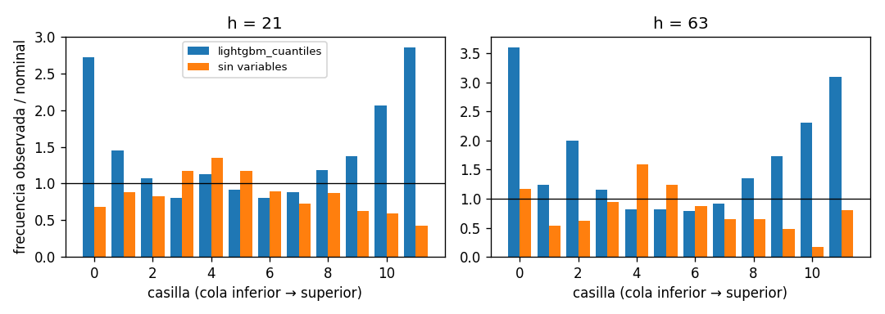

# F3 · Diagnóstico N4: LightGBM a 21 y 63 días

Solo desarrollo (orígenes 2005-01-04 a 2019-09-26, 3493 por horizonte). Hash de trm.csv: 641393c5df0c869b. No se cambia ningún modelo: es diagnóstico.

«Sin variables» = el mismo esquema z = y/(σ·√h) con cuantiles incondicionales de z (sin aprender nada de las variables): aísla el efecto de la estandarización. Las columnas «/ base» son CRPS relativo a la mejor línea base del horizonte (< 1 = mejor). «Dentro» = pérdida de cuantil de LightGBM sobre la del modelo sin variables en la propia muestra de entrenamiento (promedio de 7 fechas de reajuste); «fuera» = lo mismo en el backtest.

| h | mejor línea base | sin variables / base | reg. cuantiles / base | LightGBM / base | LightGBM / sin variables (fuera) | LightGBM / sin variables (dentro) | objetivos independientes (≈ n/h) |
|---|---|---|---|---|---|---|---|
| 1 | sim_hist_pond | 0.982 | 0.968 | 0.963 | 0.980 | 0.881 | 5977 |
| 5 | sim_hist_pond | 0.996 | 0.993 | 0.998 | 1.002 | 0.831 | 1194 |
| 21 | sim_hist_pond | 1.001 | 0.997 | 1.052 | 1.051 | 0.696 | 283 |
| 63 | caminata_aleatoria | 1.088 | 1.083 | 1.137 | 1.045 | 0.566 | 93 |

## PIT por casillas

Frecuencia observada en las casillas extremas (nominal 1 % cada una) y en el centro (nominal 50 %).

| modelo | h | p ji-cuadrado | casilla < 1 % | casilla > 99 % | centro (25-75 %) |
|---|---|---|---|---|---|
| lightgbm_cuantiles | 1 | <0,001 | 1.9 % | 1.5 % | 47.1 % |
| sin variables | 1 | <0,001 | 0.8 % | 0.9 % | 46.0 % |
| lightgbm_cuantiles | 5 | 0.030 (aprox.) | 1.9 % | 1.8 % | 46.3 % |
| sin variables | 5 | 0.066 (aprox.) | 0.5 % | 0.6 % | 49.0 % |
| lightgbm_cuantiles | 21 | 0.103 (aprox.) | 2.7 % | 2.9 % | 42.9 % |
| sin variables | 21 | 0.261 (aprox.) | 0.7 % | 0.4 % | 51.7 % |
| lightgbm_cuantiles | 63 | 0.235 (aprox.) | 3.6 % | 3.1 % | 40.0 % |
| sin variables | 63 | 0.288 (aprox.) | 1.2 % | 0.8 % | 52.7 % |

## Lectura

Escrita para los datos con hash 641393c5df0c869b. Son las dos cosas, en horizontes distintos:

- **A 21 días es sobreajuste.** La estandarización sola no cuesta nada (1,001 frente a la base), pero LightGBM pierde 5,1 % contra su propia versión sin variables. Dentro de la muestra parece ganar 30 % (0,696): esa ganancia no existe fuera.
- **A 63 días se suman las dos.** La estandarización sola ya pierde 8,8 % (1,088; la regresión lineal por cuantiles, 1,083): la volatilidad de hoy escalada por √63 no describe el trimestre que sigue. LightGBM agrega 4,5 % de sobreajuste (dentro de la muestra, 0,566).
- La brecha entre «dentro» y «fuera» crece cuando bajan los objetivos independientes (de 5977 a 93): con ≈ 93 trimestres sin traslape y 14 variables, los árboles memorizan.
- El PIT lo confirma: LightGBM deja entre 2,7 % y 3,6 % de las observaciones por fuera de cada cuantil extremo (nominal 1 %) y solo 40-43 % en el centro (nominal 50 %). El modelo sin variables queda cerca del nominal. La ji-cuadrado no rechaza a LightGBM (p = 0,10 y 0,24) porque con n/h observaciones efectivas tiene poca potencia: no es evidencia de buena calibración.
- A 1 día pasa lo contrario: las variables sí aportan fuera de la muestra (0,980), aunque menos que dentro (0,881).

Consecuencia: LightGBM no se usa por encima de 1 día. No se retoca (ni hiperparámetros ni variables): hacerlo ahora sería buscar con los datos de desarrollo.
