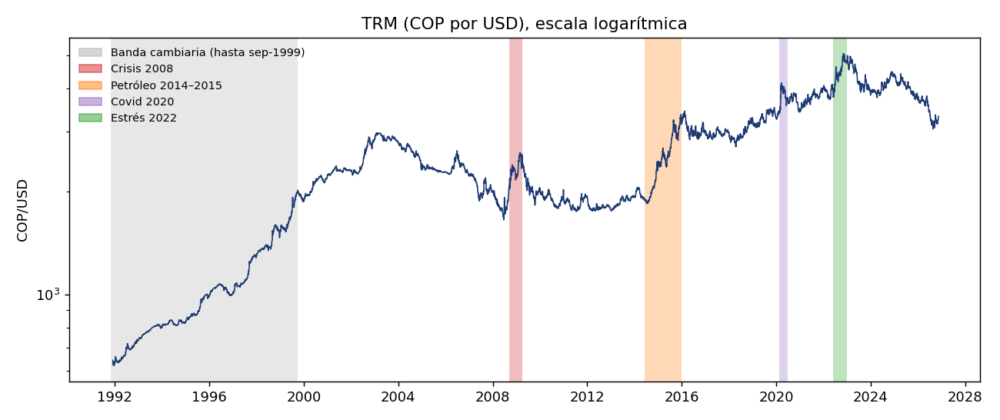
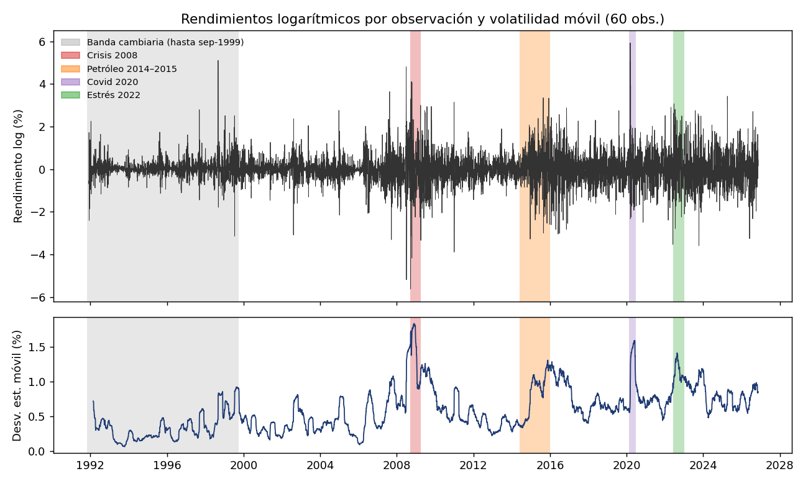
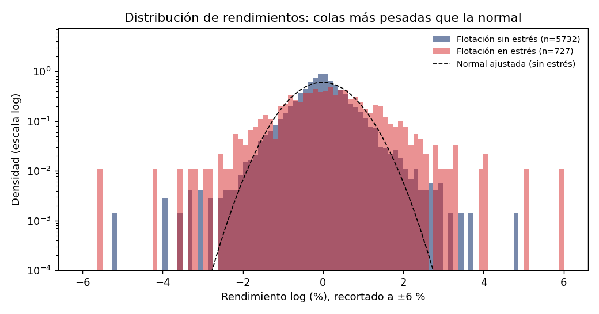

# Fase 0 — Análisis exploratorio de la TRM

Reporte generado automáticamente por `laboratorio.reportes.fase0` a partir de
`data/processed/trm.csv` (TRM de la Superfinanciera, 1991-12-02 a 2026-11-14,
8387 observaciones). Describe incertidumbre histórica; no es asesoría financiera ni un pronóstico.

## 1. Datos y convenciones

- Rendimiento logarítmico por observación: `r_t = ln(TRM_t) − ln(TRM_(t−1))`. Cada fila es una
  vigencia de la TRM (fecha = inicio de vigencia), así que el intervalo entre observaciones es
  de 1 día (6,440 casos), 3 días (1,292, fines de semana) u otros (654, festivos). **No se
  anualiza ni se reescala por días**; la sección 4 muestra el efecto.
- Régimen **banda cambiaria** hasta el 24-sep-1999; **flotación** desde el 25-sep-1999 (supuesto
  del autor, editable en `laboratorio/datos/limpieza.py`).
- Periodos de estrés (supuestos del autor): Crisis 2008 2008-09-15 a 2009-03-31; Petróleo 2014–2015 2014-06-01 a 2015-12-31; Covid 2020 2020-02-20 a 2020-06-30; Estrés 2022 2022-06-01 a 2022-12-31.
- Nivel: de 643.42 a 3,316.70 COP/USD (5.2 veces).

## 2. Nivel de la TRM



La escala logarítmica permite comparar variaciones relativas entre décadas. La zona gris
corresponde a la banda cambiaria; desde la flotación, los periodos de estrés coinciden con
tramos de movimiento más fuerte del nivel (compárese con la volatilidad de la sección 3).

## 3. Rendimientos y volatilidad



La desviación estándar por observación en flotación es 1.8 veces la de la banda
(0.73 % frente a 0.41 %). La
volatilidad móvil se agrupa en racimos (alta volatilidad sigue a alta volatilidad), con picos
en los periodos de estrés etiquetados.

| Grupo | n | Media % | Desv. % | Asimetría | Curtosis exc. | Mín % | Máx % |
|---|---:|---:|---:|---:|---:|---:|---:|
| Todo | 8386 | 0.020 | 0.673 | 0.24 | 6.3 | -5.62 | 5.93 |
| Banda (hasta 24-sep-1999) | 1927 | 0.059 | 0.413 | 1.29 | 19.0 | -3.14 | 5.11 |
| Flotación (desde 25-sep-1999) | 6459 | 0.008 | 0.733 | 0.21 | 4.9 | -5.62 | 5.93 |
| Flotación sin estrés | 5732 | -0.009 | 0.661 | 0.05 | 4.0 | -5.19 | 4.80 |
| Crisis 2008 (2008-09-15 a 2009-03-31) | 128 | 0.173 | 1.464 | -0.22 | 2.0 | -5.62 | 4.11 |
| Petróleo 2014–2015 (2014-06-01 a 2015-12-31) | 374 | 0.135 | 0.933 | -0.22 | 1.2 | -3.28 | 3.35 |
| Covid 2020 (2020-02-20 a 2020-06-30) | 86 | 0.113 | 1.406 | 1.40 | 4.1 | -2.33 | 5.93 |
| Estrés 2022 (2022-06-01 a 2022-12-31) | 139 | 0.149 | 1.169 | 0.10 | 0.3 | -3.53 | 3.07 |

(Todos los valores en porcentaje; curtosis en exceso sobre la normal = 0.)

## 4. Forma de la distribución



- Jarque–Bera, toda la muestra: estadístico 13,874 (p = 0); se rechaza normalidad.
- Jarque–Bera, flotación sin estrés: estadístico 3,720 (p = 0); las colas pesadas persisten fuera de los periodos de estrés.
- Los rendimientos en estrés tienen una dispersión visiblemente mayor que la normal ajustada fuera de estrés.

Autocorrelación (Pearson) de los rendimientos y de su valor absoluto:

| Rezago | r_t | \|r_t\| |
|---:|---:|---:|
| 1 | +0.175 | +0.348 |
| 2 | -0.007 | +0.321 |
| 5 | -0.009 | +0.288 |
| 10 | +0.035 | +0.257 |

El valor absoluto de los rendimientos mantiene autocorrelación positiva y lenta
(+0.35 en el rezago 1 y +0.26 en el 10): agrupamiento de volatilidad. Los
propios rendimientos muestran una autocorrelación de +0.18 en el rezago 1 y casi nula
después; no se investigó su causa (podría deberse a cómo se construye la TRM o al intervalo
irregular entre observaciones), así que se reporta sin interpretarla. Un modelo probabilístico
debe permitir varianza variable y colas pesadas.

Efecto del intervalo entre observaciones (desviación estándar del rendimiento):

| Días entre observaciones | n | Desv. % |
|---|---:|---:|
| 1 | 6440 | 0.646 |
| 2 | 112 | 0.720 |
| 3 | 1292 | 0.723 |
| 4 o más | 542 | 0.834 |

## 5. Mayores movimientos

| Fecha | Rendimiento % | TRM | Días | Régimen | Estrés |
|---|---:|---:|---:|---|---|
| 2020-03-10 | +5.93 | 3803.60 | 3 | flotacion | covid_2020 |
| 2008-09-20 | -5.62 | 2067.45 | 1 | flotacion | crisis_2008 |
| 2008-07-03 | -5.19 | 1818.60 | 1 | flotacion | — |
| 1998-09-03 | +5.11 | 1518.56 | 1 | banda | — |
| 2020-03-13 | +5.07 | 4034.66 | 1 | flotacion | covid_2020 |
| 2008-06-28 | +4.80 | 1923.02 | 1 | flotacion | — |
| 2008-10-15 | -4.17 | 2223.94 | 4 | flotacion | crisis_2008 |
| 2008-10-07 | +4.11 | 2250.73 | 3 | flotacion | crisis_2008 |

3 de los 8 mayores movimientos caen fuera de las ventanas de estrés definidas (por ejemplo,
a mediados de 2008 y en la crisis de la banda de 1998): conviene revisar si las ventanas deben ampliarse.

## 6. Implicaciones para el modelado (sección 6 del prompt)

1. Calibrar **solo con el régimen de flotación** (o declarar explícitamente si se usa la banda): la volatilidad y la dinámica son distintas.
2. Usar rendimientos logarítmicos; nunca mezclar niveles y rendimientos sin decirlo.
3. Colas pesadas y agrupamiento de volatilidad: la normal con varianza constante subestima los extremos; los periodos de estrés deben poder activarse como escenario.
4. Decidir el tratamiento del intervalo irregular (1, 3 o más días) antes de anualizar: la desviación por observación crece con los días transcurridos.
5. Las ventanas de estrés son supuestos; conviene probar sensibilidad a sus fechas de inicio y fin.

## Reproducir

```
PYTHONPATH=src python -m laboratorio.datos.limpieza   # si cambian los datos crudos
PYTHONPATH=src python -m laboratorio.reportes.fase0
```
