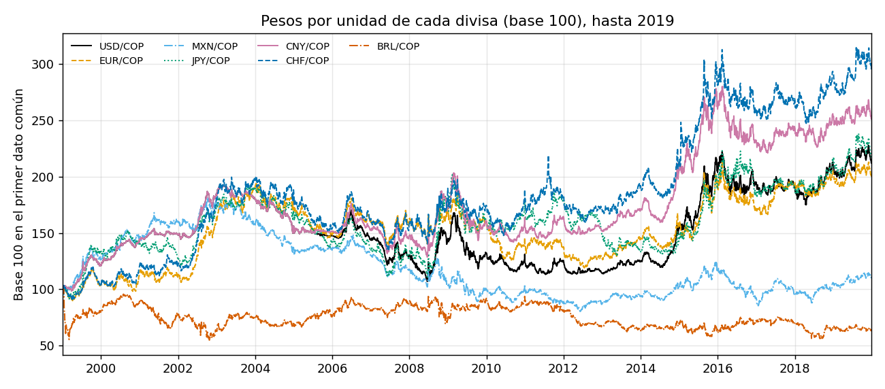
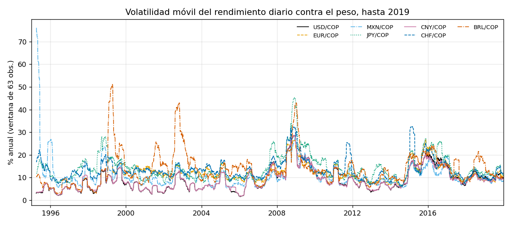
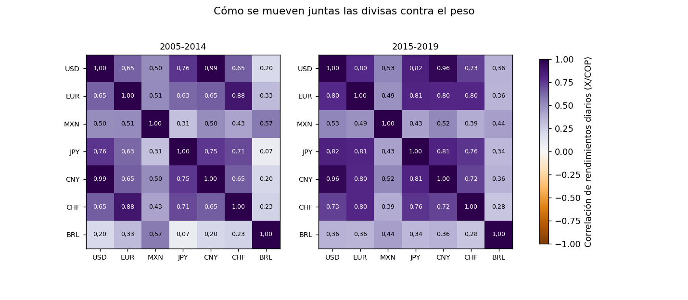

# Fase 0 multidivisa: análisis exploratorio (hasta 2019)

**No es asesoría financiera**; los rangos describen incertidumbre estadística, no promesas. Todas las cifras de este reporte son descriptivas: **sin respaldo fuera de muestra**.

Siete divisas contra el peso colombiano: USD (TRM) y EUR, MXN, JPY, CNY, CHF y BRL, cruzadas como
X/COP = TRM × (USD por X) con las tasas H.10 de la Reserva Federal (FRED). **Este reporte solo usa
datos hasta el 31-dic-2019** (43.836 filas `#0d07688bec` de `processed/divisas.csv`): lo posterior queda sin ver para
la evaluación de las divisas nuevas (M3). Generado por `python -m laboratorio.reportes.fase0_divisas`.

## 1. Fuentes

| Divisa | Serie FRED | Unidad original | Primer dato | Observaciones hasta 2019 |
|---|---|---|---|---:|
| EUR | `DEXUSEU` | USD por EUR | 1999-01-04 | 5.271 obs. `#ccc46c6836` |
| MXN | `DEXMXUS` | MXN por USD | 1993-11-08 | 6.560 obs. `#9f10fc81b1` |
| JPY | `DEXJPUS` | JPY por USD | 1971-01-04 | 12.286 obs. `#e8bbe6f64a` |
| CNY | `DEXCHUS` | CNY por USD | 1981-01-02 | 9.732 obs. `#c9e666b76a` |
| CHF | `DEXSZUS` | CHF por USD | 1971-01-04 | 12.292 obs. `#b77b9fafde` |
| BRL | `DEXBZUS` | BRL por USD | 1995-01-02 | 6.275 obs. `#32fb8d0294` |

`DEXUSEU` ya viene en USD por EUR; las demás se invierten (USD por X = 1 / valor). La fecha de
descarga, la URL y el SHA-256 de cada archivo están en `data/raw/MANIFEST.csv`.

## 2. Alineación de fechas TRM–FRED

La TRM vigente en la fecha *t* (martes a sábado) se calcula con las operaciones del día hábil
anterior; H.10 es el precio de mediodía en Nueva York del día *d*. Por calendario, la TRM de *t* se
cruza con el precio H.10 del **día hábil anterior** (desfase −1, supuesto `divisas.desfase_fred`
del registro). Se comprobó con la correlación de los rendimientos de la TRM y de USD por X:

| Divisa | desfase −1 | desfase 0 | desfase +1 | pares (−1) |
|---|---:|---:|---:|---:|
| EUR | -0,231 `#faf4928724` | -0,054 `#c692921f9f` | -0,015 `#2abed0dba4` | 4.969 pares `#59305aeec3` |
| MXN | -0,291 `#108d9e6e1a` | -0,075 `#e79b41013e` | -0,029 `#f2747d6bcb` | 6.201 pares `#4443188ee3` |
| JPY | 0,047 `#0ca08c212f` | 0,018 `#6f41d46c7e` | 0,011 `#718e8ba57c` | 6.670 pares `#1ab1ccdd82` |
| CNY | -0,201 `#84bba805eb` | -0,090 `#49c67b6d22` | -0,028 `#ec17dac800` | 3.412 pares `#9d3e8af92e` |
| CHF | -0,110 `#04cf6b47fa` | -0,028 `#99212f18bd` | 0,004 `#364d6ac6ff` | 6.670 pares `#7c73174579` |
| BRL | -0,378 `#bb1b861eda` | -0,085 `#0a4e911aa5` | -0,056 `#5137abeae2` | 5.930 pares `#d58557ef28` |

El desfase −1 tiene la mayor correlación en valor absoluto en las seis divisas. El signo
negativo es el esperado: cuando el dólar se fortalece en el mundo, sube la TRM y baja el precio
en dólares de las otras divisas. El yen tiene la correlación más débil. El yuan se mide solo
desde que dejó el tipo fijo (2005-07-22).

## 3. Días que se pierden en la unión (sin relleno)

Una fila existe solo si hay TRM en *t* y precio H.10 el día hábil anterior. Los festivos de
EE. UU. que no lo son en Colombia eliminan la fila; no se interpola ni se arrastra ningún valor.

| Divisa | Fechas de TRM en el tramo | Perdidas | % perdido |
|---|---:|---:|---:|
| EUR | 5.011 días `#f3f36d401e` | 41 días `#248080b9b8` | 0,82 % `#d328bd64d1` |
| MXN | 6.284 días `#fdea86814a` | 82 días `#b6c663bf71` | 1,30 % `#9d73c9accf` |
| JPY | 6.760 días `#678791ba39` | 89 días `#7a8056de9b` | 1,32 % `#fe91ae13e6` |
| CNY | 6.760 días `#efcd88d85c` | 129 días `#c7056391c0` | 1,91 % `#5df3f80ae7` |
| CHF | 6.760 días `#1c18199af3` | 89 días `#129a1a5863` | 1,32 % `#f892578973` |
| BRL | 6.000 días `#1bd392f392` | 69 días `#fb807b04d8` | 1,15 % `#2ad6a0efa6` |

## 4. Regímenes por divisa

Constantes editables en `src/laboratorio/datos/divisas.py` (con su fuente). El régimen de cada
fila es el de la divisa en la fecha de su precio H.10; durante la banda cambiaria colombiana
(hasta el 24-sep-1999) la fila se marca `banda_cop`.

| Divisa | Tramos |
|---|---|
| EUR | flotacion |
| MXN | banda; flotacion desde 1994-12-22 |
| JPY | flotacion |
| CNY | fijo; flotacion_administrada desde 2005-07-22 |
| CHF | flotacion; piso desde 2011-09-06; flotacion desde 2015-01-15 |
| BRL | banda; flotacion desde 1999-01-18 |

Episodios declarados en la constante `EPISODIOS` (no son una columna de los datos): fin del piso
del franco suizo (15-ene-2015) y fin del tipo fijo del yuan (21-jul-2005).

## 5. Niveles, volatilidad y correlaciones







| Cruce | Vol. anual % 2005-2014 | Corr. con USD/COP 2005-2014 | Vol. anual % 2015-2019 | Corr. con USD/COP 2015-2019 |
|---|---:|---:|---:|---:|
| USD/COP | 11,3 `#4a3384973a` | — | 13,1 `#4e5ed38c3d` | — |
| EUR/COP | 12,6 `#59f5feb40b` | 0,648 `#0ce1463d81` | 13,8 `#418f63c733` | 0,795 `#c9da6c1fd2` |
| MXN/COP | 11,4 `#87a4a7b44d` | 0,503 `#efa8560b6b` | 12,1 `#8572eb43ae` | 0,530 `#e0fcd4fdca` |
| JPY/COP | 16,7 `#872c49c861` | 0,763 `#dad8533e51` | 16,2 `#fe9d74cc14` | 0,823 `#2c443dc2ab` |
| CNY/COP | 11,4 `#e4764f97b8` | 0,986 `#791d948c08` | 12,5 `#1997ccafad` | 0,957 `#3145e7dd4b` |
| CHF/COP | 14,6 `#5c6a6a74c1` | 0,655 `#a53e53b1fe` | 15,2 `#3a48d67abf` | 0,732 `#8037d14f41` |
| BRL/COP | 14,4 `#f3fd828c99` | 0,198 `#b5be11763d` | 15,8 `#644d0ee559` | 0,364 `#cb55736cf5` |

Todos los cruces se correlacionan positivamente con USD/COP en parte por construcción: cada X/COP
lleva la TRM dentro. Por eso el motor conjunto (M2) simula los factores (TRM y USD por X) y no los
cruces. El yuan casi replica al dólar (muy administrado); el real brasileño es el que menos se
mueve con él.

## 6. Saltos diarios mayores al 8 % (para revisión manual; no se borran)

| Fecha | Divisa | Cambio | Régimen |
|---|---|---:|---|
| 1994-12-21 | MXN | -12,3 % `#0a657f6fc7` | banda_cop |
| 1994-12-23 | MXN | -17,6 % `#b065960b27` | banda_cop |
| 1994-12-28 | MXN | -17,9 % `#d996a2da3f` | banda_cop |
| 1995-01-04 | MXN | -8,6 % `#0fa832323f` | banda_cop |
| 1995-01-31 | MXN | -12,8 % `#edcb8ca78d` | banda_cop |
| 1995-02-01 | MXN | 11,8 % `#9726eefe5c` | banda_cop |
| 1995-02-23 | MXN | -8,1 % `#dd9a0c0d41` | banda_cop |
| 1995-03-07 | MXN | -8,3 % `#5fd569e8cb` | banda_cop |
| 1995-03-10 | MXN | -10,2 % `#e281b42364` | banda_cop |
| 1995-03-11 | MXN | 20,0 % `#b18ba4b32a` | banda_cop |
| 2008-10-07 | JPY | 8,8 % `#76a3cb9db1` | flotacion |
| 1994-01-04 | CNY | -33,2 % `#29d3f91346` | banda_cop |
| 2011-09-07 | CHF | -8,0 % `#da27a72e3a` | piso |
| 2015-01-16 | CHF | 12,0 % `#b16684b8c5` | flotacion |
| 1999-01-16 | BRL | -10,1 % `#c04950209a` | banda_cop |
| 1999-01-20 | BRL | -8,0 % `#464b7f7e3e` | banda_cop |
| 1999-02-03 | BRL | 8,5 % `#35b603a3f8` | banda_cop |
| 2002-08-09 | BRL | 9,2 % `#4a569d2d0b` | flotacion |

## 7. Implicaciones para el motor conjunto (M2)

1. La muestra común empieza cuando todas las divisas incluidas flotan (con el yuan, desde el
   2005-07-22): el motor conjunto no incluye la banda colombiana y no es el motor evaluado en la
   prueba final.
2. Los saltos del peso mexicano (1994-1995), del yuan (1994) y del real (1999) quedan fuera
   de esa muestra común. Quedan dentro el del real en 2002, el del yen en octubre de 2008 y los
   dos del franco suizo (2011 y 2015). Este reporte no atribuye causas a los saltos.
3. Las correlaciones cambian entre periodos: el remuestreo por bloques con índices de fecha
   compartidos las conserva tal como fueron, sin suponer que son constantes.

## Reproducir

```
PYTHONPATH=src python -m laboratorio.datos.limpieza       # data/processed/divisas.csv
PYTHONPATH=src python -m laboratorio.datos                # data/validacion.json
PYTHONPATH=src python -m laboratorio.reportes.fase0_divisas
```

## Apéndice: fuente y hash de cada cifra

| Cifra | Origen | Fuente / fórmula | Hash SHA-256 |
|---|---|---|---|
| `#c04950209a` | calculo | cambio diario BRL/COP del 1999-01-16 | `c04950209a3929fefd2f3df51a469991f9d9207db32b39a702fcb75924a2ecd6` |
| `#464b7f7e3e` | calculo | cambio diario BRL/COP del 1999-01-20 | `464b7f7e3e6d5cb0d430c27b0c8d5609019e2bc7914be7c5e590ea41ff556568` |
| `#35b603a3f8` | calculo | cambio diario BRL/COP del 1999-02-03 | `35b603a3f85bedf518dcc616796207fe787c5707aa075c31f319d196d9d84ba3` |
| `#4a569d2d0b` | calculo | cambio diario BRL/COP del 2002-08-09 | `4a569d2d0bad614732f6cee374e5442101005634d1db814b81712dcfb757971f` |
| `#da27a72e3a` | calculo | cambio diario CHF/COP del 2011-09-07 | `da27a72e3a385a4ffaae51eeafa2dc03b13e62bd42bdab84b941cc8170c82208` |
| `#b16684b8c5` | calculo | cambio diario CHF/COP del 2015-01-16 | `b16684b8c5a6a12c0b4ef614cfbd06ad92acaf21f76a9e2794c50969193c57f6` |
| `#29d3f91346` | calculo | cambio diario CNY/COP del 1994-01-04 | `29d3f9134640b17cb4a48a9bf2c8c713b7febfce56a2daac35f5ff3585c26a40` |
| `#76a3cb9db1` | calculo | cambio diario JPY/COP del 2008-10-07 | `76a3cb9db19ba28f08f70c45c8e9c262e93d97e19f33137765bcf868cf789517` |
| `#0a657f6fc7` | calculo | cambio diario MXN/COP del 1994-12-21 | `0a657f6fc717b2f461dfc46bba83c939d954e73754d06d0eaf439bbb971e26d3` |
| `#b065960b27` | calculo | cambio diario MXN/COP del 1994-12-23 | `b065960b278ec67d18f09253004dc50855960453f3848cffd17066f44180ebd4` |
| `#d996a2da3f` | calculo | cambio diario MXN/COP del 1994-12-28 | `d996a2da3f4bd0793e3c49c3ebfb4f7e20d951eccf55b18381675180107ce682` |
| `#0fa832323f` | calculo | cambio diario MXN/COP del 1995-01-04 | `0fa832323f00b8dd21f19867b00616e902cfb1c8a5940643fce0b572ec52e76d` |
| `#edcb8ca78d` | calculo | cambio diario MXN/COP del 1995-01-31 | `edcb8ca78dbd77aed0a857c3489e65c1ea2ba84c1c35aa9891d0cbc097581963` |
| `#9726eefe5c` | calculo | cambio diario MXN/COP del 1995-02-01 | `9726eefe5c563a6d1d44714b186b1552372d8434ba03cda2696e744266fb9887` |
| `#dd9a0c0d41` | calculo | cambio diario MXN/COP del 1995-02-23 | `dd9a0c0d4116e814e38174e45720046736f20586bb905c634fcf16d7f0c6b7bc` |
| `#5fd569e8cb` | calculo | cambio diario MXN/COP del 1995-03-07 | `5fd569e8cbb86eae8f6325006d09d9060569a8c76a67bd24090dd983229d6597` |
| `#e281b42364` | calculo | cambio diario MXN/COP del 1995-03-10 | `e281b423645b78c869c4e013d906ea0f12cfbabc2e741d553621650c51b8baf4` |
| `#b18ba4b32a` | calculo | cambio diario MXN/COP del 1995-03-11 | `b18ba4b32a7cdac3af5c0217c00a6643a36d188a550c1dbe256fb1b83ebaacba` |
| `#b5be11763d` | calculo | corr(r_BRL/COP, r_USD/COP) 2005-2014 | `b5be11763da7a82cd14b478a16faa2a82011fe29ca1f7fb0cf4bf9840992c85c` |
| `#cb55736cf5` | calculo | corr(r_BRL/COP, r_USD/COP) 2015-2019 | `cb55736cf5492a7e1e6a1554a52cd30b7d7f5201fd3b8cffc6a6696b87a4deac` |
| `#a53e53b1fe` | calculo | corr(r_CHF/COP, r_USD/COP) 2005-2014 | `a53e53b1fe84eef4d99536196b2e8a024543269bf3b62c64df2f842aedebfde1` |
| `#8037d14f41` | calculo | corr(r_CHF/COP, r_USD/COP) 2015-2019 | `8037d14f41572b2537aa7e7092efc2b65238ab0b6b1bee73807e1b1af29dacd1` |
| `#791d948c08` | calculo | corr(r_CNY/COP, r_USD/COP) 2005-2014 | `791d948c080fb48a82f391366fa1cb7e4525a5b3927076fb0694bed892afce18` |
| `#3145e7dd4b` | calculo | corr(r_CNY/COP, r_USD/COP) 2015-2019 | `3145e7dd4b846edb56b277b53f9060590345e4788f07b3b1af2a0d72a70db520` |
| `#0ce1463d81` | calculo | corr(r_EUR/COP, r_USD/COP) 2005-2014 | `0ce1463d815b79bab54d1b1f199e9b30ac2b6fc6775f80f82b53aad89f4c1fa1` |
| `#c9da6c1fd2` | calculo | corr(r_EUR/COP, r_USD/COP) 2015-2019 | `c9da6c1fd25e4cca0bea81ec2fe2097988fb076bab35942b00634143abb83992` |
| `#dad8533e51` | calculo | corr(r_JPY/COP, r_USD/COP) 2005-2014 | `dad8533e51e8d3766cd1ea19fc378ff15e67b165f5adbeb3bf51597e4dcb54e6` |
| `#2c443dc2ab` | calculo | corr(r_JPY/COP, r_USD/COP) 2015-2019 | `2c443dc2abed4a7d9ab969f651ece06b2a0d36e8452ea4b0d7482cbdef7f0507` |
| `#efa8560b6b` | calculo | corr(r_MXN/COP, r_USD/COP) 2005-2014 | `efa8560b6b6b61cb2b5d5267dfd481c39e14416d32ba3b80ba070fe7c36a5f1c` |
| `#e0fcd4fdca` | calculo | corr(r_MXN/COP, r_USD/COP) 2015-2019 | `e0fcd4fdcaf5fbd39dae91eb09bcb140f287272fddcc9390dcaae1b55a45ae26` |
| `#0a4e911aa5` | calculo | corr(r_TRM, r_USD/BRL) desfase +0 | `0a4e911aa5eaee1d90b61220f894c4f96e1532ffb766d39c7af4f09e7f8a87d2` |
| `#5137abeae2` | calculo | corr(r_TRM, r_USD/BRL) desfase +1 | `5137abeae2f503efcbde66fa2b03caad43236e0d36fc725db8fcd5917e47b7ff` |
| `#bb1b861eda` | calculo | corr(r_TRM, r_USD/BRL) desfase -1 | `bb1b861edaa2560b51cc100734000f878478e0bd610b2feae5a87e33d2a313f0` |
| `#99212f18bd` | calculo | corr(r_TRM, r_USD/CHF) desfase +0 | `99212f18bdac58aa27194946b0c7289c53728af0b5ade2959de3a4019a310fa6` |
| `#364d6ac6ff` | calculo | corr(r_TRM, r_USD/CHF) desfase +1 | `364d6ac6ff2b248181a180b605c816566b72550d0bc41be19d6644f4b7aceb99` |
| `#04cf6b47fa` | calculo | corr(r_TRM, r_USD/CHF) desfase -1 | `04cf6b47fad7d2cf8c0c09dd4ce5b720e77c99a0307c872ef7be2e2230b8c03f` |
| `#49c67b6d22` | calculo | corr(r_TRM, r_USD/CNY) desfase +0 | `49c67b6d2204f5acc8dae01c85cedde92243761d61f0086872b9bd03a203899d` |
| `#ec17dac800` | calculo | corr(r_TRM, r_USD/CNY) desfase +1 | `ec17dac8006f97ccdd6d645a4f5f0d490e6114f811f1251ff8a532f8980c896f` |
| `#84bba805eb` | calculo | corr(r_TRM, r_USD/CNY) desfase -1 | `84bba805eb6333c3e7ec2f2573abc01bc4e3255643c6ad362a80beb257b9d067` |
| `#c692921f9f` | calculo | corr(r_TRM, r_USD/EUR) desfase +0 | `c692921f9f01e9bdccb7be35db61128f8dd6f9338574fc694840997121b44e48` |
| `#2abed0dba4` | calculo | corr(r_TRM, r_USD/EUR) desfase +1 | `2abed0dba447184911ec9257a8c30ca7488c05e1ac6343953ef2aae8eb9c461a` |
| `#faf4928724` | calculo | corr(r_TRM, r_USD/EUR) desfase -1 | `faf49287241d5a7d09d6df1f1b7878b4e4b5ad1b8a7e9c2f393ddeb687b430d9` |
| `#6f41d46c7e` | calculo | corr(r_TRM, r_USD/JPY) desfase +0 | `6f41d46c7e32453c0b038e5ebc24d1f3d62bd2742e29e1c99f3307efc6d469e9` |
| `#718e8ba57c` | calculo | corr(r_TRM, r_USD/JPY) desfase +1 | `718e8ba57c77aae65d6b02fe1c6ac77ba554099f60467435be5f2340de3c73ca` |
| `#0ca08c212f` | calculo | corr(r_TRM, r_USD/JPY) desfase -1 | `0ca08c212f193dd80b7803519f779fd3f3a5c477c6054bb593be8c1fb2d768cd` |
| `#e79b41013e` | calculo | corr(r_TRM, r_USD/MXN) desfase +0 | `e79b41013e132e2f7b58a347c3be84ce42247084ff7499f29504b8c5522fd7c4` |
| `#f2747d6bcb` | calculo | corr(r_TRM, r_USD/MXN) desfase +1 | `f2747d6bcb9fc8627d9f2ff7789f33711fce5ce6e2f1cc1a05a5d02803dee212` |
| `#108d9e6e1a` | calculo | corr(r_TRM, r_USD/MXN) desfase -1 | `108d9e6e1a0f335c4bb181381618cfd218b3f6ed75fc24dd7ced3ad7cc1042db` |
| `#f3fd828c99` | calculo | desv. est. anualizada de r_BRL/COP 2005-2014 | `f3fd828c99c75bab30cb824f6f8028e6c2ab63934c9c4a964263d5e77259ccee` |
| `#644d0ee559` | calculo | desv. est. anualizada de r_BRL/COP 2015-2019 | `644d0ee55987247ce13eee4a6c6848a19c74427c6c7eedbdf4fb439d215964db` |
| `#5c6a6a74c1` | calculo | desv. est. anualizada de r_CHF/COP 2005-2014 | `5c6a6a74c1d447049f0fc60ff3fd16a3c17bbd8f6976a9d58fd76e3b0199a7de` |
| `#3a48d67abf` | calculo | desv. est. anualizada de r_CHF/COP 2015-2019 | `3a48d67abf79027e98c618737de8d56759ca5c022e56598b7408999bc1f0ea56` |
| `#e4764f97b8` | calculo | desv. est. anualizada de r_CNY/COP 2005-2014 | `e4764f97b8e1f4f5de71a72235c5d57c75b0c91a9aefc09aafe868c9411e4c5f` |
| `#1997ccafad` | calculo | desv. est. anualizada de r_CNY/COP 2015-2019 | `1997ccafad239c08d54f42586c08a5714746ca56461e715735cac9dd3e161ae1` |
| `#59f5feb40b` | calculo | desv. est. anualizada de r_EUR/COP 2005-2014 | `59f5feb40b8f32890d9fd798b019b7571700dd46c4381882cb0038f2cd9b0cb8` |
| `#418f63c733` | calculo | desv. est. anualizada de r_EUR/COP 2015-2019 | `418f63c7330e5aea5d7eaad41513fe2a6ff34aa284c57c73eab16bc89f7dc121` |
| `#872c49c861` | calculo | desv. est. anualizada de r_JPY/COP 2005-2014 | `872c49c86163efd5b3cf001821df3ca84d26a09a123f8acd754f3bd0c1c60b08` |
| `#fe9d74cc14` | calculo | desv. est. anualizada de r_JPY/COP 2015-2019 | `fe9d74cc1402523be1447e9810cbf2763550e06e809dc7a5a961d871bdacb359` |
| `#87a4a7b44d` | calculo | desv. est. anualizada de r_MXN/COP 2005-2014 | `87a4a7b44d0018e299dc7d25a036d25d7990958850b427ce754b4f603ecfe8b5` |
| `#8572eb43ae` | calculo | desv. est. anualizada de r_MXN/COP 2015-2019 | `8572eb43ae9959fa19c665362f8776a85efec2f5a7b86933719473d506da3238` |
| `#4a3384973a` | calculo | desv. est. anualizada de r_USD/COP 2005-2014 | `4a3384973a0107e9e347ae8d626f6cff73c369e3946913dd398f9d7fa2ff3d5d` |
| `#4e5ed38c3d` | calculo | desv. est. anualizada de r_USD/COP 2015-2019 | `4e5ed38c3d6fc939790962d80f7f3dcdef8f51a8b10870438dad617a8e2e7b12` |
| `#1bd392f392` | calculo | fechas de TRM en el tramo de BRL hasta 2019 | `1bd392f3924b5900b269890314533a2255d83b47f124b056f997d490874bd084` |
| `#1c18199af3` | calculo | fechas de TRM en el tramo de CHF hasta 2019 | `1c18199af33e96a9fdc4e120773e88b5528ad0500cdaba3303275f2d4b84ebfb` |
| `#efcd88d85c` | calculo | fechas de TRM en el tramo de CNY hasta 2019 | `efcd88d85c98da80bdc5ddb20942cce904da55cf2e949844fb4b34941c843b6f` |
| `#f3f36d401e` | calculo | fechas de TRM en el tramo de EUR hasta 2019 | `f3f36d401e3dd811540232b33b1e5eac4166f6c9abf5b1c0926490a4ee416f92` |
| `#678791ba39` | calculo | fechas de TRM en el tramo de JPY hasta 2019 | `678791ba39de282dab57ef9cf20c7d1de9e703d9d8ba2d890e8b6bfba27e46dc` |
| `#fdea86814a` | calculo | fechas de TRM en el tramo de MXN hasta 2019 | `fdea86814a4f238b340eb641ada2bc8649b7fa00e64bfbf5ddcc4ee21f94654a` |
| `#fb807b04d8` | calculo | fechas de TRM sin precio H.10 (BRL) hasta 2019 | `fb807b04d8da3c6c94abbcd8bf08e46d270bd1996f8c9365bcdc1ef11697ecf8` |
| `#129a1a5863` | calculo | fechas de TRM sin precio H.10 (CHF) hasta 2019 | `129a1a586372004a482b3d2ee8661257adfd69edce6fbc090499657ecc0708ab` |
| `#c7056391c0` | calculo | fechas de TRM sin precio H.10 (CNY) hasta 2019 | `c7056391c072b65aeb30515e803b610c9c22a7d02f1391791160643e1f95a884` |
| `#248080b9b8` | calculo | fechas de TRM sin precio H.10 (EUR) hasta 2019 | `248080b9b8eb7e58a91a91dde07f5122273c0f1cb35290560c24da4225452b86` |
| `#7a8056de9b` | calculo | fechas de TRM sin precio H.10 (JPY) hasta 2019 | `7a8056de9b0d071124d55a38f116edf543d077c0c2bea0a3c1ab8188282d9ad9` |
| `#b6c663bf71` | calculo | fechas de TRM sin precio H.10 (MXN) hasta 2019 | `b6c663bf7180a59fbc9efc7a761b972729df6e08f5293deaafa7ad90e7d34699` |
| `#d58557ef28` | calculo | pares de rendimientos BRL desfase -1 | `d58557ef2811ea46b00de0f0ca2fb87d414cc6c0f24096a740c374b243bcca08` |
| `#7c73174579` | calculo | pares de rendimientos CHF desfase -1 | `7c731745790f7f32fc80565beb334a126c418713a563d56e90f7f6f163c5ae81` |
| `#9d3e8af92e` | calculo | pares de rendimientos CNY desfase -1 | `9d3e8af92eab2e659e7b223757683eb36aa7df99d3a0ec7e90bea82c63406ed4` |
| `#59305aeec3` | calculo | pares de rendimientos EUR desfase -1 | `59305aeec3388d2b2fcf7b9b6c38a71c52d2cc14f011ca7e6c682c7f2c89a2ab` |
| `#1ab1ccdd82` | calculo | pares de rendimientos JPY desfase -1 | `1ab1ccdd82f282d352149990b03830e1559543d75d718d470595ca3a74329481` |
| `#4443188ee3` | calculo | pares de rendimientos MXN desfase -1 | `4443188ee3df487f0a0e1b4e4d1ed8d56cd47c80c313c13c2b9a3e49a35dbd62` |
| `#2ad6a0efa6` | calculo | porcentaje perdido BRL hasta 2019 | `2ad6a0efa6141bbdf84389022dbb73a5256ccda4755eda363cdd7abf4aeefe2b` |
| `#f892578973` | calculo | porcentaje perdido CHF hasta 2019 | `f892578973aa703f882c79340e6315b2cddf9be76b08412e9a5d36e487f1d91e` |
| `#5df3f80ae7` | calculo | porcentaje perdido CNY hasta 2019 | `5df3f80ae7041779f270cf9e3c2bbef611f179e95d39cc5c7e491fc6f5168b07` |
| `#d328bd64d1` | calculo | porcentaje perdido EUR hasta 2019 | `d328bd64d18c105ede27bf50c96f53782db06739ef322cfaca9ec85d6c3e23c2` |
| `#fe91ae13e6` | calculo | porcentaje perdido JPY hasta 2019 | `fe91ae13e6d0d5a43a6309a10013e3cf243de0863da08c7037a1f689ac37402e` |
| `#9d73c9accf` | calculo | porcentaje perdido MXN hasta 2019 | `9d73c9accf295000347d18f21c167b088e95506f51ed24afaf58092f689d1407` |
| `#32fb8d0294` | calculo | valores no vacíos de DEXBZUS hasta 2019-12-31 | `32fb8d029406b7676c8b171cbe431df5625ae8b2ba5be778ddf099a474c25ba3` |
| `#c9e666b76a` | calculo | valores no vacíos de DEXCHUS hasta 2019-12-31 | `c9e666b76aaa0f4d31eeac93ba60d0d587b0bd6d93f78f9d84d933b55c5b424a` |
| `#e8bbe6f64a` | calculo | valores no vacíos de DEXJPUS hasta 2019-12-31 | `e8bbe6f64a0eee3414d30b8b291b10c6dc4da626fe5bacf778a7076fe9cf7fa0` |
| `#9f10fc81b1` | calculo | valores no vacíos de DEXMXUS hasta 2019-12-31 | `9f10fc81b14168615c36897ca2096c48e8bfadbf70331dd4cbce50be721c332f` |
| `#b77b9fafde` | calculo | valores no vacíos de DEXSZUS hasta 2019-12-31 | `b77b9fafde8d86a7661fed09f982186ae6e5581a7ffd47ec4e750e644f31ec09` |
| `#ccc46c6836` | calculo | valores no vacíos de DEXUSEU hasta 2019-12-31 | `ccc46c68366c2d88ffc91b2fdca318afd557def635c6bc2490a0e5d24c0b56e2` |
| `#0d07688bec` | dato | processed/divisas.csv#filas con fecha <= 2019-12-31 | `0d07688becce160c56cb61ec18bfc57e2ad7f6521f213c094cdbcb177958c5ac` |
