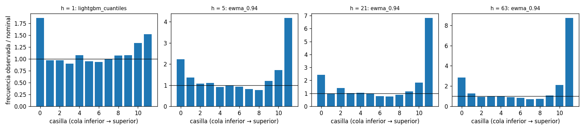

# Fase 2 — Comparación de modelos (backtest de desarrollo)

Distribuciones de pronóstico del rendimiento logarítmico de la TRM a h observaciones (días de mercado). Los rangos describen incertidumbre estadística; no son recomendaciones financieras.

## Protocolo

- Orígenes: 2005-01-04 a 2019-09-26 (3493 por horizonte); inicio de desarrollo 2005-01-03. La prueba final (desde 2020-01-01) NO se cargó.
- Ventana expansiva, reajuste cada 21 orígenes (lightgbm_cuantiles y markov_3 cada 63), purga s+h ≤ t, embargo de 63 obs.
- CRPS aproximado por 11 cuantiles (0,01–0,99), en puntos porcentuales de rendimiento log; menor es mejor. IS95 = puntaje de intervalo del 95 %. cob = cobertura observada.
- **Criterio de descarte** (fijado antes de correr): en cada horizonte la referencia es la mejor línea base (caminata aleatoria, simulación histórica 756 obs., simulación histórica ponderada λ=0,994). Un candidato *supera* si su CRPS medio es menor y Diebold-Mariano unilateral (HAC, corrección HLN) da p < 0,05; si no, queda **descartado** en ese horizonte. Global: descartado si no supera en ningún horizonte.
- Los orígenes se traslapan para h>1: las coberturas a h=21 y 63 tienen pocas observaciones independientes (≈ n/h) y su error estándar es grande.

## Resumen por modelo

| modelo | tipo | supera en h | estado | segundos | fallos de estimación |
|---|---|---|---|---|---|
| bootstrap_est | candidato | ninguno | **DESCARTADO** | 34.5 | 0 |
| bootstrap_est_filtrado | candidato | 1 | **SUPERA** | 38.2 | 0 |
| caminata_aleatoria | línea base | — | línea base | 3.1 | 0 |
| egarch_skewt | candidato | 1 | **SUPERA** | 98.4 | 0 |
| egarch_t | candidato | 1 | **SUPERA** | 79.3 | 0 |
| ewma_0.94 | candidato | 1 | **SUPERA** | 2.3 | 0 |
| fhs_ewma | candidato | 1 | **SUPERA** | 26.5 | 0 |
| fhs_gjr | candidato | 1 | **SUPERA** | 37.2 | 1 |
| garch_t | candidato | 1 | **SUPERA** | 82.9 | 0 |
| gjr_skewt | candidato | 1 | **SUPERA** | 96.6 | 1 |
| gjr_t | candidato | 1 | **SUPERA** | 74.4 | 1 |
| lightgbm_cuantiles | candidato | 1 | **SUPERA** | 294.1 | 0 |
| markov_2 | candidato | ninguno | **DESCARTADO** | 164.9 | 0 |
| markov_3 | candidato | 1 | **SUPERA** | 318.0 | 0 |
| reg_cuantiles | candidato | 1 | **SUPERA** | 636.5 | 0 |
| sim_hist_756 | línea base | — | línea base | 3.9 | 0 |
| sim_hist_pond | línea base | — | línea base | 12.0 | 0 |

## Horizonte h = 1

### Muestra completa

| modelo | CRPS | pinball | IS95 | cob90 | cob95 | cob98 | CRPS/base | DM p | estado |
|---|---|---|---|---|---|---|---|---|---|
| lightgbm_cuantiles | 0.3593 | 0.1077 | 3.405 | 0.880 | 0.932 | 0.966 | 0.963 | <0,001 | supera |
| reg_cuantiles | 0.3612 | 0.1090 | 3.544 | 0.887 | 0.942 | 0.973 | 0.968 | <0,001 | supera |
| ewma_0.94 | 0.3660 | 0.1105 | 3.562 | 0.899 | 0.938 | 0.967 | 0.981 | <0,001 | supera |
| egarch_skewt | 0.3662 | 0.1100 | 3.463 | 0.881 | 0.943 | 0.982 | 0.982 | <0,001 | supera |
| egarch_t | 0.3662 | 0.1101 | 3.472 | 0.883 | 0.942 | 0.982 | 0.982 | <0,001 | supera |
| fhs_ewma | 0.3664 | 0.1106 | 3.594 | 0.900 | 0.952 | 0.983 | 0.982 | <0,001 | supera |
| fhs_gjr | 0.3665 | 0.1102 | 3.473 | 0.885 | 0.944 | 0.977 | 0.983 | <0,001 | supera |
| garch_t | 0.3666 | 0.1102 | 3.473 | 0.870 | 0.932 | 0.973 | 0.983 | <0,001 | supera |
| gjr_skewt | 0.3666 | 0.1102 | 3.470 | 0.869 | 0.931 | 0.974 | 0.983 | <0,001 | supera |
| gjr_t | 0.3666 | 0.1102 | 3.474 | 0.871 | 0.930 | 0.973 | 0.983 | <0,001 | supera |
| bootstrap_est_filtrado | 0.3667 | 0.1107 | 3.605 | 0.900 | 0.951 | 0.982 | 0.983 | <0,001 | supera |
| markov_3 | 0.3685 | 0.1121 | 3.694 | 0.880 | 0.934 | 0.974 | 0.988 | <0,001 | supera |
| markov_2 | 0.3728 | 0.1154 | 4.029 | 0.869 | 0.925 | 0.965 | 0.999 | 0.415 | **descartado** |
| sim_hist_pond *(línea base)* | 0.3730 | 0.1150 | 3.945 | 0.896 | 0.949 | 0.977 | — | — | — |
| caminata_aleatoria *(línea base)* | 0.3834 | 0.1243 | 4.989 | 0.831 | 0.879 | 0.912 | — | — | — |
| sim_hist_756 *(línea base)* | 0.3844 | 0.1216 | 4.491 | 0.879 | 0.934 | 0.965 | — | — | — |
| bootstrap_est | 0.3932 | 0.1268 | 4.929 | 0.799 | 0.883 | 0.946 | 1.054 | 1.000 | **descartado** |

Línea base de referencia en h=1: `sim_hist_pond`.

### Por régimen

| modelo | CRPS estres | cob95 estres | CRPS normal | cob95 normal | CRPS crisis_2008 | cob95 crisis_2008 | CRPS petroleo_2014_2015 | cob95 petroleo_2014_2015 |
|---|---|---|---|---|---|---|---|---|
| bootstrap_est | 0.6346 | 0.749 | 0.3527 | 0.906 | 0.8949 | 0.555 | 0.5454 | 0.816 |
| bootstrap_est_filtrado | 0.5606 | 0.950 | 0.3341 | 0.952 | 0.7620 | 0.961 | 0.4916 | 0.947 |
| caminata_aleatoria | 0.6092 | 0.755 | 0.3455 | 0.899 | 0.8570 | 0.594 | 0.5244 | 0.810 |
| egarch_skewt | 0.5658 | 0.938 | 0.3327 | 0.944 | 0.7610 | 0.938 | 0.4989 | 0.939 |
| egarch_t | 0.5656 | 0.932 | 0.3327 | 0.943 | 0.7595 | 0.945 | 0.4992 | 0.928 |
| ewma_0.94 | 0.5623 | 0.934 | 0.3330 | 0.938 | 0.7639 | 0.945 | 0.4934 | 0.930 |
| fhs_ewma | 0.5597 | 0.950 | 0.3340 | 0.953 | 0.7583 | 0.961 | 0.4917 | 0.947 |
| fhs_gjr | 0.5603 | 0.944 | 0.3340 | 0.944 | 0.7503 | 0.961 | 0.4953 | 0.939 |
| garch_t | 0.5661 | 0.928 | 0.3331 | 0.932 | 0.7586 | 0.938 | 0.5002 | 0.925 |
| gjr_skewt | 0.5668 | 0.926 | 0.3330 | 0.932 | 0.7609 | 0.930 | 0.5004 | 0.925 |
| gjr_t | 0.5659 | 0.922 | 0.3331 | 0.932 | 0.7587 | 0.922 | 0.4999 | 0.922 |
| lightgbm_cuantiles | 0.5548 | 0.928 | 0.3265 | 0.932 | 0.7725 | 0.938 | 0.4802 | 0.925 |
| markov_2 | 0.5819 | 0.865 | 0.3377 | 0.935 | 0.8094 | 0.773 | 0.5040 | 0.896 |
| markov_3 | 0.5695 | 0.924 | 0.3348 | 0.936 | 0.7871 | 0.852 | 0.4950 | 0.949 |
| reg_cuantiles | 0.5598 | 0.918 | 0.3278 | 0.946 | 0.7995 | 0.883 | 0.4778 | 0.930 |
| sim_hist_756 | 0.6100 | 0.807 | 0.3466 | 0.955 | 0.8292 | 0.812 | 0.5350 | 0.805 |
| sim_hist_pond | 0.5769 | 0.890 | 0.3388 | 0.959 | 0.7868 | 0.906 | 0.5051 | 0.885 |

n por grupo: estres = 502, normal = 2991, crisis_2008 = 128, petroleo_2014_2015 = 374

## Horizonte h = 5

### Muestra completa

| modelo | CRPS | pinball | IS95 | cob90 | cob95 | cob98 | CRPS/base | DM p | estado |
|---|---|---|---|---|---|---|---|---|---|
| ewma_0.94 | 0.9465 | 0.2905 | 9.805 | 0.833 | 0.890 | 0.936 | 0.988 | 0.053 | **descartado** |
| reg_cuantiles | 0.9512 | 0.2908 | 9.683 | 0.870 | 0.929 | 0.974 | 0.993 | 0.189 | **descartado** |
| egarch_t | 0.9539 | 0.2936 | 9.927 | 0.824 | 0.901 | 0.958 | 0.996 | 0.301 | **descartado** |
| bootstrap_est_filtrado | 0.9541 | 0.2887 | 9.302 | 0.902 | 0.952 | 0.983 | 0.996 | 0.322 | **descartado** |
| egarch_skewt | 0.9542 | 0.2936 | 9.919 | 0.823 | 0.900 | 0.958 | 0.996 | 0.315 | **descartado** |
| lightgbm_cuantiles | 0.9554 | 0.2897 | 9.329 | 0.853 | 0.920 | 0.963 | 0.998 | 0.379 | **descartado** |
| markov_3 | 0.9567 | 0.2962 | 10.282 | 0.824 | 0.891 | 0.949 | 0.999 | 0.439 | **descartado** |
| fhs_ewma | 0.9576 | 0.2914 | 9.545 | 0.837 | 0.909 | 0.958 | 1.000 | 0.491 | **descartado** |
| sim_hist_pond *(línea base)* | 0.9577 | 0.2955 | 10.121 | 0.889 | 0.941 | 0.971 | — | — | — |
| garch_t | 0.9586 | 0.2978 | 10.409 | 0.799 | 0.878 | 0.941 | 1.001 | 0.547 | **descartado** |
| gjr_t | 0.9586 | 0.2975 | 10.359 | 0.798 | 0.880 | 0.941 | 1.001 | 0.543 | **descartado** |
| gjr_skewt | 0.9587 | 0.2975 | 10.326 | 0.800 | 0.880 | 0.940 | 1.001 | 0.549 | **descartado** |
| fhs_gjr | 0.9638 | 0.2968 | 10.084 | 0.809 | 0.897 | 0.954 | 1.006 | 0.767 | **descartado** |
| markov_2 | 0.9651 | 0.3027 | 10.857 | 0.816 | 0.891 | 0.944 | 1.008 | 0.850 | **descartado** |
| sim_hist_756 *(línea base)* | 0.9809 | 0.3091 | 11.231 | 0.873 | 0.931 | 0.969 | — | — | — |
| caminata_aleatoria *(línea base)* | 0.9859 | 0.3255 | 13.666 | 0.779 | 0.834 | 0.882 | — | — | — |
| bootstrap_est | 0.9998 | 0.3207 | 12.244 | 0.786 | 0.882 | 0.944 | 1.044 | 1.000 | **descartado** |

Línea base de referencia en h=5: `sim_hist_pond`.

### Por régimen

| modelo | CRPS estres | cob95 estres | CRPS normal | cob95 normal | CRPS crisis_2008 | cob95 crisis_2008 | CRPS petroleo_2014_2015 | cob95 petroleo_2014_2015 |
|---|---|---|---|---|---|---|---|---|
| bootstrap_est | 1.6375 | 0.743 | 0.8928 | 0.905 | 2.0089 | 0.648 | 1.5104 | 0.775 |
| bootstrap_est_filtrado | 1.4696 | 0.942 | 0.8675 | 0.954 | 1.8058 | 0.930 | 1.3545 | 0.947 |
| caminata_aleatoria | 1.6321 | 0.645 | 0.8775 | 0.866 | 1.9870 | 0.555 | 1.5107 | 0.676 |
| egarch_skewt | 1.5326 | 0.849 | 0.8571 | 0.908 | 1.8368 | 0.789 | 1.4285 | 0.869 |
| egarch_t | 1.5314 | 0.853 | 0.8570 | 0.909 | 1.8366 | 0.805 | 1.4269 | 0.869 |
| ewma_0.94 | 1.5161 | 0.845 | 0.8509 | 0.897 | 1.8326 | 0.859 | 1.4078 | 0.840 |
| fhs_ewma | 1.4777 | 0.869 | 0.8702 | 0.915 | 1.7947 | 0.859 | 1.3693 | 0.872 |
| fhs_gjr | 1.4929 | 0.884 | 0.8750 | 0.899 | 1.7974 | 0.836 | 1.3887 | 0.901 |
| garch_t | 1.5383 | 0.829 | 0.8614 | 0.886 | 1.8470 | 0.828 | 1.4326 | 0.829 |
| gjr_skewt | 1.5392 | 0.827 | 0.8613 | 0.889 | 1.8446 | 0.820 | 1.4346 | 0.829 |
| gjr_t | 1.5381 | 0.833 | 0.8613 | 0.888 | 1.8462 | 0.828 | 1.4326 | 0.834 |
| lightgbm_cuantiles | 1.4655 | 0.902 | 0.8698 | 0.923 | 1.7565 | 0.906 | 1.3658 | 0.901 |
| markov_2 | 1.5604 | 0.789 | 0.8652 | 0.908 | 1.8960 | 0.695 | 1.4455 | 0.821 |
| markov_3 | 1.5209 | 0.851 | 0.8620 | 0.898 | 1.8453 | 0.781 | 1.4098 | 0.874 |
| reg_cuantiles | 1.5058 | 0.894 | 0.8581 | 0.934 | 1.9074 | 0.797 | 1.3683 | 0.928 |
| sim_hist_756 | 1.5829 | 0.785 | 0.8799 | 0.955 | 1.8920 | 0.773 | 1.4771 | 0.789 |
| sim_hist_pond | 1.4956 | 0.871 | 0.8675 | 0.953 | 1.8077 | 0.867 | 1.3888 | 0.872 |

n por grupo: estres = 502, normal = 2991, crisis_2008 = 128, petroleo_2014_2015 = 374

## Horizonte h = 21

### Muestra completa

| modelo | CRPS | pinball | IS95 | cob90 | cob95 | cob98 | CRPS/base | DM p | estado |
|---|---|---|---|---|---|---|---|---|---|
| ewma_0.94 | 2.0864 | 0.6439 | 22.448 | 0.801 | 0.865 | 0.908 | 0.964 | 0.056 | **descartado** |
| egarch_skewt | 2.1248 | 0.6549 | 22.459 | 0.804 | 0.895 | 0.952 | 0.982 | 0.213 | **descartado** |
| egarch_t | 2.1250 | 0.6547 | 22.468 | 0.804 | 0.894 | 0.951 | 0.982 | 0.213 | **descartado** |
| markov_3 | 2.1354 | 0.6647 | 23.317 | 0.786 | 0.874 | 0.938 | 0.987 | 0.279 | **descartado** |
| gjr_skewt | 2.1495 | 0.6739 | 24.436 | 0.765 | 0.858 | 0.934 | 0.994 | 0.390 | **descartado** |
| garch_t | 2.1496 | 0.6743 | 24.554 | 0.765 | 0.854 | 0.932 | 0.994 | 0.389 | **descartado** |
| gjr_t | 2.1498 | 0.6739 | 24.486 | 0.765 | 0.855 | 0.933 | 0.994 | 0.391 | **descartado** |
| bootstrap_est_filtrado | 2.1501 | 0.6402 | 19.772 | 0.917 | 0.958 | 0.982 | 0.994 | 0.410 | **descartado** |
| markov_2 | 2.1541 | 0.6829 | 25.452 | 0.784 | 0.855 | 0.914 | 0.996 | 0.424 | **descartado** |
| reg_cuantiles | 2.1567 | 0.6561 | 21.637 | 0.863 | 0.923 | 0.961 | 0.997 | 0.448 | **descartado** |
| sim_hist_pond *(línea base)* | 2.1634 | 0.6633 | 22.462 | 0.851 | 0.905 | 0.940 | — | — | — |
| caminata_aleatoria *(línea base)* | 2.1729 | 0.7168 | 30.162 | 0.743 | 0.807 | 0.864 | — | — | — |
| sim_hist_756 *(línea base)* | 2.1732 | 0.6763 | 22.986 | 0.859 | 0.913 | 0.951 | — | — | — |
| fhs_ewma | 2.1776 | 0.6550 | 20.607 | 0.800 | 0.889 | 0.946 | 1.007 | 0.592 | **descartado** |
| bootstrap_est | 2.1894 | 0.6861 | 24.770 | 0.794 | 0.884 | 0.939 | 1.012 | 0.694 | **descartado** |
| fhs_gjr | 2.1960 | 0.6734 | 22.251 | 0.786 | 0.893 | 0.958 | 1.015 | 0.726 | **descartado** |
| lightgbm_cuantiles | 2.2761 | 0.6864 | 21.792 | 0.830 | 0.891 | 0.944 | 1.052 | 0.976 | **descartado** |

Línea base de referencia en h=21: `sim_hist_pond`.

### Por régimen

| modelo | CRPS estres | cob95 estres | CRPS normal | cob95 normal | CRPS crisis_2008 | cob95 crisis_2008 | CRPS petroleo_2014_2015 | cob95 petroleo_2014_2015 |
|---|---|---|---|---|---|---|---|---|
| bootstrap_est | 3.7960 | 0.715 | 1.9198 | 0.913 | 4.5604 | 0.547 | 3.5344 | 0.773 |
| bootstrap_est_filtrado | 3.3825 | 0.950 | 1.9433 | 0.959 | 4.1298 | 0.969 | 3.1267 | 0.944 |
| caminata_aleatoria | 3.9703 | 0.562 | 1.8712 | 0.848 | 4.6151 | 0.461 | 3.7496 | 0.596 |
| egarch_skewt | 3.7664 | 0.805 | 1.8493 | 0.910 | 4.2472 | 0.820 | 3.6018 | 0.799 |
| egarch_t | 3.7628 | 0.801 | 1.8502 | 0.909 | 4.2505 | 0.820 | 3.5959 | 0.794 |
| ewma_0.94 | 3.6909 | 0.771 | 1.8172 | 0.881 | 4.1359 | 0.859 | 3.5385 | 0.741 |
| fhs_ewma | 3.4519 | 0.892 | 1.9637 | 0.889 | 4.1582 | 0.891 | 3.2102 | 0.893 |
| fhs_gjr | 3.5561 | 0.892 | 1.9678 | 0.893 | 4.2242 | 0.836 | 3.3275 | 0.912 |
| garch_t | 3.8066 | 0.759 | 1.8714 | 0.870 | 4.2789 | 0.812 | 3.6449 | 0.741 |
| gjr_skewt | 3.8136 | 0.773 | 1.8702 | 0.872 | 4.2759 | 0.820 | 3.6554 | 0.757 |
| gjr_t | 3.8086 | 0.763 | 1.8714 | 0.871 | 4.2812 | 0.797 | 3.6469 | 0.751 |
| lightgbm_cuantiles | 3.7802 | 0.841 | 2.0236 | 0.900 | 4.4447 | 0.852 | 3.5528 | 0.837 |
| markov_2 | 3.8587 | 0.673 | 1.8679 | 0.886 | 4.4748 | 0.562 | 3.6479 | 0.711 |
| markov_3 | 3.7721 | 0.775 | 1.8607 | 0.891 | 4.3240 | 0.703 | 3.5832 | 0.799 |
| reg_cuantiles | 3.7564 | 0.835 | 1.8882 | 0.937 | 4.6390 | 0.750 | 3.4544 | 0.864 |
| sim_hist_756 | 3.6539 | 0.771 | 1.9247 | 0.937 | 4.2036 | 0.812 | 3.4657 | 0.757 |
| sim_hist_pond | 3.4920 | 0.847 | 1.9404 | 0.914 | 4.1407 | 0.922 | 3.2700 | 0.821 |

n por grupo: estres = 502, normal = 2991, crisis_2008 = 128, petroleo_2014_2015 = 374

## Horizonte h = 63

### Muestra completa

| modelo | CRPS | pinball | IS95 | cob90 | cob95 | cob98 | CRPS/base | DM p | estado |
|---|---|---|---|---|---|---|---|---|---|
| ewma_0.94 | 3.7942 | 1.2207 | 48.002 | 0.783 | 0.834 | 0.884 | 0.976 | 0.125 | **descartado** |
| egarch_t | 3.8344 | 1.2130 | 45.054 | 0.798 | 0.885 | 0.940 | 0.986 | 0.056 | **descartado** |
| egarch_skewt | 3.8347 | 1.2136 | 45.185 | 0.800 | 0.884 | 0.939 | 0.986 | 0.058 | **descartado** |
| markov_3 | 3.8574 | 1.2568 | 50.782 | 0.773 | 0.851 | 0.906 | 0.992 | 0.113 | **descartado** |
| markov_2 | 3.8764 | 1.2849 | 54.601 | 0.761 | 0.827 | 0.883 | 0.997 | 0.119 | **descartado** |
| caminata_aleatoria *(línea base)* | 3.8874 | 1.3148 | 58.950 | 0.745 | 0.805 | 0.852 | — | — | — |
| garch_t | 3.9016 | 1.2565 | 49.092 | 0.723 | 0.843 | 0.923 | 1.004 | 0.625 | **descartado** |
| gjr_skewt | 3.9037 | 1.2545 | 48.468 | 0.727 | 0.844 | 0.922 | 1.004 | 0.642 | **descartado** |
| gjr_t | 3.9043 | 1.2556 | 48.842 | 0.726 | 0.841 | 0.923 | 1.004 | 0.647 | **descartado** |
| bootstrap_est | 3.9513 | 1.2500 | 45.861 | 0.816 | 0.874 | 0.926 | 1.016 | 0.707 | **descartado** |
| sim_hist_756 *(línea base)* | 3.9691 | 1.2946 | 52.512 | 0.855 | 0.883 | 0.902 | — | — | — |
| fhs_gjr | 4.0799 | 1.2802 | 43.901 | 0.757 | 0.886 | 0.965 | 1.050 | 0.853 | **descartado** |
| bootstrap_est_filtrado | 4.0903 | 1.2213 | 37.616 | 0.902 | 0.946 | 0.969 | 1.052 | 0.816 | **descartado** |
| sim_hist_pond *(línea base)* | 4.1729 | 1.3713 | 55.996 | 0.780 | 0.833 | 0.889 | — | — | — |
| reg_cuantiles | 4.2113 | 1.4035 | 59.474 | 0.867 | 0.912 | 0.934 | 1.083 | 0.965 | **descartado** |
| fhs_ewma | 4.2440 | 1.3134 | 45.580 | 0.754 | 0.861 | 0.930 | 1.092 | 0.922 | **descartado** |
| lightgbm_cuantiles | 4.4196 | 1.3618 | 46.002 | 0.787 | 0.880 | 0.933 | 1.137 | 0.995 | **descartado** |

Línea base de referencia en h=63: `caminata_aleatoria`.

### Por régimen

| modelo | CRPS estres | cob95 estres | CRPS normal | cob95 normal | CRPS crisis_2008 | cob95 crisis_2008 | CRPS petroleo_2014_2015 | cob95 petroleo_2014_2015 |
|---|---|---|---|---|---|---|---|---|
| bootstrap_est | 6.6257 | 0.737 | 3.5025 | 0.897 | 6.4890 | 0.711 | 6.6724 | 0.746 |
| bootstrap_est_filtrado | 6.1676 | 0.859 | 3.7417 | 0.960 | 7.0777 | 0.891 | 5.8561 | 0.848 |
| caminata_aleatoria | 7.5198 | 0.490 | 3.2777 | 0.858 | 6.7346 | 0.531 | 7.7885 | 0.476 |
| egarch_skewt | 7.3252 | 0.663 | 3.2489 | 0.921 | 6.4211 | 0.828 | 7.6346 | 0.607 |
| egarch_t | 7.3232 | 0.669 | 3.2488 | 0.921 | 6.4329 | 0.836 | 7.6279 | 0.612 |
| ewma_0.94 | 7.2753 | 0.659 | 3.2099 | 0.863 | 6.3136 | 0.891 | 7.6044 | 0.580 |
| fhs_ewma | 6.4044 | 0.771 | 3.8814 | 0.876 | 7.3844 | 0.805 | 6.0690 | 0.759 |
| fhs_gjr | 6.4599 | 0.871 | 3.6805 | 0.889 | 6.8378 | 0.828 | 6.3306 | 0.885 |
| garch_t | 7.5050 | 0.653 | 3.2968 | 0.875 | 6.6215 | 0.844 | 7.8074 | 0.588 |
| gjr_skewt | 7.5146 | 0.653 | 3.2977 | 0.876 | 6.6033 | 0.828 | 7.8264 | 0.594 |
| gjr_t | 7.5098 | 0.655 | 3.2992 | 0.872 | 6.6140 | 0.836 | 7.8164 | 0.594 |
| lightgbm_cuantiles | 7.9395 | 0.729 | 3.8288 | 0.905 | 8.1141 | 0.883 | 7.8798 | 0.676 |
| markov_2 | 7.4582 | 0.544 | 3.2752 | 0.874 | 6.6613 | 0.602 | 7.7309 | 0.524 |
| markov_3 | 7.3708 | 0.610 | 3.2677 | 0.892 | 6.4721 | 0.750 | 7.6784 | 0.561 |
| reg_cuantiles | 7.9599 | 0.789 | 3.5822 | 0.933 | 8.3397 | 0.750 | 7.8299 | 0.802 |
| sim_hist_756 | 6.6967 | 0.657 | 3.5113 | 0.921 | 6.4837 | 0.805 | 6.7696 | 0.607 |
| sim_hist_pond | 6.5109 | 0.671 | 3.7805 | 0.860 | 7.2013 | 0.789 | 6.2746 | 0.631 |

n por grupo: estres = 502, normal = 2991, crisis_2008 = 128, petroleo_2014_2015 = 374

## Pruebas de VaR al 95 % y 99 % en ambas colas, h = 1 (Kupiec y Christoffersen)

Cola inf = caída del dólar; sup = alza.

Tasa = proporción de violaciones (esperada 0,01 o 0,05). p_uc = Kupiec; p_ind = independencia de Christoffersen; p_cc = cobertura condicional. p < 0,05 rechaza la calibración de esa cola.

| modelo | cola | tasa | p_uc | p_ind | p_cc |
|---|---|---|---|---|---|
| bootstrap_est | inf 1 % | 0.0303 | <0,001 | <0,001 | <0,001 |
| bootstrap_est | inf 5 % | 0.1071 | <0,001 | <0,001 | <0,001 |
| bootstrap_est | sup 5 % | 0.0942 | <0,001 | <0,001 | <0,001 |
| bootstrap_est | sup 1 % | 0.0235 | <0,001 | <0,001 | <0,001 |
| bootstrap_est_filtrado | inf 1 % | 0.0086 | 0.390 | 0.261 | 0.367 |
| bootstrap_est_filtrado | inf 5 % | 0.0518 | 0.624 | <0,001 | <0,001 |
| bootstrap_est_filtrado | sup 5 % | 0.0478 | 0.550 | <0,001 | <0,001 |
| bootstrap_est_filtrado | sup 1 % | 0.0094 | 0.740 | 0.321 | 0.579 |
| caminata_aleatoria | inf 1 % | 0.0407 | <0,001 | <0,001 | <0,001 |
| caminata_aleatoria | inf 5 % | 0.0813 | <0,001 | <0,001 | <0,001 |
| caminata_aleatoria | sup 5 % | 0.0873 | <0,001 | <0,001 | <0,001 |
| caminata_aleatoria | sup 1 % | 0.0475 | <0,001 | <0,001 | <0,001 |
| egarch_skewt | inf 1 % | 0.0066 | 0.031 | 0.581 | 0.083 |
| egarch_skewt | inf 5 % | 0.0555 | 0.140 | 0.062 | 0.059 |
| egarch_skewt | sup 5 % | 0.0638 | <0,001 | <0,001 | <0,001 |
| egarch_skewt | sup 1 % | 0.0112 | 0.497 | 0.348 | 0.511 |
| egarch_t | inf 1 % | 0.0069 | 0.049 | 0.564 | 0.122 |
| egarch_t | inf 5 % | 0.0541 | 0.271 | 0.075 | 0.112 |
| egarch_t | sup 5 % | 0.0633 | <0,001 | <0,001 | <0,001 |
| egarch_t | sup 1 % | 0.0115 | 0.399 | 0.336 | 0.441 |
| ewma_0.94 | inf 1 % | 0.0135 | 0.051 | 0.162 | 0.056 |
| ewma_0.94 | inf 5 % | 0.0441 | 0.102 | 0.004 | 0.004 |
| ewma_0.94 | sup 5 % | 0.0573 | 0.054 | <0,001 | <0,001 |
| ewma_0.94 | sup 1 % | 0.0195 | <0,001 | 0.002 | <0,001 |
| fhs_ewma | inf 1 % | 0.0083 | 0.299 | 0.242 | 0.294 |
| fhs_ewma | inf 5 % | 0.0524 | 0.520 | <0,001 | <0,001 |
| fhs_ewma | sup 5 % | 0.0478 | 0.550 | <0,001 | <0,001 |
| fhs_ewma | sup 1 % | 0.0086 | 0.390 | 0.027 | 0.059 |
| fhs_gjr | inf 1 % | 0.0135 | 0.051 | 0.665 | 0.136 |
| fhs_gjr | inf 5 % | 0.0607 | 0.005 | 0.240 | 0.010 |
| fhs_gjr | sup 5 % | 0.0544 | 0.240 | <0,001 | <0,001 |
| fhs_gjr | sup 1 % | 0.0092 | 0.613 | 0.442 | 0.655 |
| garch_t | inf 1 % | 0.0106 | 0.727 | 0.411 | 0.671 |
| garch_t | inf 5 % | 0.0590 | 0.018 | 0.160 | 0.023 |
| garch_t | sup 5 % | 0.0710 | <0,001 | <0,001 | <0,001 |
| garch_t | sup 1 % | 0.0163 | <0,001 | 0.326 | 0.002 |
| gjr_skewt | inf 1 % | 0.0115 | 0.399 | 0.483 | 0.548 |
| gjr_skewt | inf 5 % | 0.0610 | 0.004 | 0.159 | 0.006 |
| gjr_skewt | sup 5 % | 0.0701 | <0,001 | <0,001 | <0,001 |
| gjr_skewt | sup 1 % | 0.0149 | 0.007 | 0.236 | 0.013 |
| gjr_t | inf 1 % | 0.0106 | 0.727 | 0.411 | 0.671 |
| gjr_t | inf 5 % | 0.0587 | 0.022 | 0.149 | 0.025 |
| gjr_t | sup 5 % | 0.0707 | <0,001 | <0,001 | <0,001 |
| gjr_t | sup 1 % | 0.0160 | <0,001 | 0.307 | 0.003 |
| lightgbm_cuantiles | inf 1 % | 0.0186 | <0,001 | 0.841 | <0,001 |
| lightgbm_cuantiles | inf 5 % | 0.0575 | 0.046 | 0.461 | 0.103 |
| lightgbm_cuantiles | sup 5 % | 0.0621 | 0.002 | 0.292 | 0.004 |
| lightgbm_cuantiles | sup 1 % | 0.0152 | 0.004 | 0.253 | 0.009 |
| markov_2 | inf 1 % | 0.0149 | 0.007 | 0.049 | 0.004 |
| markov_2 | inf 5 % | 0.0610 | 0.004 | 0.003 | <0,001 |
| markov_2 | sup 5 % | 0.0699 | <0,001 | <0,001 | <0,001 |
| markov_2 | sup 1 % | 0.0198 | <0,001 | <0,001 | <0,001 |
| markov_3 | inf 1 % | 0.0103 | 0.856 | 0.057 | 0.160 |
| markov_3 | inf 5 % | 0.0544 | 0.240 | <0,001 | <0,001 |
| markov_3 | sup 5 % | 0.0658 | <0,001 | <0,001 | <0,001 |
| markov_3 | sup 1 % | 0.0160 | <0,001 | 0.002 | <0,001 |
| reg_cuantiles | inf 1 % | 0.0129 | 0.101 | 0.612 | 0.229 |
| reg_cuantiles | inf 5 % | 0.0524 | 0.520 | 0.428 | 0.593 |
| reg_cuantiles | sup 5 % | 0.0601 | 0.008 | 0.330 | 0.018 |
| reg_cuantiles | sup 1 % | 0.0137 | 0.035 | 0.693 | 0.101 |
| sim_hist_756 | inf 1 % | 0.0163 | <0,001 | <0,001 | <0,001 |
| sim_hist_756 | inf 5 % | 0.0573 | 0.054 | <0,001 | <0,001 |
| sim_hist_756 | sup 5 % | 0.0638 | <0,001 | <0,001 | <0,001 |
| sim_hist_756 | sup 1 % | 0.0186 | <0,001 | <0,001 | <0,001 |
| sim_hist_pond | inf 1 % | 0.0112 | 0.497 | <0,001 | <0,001 |
| sim_hist_pond | inf 5 % | 0.0515 | 0.679 | <0,001 | <0,001 |
| sim_hist_pond | sup 5 % | 0.0527 | 0.472 | <0,001 | <0,001 |
| sim_hist_pond | sup 1 % | 0.0123 | 0.185 | 0.002 | 0.003 |

## Model Confidence Set (α = 0,10)

Conjunto de modelos que, con 90 % de confianza, contiene al de menor CRPS esperado (Hansen, Lunde y Nason). Compara TODOS los modelos a la vez, líneas base incluidas, así que no premia al ganador de muchas pruebas por pares. Bootstrap estacionario, 5000 réplicas, bloque máx(2h, 10), estadístico de rango, semilla fija. p_mcs ≥ 0,10 ⇒ el modelo queda en el conjunto.

### h = 1

| modelo | CRPS | p_mcs | en el MCS |
|---|---|---|---|
| lightgbm_cuantiles | 0.3593 | 1.000 | **sí** |
| reg_cuantiles | 0.3612 | 0.063 | no |
| ewma_0.94 | 0.3660 | <0,001 | no |
| egarch_t | 0.3662 | <0,001 | no |
| egarch_skewt | 0.3662 | <0,001 | no |
| fhs_ewma | 0.3664 | <0,001 | no |
| fhs_gjr | 0.3665 | <0,001 | no |
| gjr_t | 0.3666 | <0,001 | no |
| garch_t | 0.3666 | <0,001 | no |
| gjr_skewt | 0.3666 | <0,001 | no |
| bootstrap_est_filtrado | 0.3667 | <0,001 | no |
| markov_3 | 0.3685 | <0,001 | no |
| markov_2 | 0.3728 | <0,001 | no |
| sim_hist_pond | 0.3730 | <0,001 | no |
| caminata_aleatoria | 0.3834 | <0,001 | no |
| sim_hist_756 | 0.3844 | <0,001 | no |
| bootstrap_est | 0.3932 | <0,001 | no |

Conjunto superior en h=1 (1 de 17, n = 3493, bloque 10): `lightgbm_cuantiles`.

### h = 5

| modelo | CRPS | p_mcs | en el MCS |
|---|---|---|---|
| ewma_0.94 | 0.9465 | 1.000 | **sí** |
| reg_cuantiles | 0.9512 | 0.466 | **sí** |
| egarch_t | 0.9539 | 0.133 | **sí** |
| bootstrap_est_filtrado | 0.9541 | 0.466 | **sí** |
| egarch_skewt | 0.9542 | 0.127 | **sí** |
| lightgbm_cuantiles | 0.9554 | 0.466 | **sí** |
| markov_3 | 0.9567 | 0.046 | no |
| fhs_ewma | 0.9576 | 0.318 | **sí** |
| sim_hist_pond | 0.9577 | 0.466 | **sí** |
| gjr_t | 0.9586 | <0,001 | no |
| garch_t | 0.9586 | <0,001 | no |
| gjr_skewt | 0.9587 | <0,001 | no |
| fhs_gjr | 0.9638 | 0.045 | no |
| markov_2 | 0.9651 | 0.001 | no |
| sim_hist_756 | 0.9809 | <0,001 | no |
| caminata_aleatoria | 0.9859 | <0,001 | no |
| bootstrap_est | 0.9998 | <0,001 | no |

Conjunto superior en h=5 (8 de 17, n = 3493, bloque 10): `ewma_0.94`, `reg_cuantiles`, `egarch_t`, `bootstrap_est_filtrado`, `egarch_skewt`, `lightgbm_cuantiles`, `fhs_ewma`, `sim_hist_pond`.

### h = 21

| modelo | CRPS | p_mcs | en el MCS |
|---|---|---|---|
| ewma_0.94 | 2.0864 | 1.000 | **sí** |
| egarch_skewt | 2.1248 | 0.113 | **sí** |
| egarch_t | 2.1250 | 0.113 | **sí** |
| markov_3 | 2.1354 | 0.117 | **sí** |
| gjr_skewt | 2.1495 | <0,001 | no |
| garch_t | 2.1496 | <0,001 | no |
| gjr_t | 2.1498 | <0,001 | no |
| bootstrap_est_filtrado | 2.1501 | 0.237 | **sí** |
| markov_2 | 2.1541 | 0.117 | **sí** |
| reg_cuantiles | 2.1567 | 0.215 | **sí** |
| sim_hist_pond | 2.1634 | 0.237 | **sí** |
| caminata_aleatoria | 2.1729 | 0.134 | **sí** |
| sim_hist_756 | 2.1732 | 0.171 | **sí** |
| fhs_ewma | 2.1776 | 0.237 | **sí** |
| bootstrap_est | 2.1894 | 0.117 | **sí** |
| fhs_gjr | 2.1960 | 0.113 | **sí** |
| lightgbm_cuantiles | 2.2761 | 0.082 | no |

Conjunto superior en h=21 (13 de 17, n = 3493, bloque 42): `ewma_0.94`, `egarch_skewt`, `egarch_t`, `markov_3`, `bootstrap_est_filtrado`, `markov_2`, `reg_cuantiles`, `sim_hist_pond`, `caminata_aleatoria`, `sim_hist_756`, `fhs_ewma`, `bootstrap_est`, `fhs_gjr`.

### h = 63

| modelo | CRPS | p_mcs | en el MCS |
|---|---|---|---|
| ewma_0.94 | 3.7942 | 1.000 | **sí** |
| egarch_t | 3.8344 | 0.726 | **sí** |
| egarch_skewt | 3.8347 | 0.726 | **sí** |
| markov_3 | 3.8574 | 0.726 | **sí** |
| markov_2 | 3.8764 | 0.708 | **sí** |
| caminata_aleatoria | 3.8874 | 0.719 | **sí** |
| garch_t | 3.9016 | 0.040 | no |
| gjr_skewt | 3.9037 | 0.030 | no |
| gjr_t | 3.9043 | 0.028 | no |
| bootstrap_est | 3.9513 | 0.726 | **sí** |
| sim_hist_756 | 3.9691 | 0.726 | **sí** |
| fhs_gjr | 4.0799 | 0.554 | **sí** |
| bootstrap_est_filtrado | 4.0903 | 0.676 | **sí** |
| sim_hist_pond | 4.1729 | 0.497 | **sí** |
| reg_cuantiles | 4.2113 | 0.338 | **sí** |
| fhs_ewma | 4.2440 | 0.323 | **sí** |
| lightgbm_cuantiles | 4.4196 | 0.222 | **sí** |

Conjunto superior en h=63 (14 de 17, n = 3493, bloque 126): `ewma_0.94`, `egarch_t`, `egarch_skewt`, `markov_3`, `markov_2`, `caminata_aleatoria`, `bootstrap_est`, `sim_hist_756`, `fhs_gjr`, `bootstrap_est_filtrado`, `sim_hist_pond`, `reg_cuantiles`, `fhs_ewma`, `lightgbm_cuantiles`.

## Semáforo de Basilea (VaR al 99 %, h = 1)

Excepciones en ventanas móviles de 250 observaciones: verde 0-4, amarillo 5-9, rojo 10 o más (esperadas 2,5). Porcentaje de ventanas en cada zona. Cola inferior = caída del dólar; superior = alza.

| modelo | cola | verde | amarillo | rojo | máx. excepciones | media por ventana |
|---|---|---|---|---|---|---|
| bootstrap_est | inferior | 51.7 % | 12.7 % | 35.6 % | 32 | 8.04 |
| bootstrap_est | superior | 52.3 % | 25.7 % | 22.0 % | 34 | 6.10 |
| bootstrap_est_filtrado | inferior | 93.2 % | 6.8 % | 0.0 % | 6 | 2.23 |
| bootstrap_est_filtrado | superior | 92.1 % | 7.9 % | 0.0 % | 9 | 2.34 |
| caminata_aleatoria | inferior | 45.6 % | 13.2 % | 41.2 % | 39 | 10.65 |
| caminata_aleatoria | superior | 41.0 % | 11.7 % | 47.3 % | 55 | 12.45 |
| egarch_skewt | inferior | 97.2 % | 2.8 % | 0.0 % | 5 | 1.69 |
| egarch_skewt | superior | 98.2 % | 1.8 % | 0.0 % | 5 | 2.78 |
| egarch_t | inferior | 97.2 % | 2.8 % | 0.0 % | 5 | 1.77 |
| egarch_t | superior | 95.5 % | 4.5 % | 0.0 % | 5 | 2.86 |
| ewma_0.94 | inferior | 76.4 % | 23.6 % | 0.0 % | 8 | 3.48 |
| ewma_0.94 | superior | 55.3 % | 38.5 % | 6.2 % | 13 | 4.99 |
| fhs_ewma | inferior | 92.9 % | 7.1 % | 0.0 % | 7 | 2.15 |
| fhs_ewma | superior | 92.1 % | 7.9 % | 0.0 % | 9 | 2.15 |
| fhs_gjr | inferior | 76.4 % | 23.6 % | 0.0 % | 9 | 3.31 |
| fhs_gjr | superior | 100.0 % | 0.0 % | 0.0 % | 4 | 2.24 |
| garch_t | inferior | 86.2 % | 13.8 % | 0.0 % | 7 | 2.71 |
| garch_t | superior | 52.1 % | 47.9 % | 0.0 % | 8 | 4.06 |
| gjr_skewt | inferior | 82.8 % | 17.2 % | 0.0 % | 7 | 2.91 |
| gjr_skewt | superior | 66.1 % | 33.9 % | 0.0 % | 8 | 3.68 |
| gjr_t | inferior | 89.6 % | 10.4 % | 0.0 % | 7 | 2.71 |
| gjr_t | superior | 56.8 % | 43.2 % | 0.0 % | 8 | 3.99 |
| lightgbm_cuantiles | inferior | 51.0 % | 46.0 % | 3.1 % | 12 | 4.75 |
| lightgbm_cuantiles | superior | 74.0 % | 26.0 % | 0.0 % | 8 | 3.86 |
| markov_2 | inferior | 66.4 % | 19.6 % | 14.0 % | 12 | 3.95 |
| markov_2 | superior | 66.0 % | 23.3 % | 10.7 % | 26 | 5.09 |
| markov_3 | inferior | 87.8 % | 9.7 % | 2.5 % | 10 | 2.64 |
| markov_3 | superior | 80.5 % | 10.1 % | 9.5 % | 20 | 4.05 |
| reg_cuantiles | inferior | 68.2 % | 31.8 % | 0.0 % | 8 | 3.28 |
| reg_cuantiles | superior | 76.6 % | 16.1 % | 7.3 % | 14 | 3.51 |
| sim_hist_756 | inferior | 60.2 % | 20.7 % | 19.1 % | 21 | 4.34 |
| sim_hist_756 | superior | 60.7 % | 19.4 % | 19.9 % | 20 | 4.79 |
| sim_hist_pond | inferior | 71.4 % | 28.6 % | 0.0 % | 9 | 2.92 |
| sim_hist_pond | superior | 70.9 % | 28.9 % | 0.2 % | 10 | 3.17 |

## Expected Shortfall al 97,5 % y prueba Z2 de Acerbi-Székely (h = 1)

ES = promedio de la cola de probabilidad 2,5 % de cada pronóstico (rejilla de 25 cuantiles pedida en la misma corrida). Z2 = 1 − Σ y·I/(T·α·ES): vale 0 si VaR y ES son correctos y es negativo si el riesgo de cola está subestimado. «exceso» = promedio de y/ES en los días de violación (1 = el ES acierta la magnitud). Umbral de referencia del artículo: Z2 < −0,70 rechaza al 5 %. No hay p-valor exacto (no se guardan las simulaciones completas).

| modelo | cola | violaciones | esperadas | exceso | Z2 | al 5 % |
|---|---|---|---|---|---|---|
| bootstrap_est | inferior | 215 | 87.3 | 1.062 | -1.614 | **rechaza** |
| bootstrap_est | superior | 193 | 87.3 | 1.031 | -1.280 | **rechaza** |
| bootstrap_est_filtrado | inferior | 99 | 87.3 | 0.968 | -0.098 | no rechaza |
| bootstrap_est_filtrado | superior | 71 | 87.3 | 0.979 | 0.204 | no rechaza |
| caminata_aleatoria | inferior | 197 | 87.3 | 1.316 | -1.969 | **rechaza** |
| caminata_aleatoria | superior | 227 | 87.3 | 1.321 | -2.434 | **rechaza** |
| egarch_skewt | inferior | 89 | 87.3 | 0.958 | 0.023 | no rechaza |
| egarch_skewt | superior | 109 | 87.3 | 0.964 | -0.203 | no rechaza |
| egarch_t | inferior | 91 | 87.3 | 0.945 | 0.015 | no rechaza |
| egarch_t | superior | 112 | 87.3 | 0.969 | -0.243 | no rechaza |
| ewma_0.94 | inferior | 97 | 87.3 | 1.067 | -0.185 | no rechaza |
| ewma_0.94 | superior | 121 | 87.3 | 1.142 | -0.583 | no rechaza |
| fhs_ewma | inferior | 100 | 87.3 | 0.949 | -0.087 | no rechaza |
| fhs_ewma | superior | 66 | 87.3 | 0.994 | 0.249 | no rechaza |
| fhs_gjr | inferior | 106 | 87.3 | 0.987 | -0.198 | no rechaza |
| fhs_gjr | superior | 89 | 87.3 | 0.966 | 0.015 | no rechaza |
| garch_t | inferior | 108 | 87.3 | 0.974 | -0.205 | no rechaza |
| garch_t | superior | 130 | 87.3 | 1.007 | -0.498 | no rechaza |
| gjr_skewt | inferior | 111 | 87.3 | 0.980 | -0.246 | no rechaza |
| gjr_skewt | superior | 130 | 87.3 | 0.997 | -0.484 | no rechaza |
| gjr_t | inferior | 110 | 87.3 | 0.970 | -0.222 | no rechaza |
| gjr_t | superior | 133 | 87.3 | 0.999 | -0.521 | no rechaza |
| markov_2 | inferior | 115 | 87.3 | 1.075 | -0.416 | no rechaza |
| markov_2 | superior | 146 | 87.3 | 1.063 | -0.777 | **rechaza** |
| markov_3 | inferior | 104 | 87.3 | 1.010 | -0.203 | no rechaza |
| markov_3 | superior | 125 | 87.3 | 1.012 | -0.448 | no rechaza |
| sim_hist_756 | inferior | 112 | 87.3 | 1.066 | -0.367 | no rechaza |
| sim_hist_756 | superior | 119 | 87.3 | 1.059 | -0.443 | no rechaza |
| sim_hist_pond | inferior | 90 | 87.3 | 1.039 | -0.071 | no rechaza |
| sim_hist_pond | superior | 89 | 87.3 | 1.049 | -0.069 | no rechaza |

ES «no aplica»:
- `lightgbm_cuantiles`: no aplica: entrena un modelo por nivel solo para los 11 niveles del protocolo; un cuantil del 0,25 % se apoyaría en muy pocas observaciones por nivel.
- `reg_cuantiles`: no aplica: entrena un modelo por nivel solo para los 11 niveles del protocolo; un cuantil del 0,25 % se apoyaría en muy pocas observaciones por nivel.

## Uniformidad del PIT

Ji-cuadrado sobre las 12 casillas que definen los 11 cuantiles (si el pronóstico está calibrado, cada casilla recibe su probabilidad nominal). A h = 1 es exacta; a h > 1 las observaciones se traslapan: se usa n efectivo = n/h, se fusionan casillas extremas con menos de 5 esperadas y el p-valor es **aproximado**. p < 0,05 rechaza la calibración.

| modelo | p (h=1) | p (h=5), aprox. | p (h=21), aprox. | p (h=63), aprox. |
|---|---|---|---|---|
| bootstrap_est | <0,001 | <0,001 | <0,001 | 0.250 |
| bootstrap_est_filtrado | <0,001 | 0.169 | 0.169 | 0.243 |
| caminata_aleatoria | <0,001 | <0,001 | <0,001 | 0.194 |
| egarch_skewt | <0,001 | <0,001 | <0,001 | 0.147 |
| egarch_t | <0,001 | <0,001 | <0,001 | 0.151 |
| ewma_0.94 | <0,001 | <0,001 | 0.001 | 0.395 |
| fhs_ewma | <0,001 | <0,001 | <0,001 | <0,001 |
| fhs_gjr | <0,001 | <0,001 | <0,001 | <0,001 |
| garch_t | <0,001 | <0,001 | <0,001 | 0.003 |
| gjr_skewt | <0,001 | <0,001 | <0,001 | 0.004 |
| gjr_t | <0,001 | <0,001 | <0,001 | 0.004 |
| lightgbm_cuantiles | <0,001 | 0.030 | 0.103 | 0.235 |
| markov_2 | <0,001 | <0,001 | <0,001 | 0.171 |
| markov_3 | <0,001 | <0,001 | <0,001 | 0.092 |
| reg_cuantiles | <0,001 | 0.329 | 0.848 | 0.921 |
| sim_hist_756 | <0,001 | 0.546 | 0.590 | 0.953 |
| sim_hist_pond | 0.749 | 0.953 | 0.523 | 0.231 |



Figura: frecuencia observada sobre nominal por casilla, para el modelo de menor CRPS en cada horizonte. 1 = calibrado; barras extremas > 1 = colas subcubiertas.

## Acierto direccional (h = 1, diagnóstico)

Signo de la mediana pronosticada contra el signo del rendimiento observado (se descartan los ceros). Binomial: H0 acierto = 50 %. Pesaran-Timmermann (PT): descuenta el acierto que se logra por predecir siempre el signo más frecuente. Se reporta, no se optimiza. En los modelos de media cero que simulan, la mediana es ruido de simulación: su acierto ronda el 50 % por construcción. «no aplica» = mediana siempre cero o de un solo signo.

| modelo | acierto | n | p binomial | PT S | p PT |
|---|---|---|---|---|---|
| bootstrap_est | 49.9 % | 3478 | 0.906 | no aplica | — |
| bootstrap_est_filtrado | 49.9 % | 3478 | 0.906 | no aplica | — |
| caminata_aleatoria | no aplica | 0 | — | — | — |
| egarch_skewt | 49.5 % | 3490 | 0.600 | -0.59 | 0.723 |
| egarch_t | 49.0 % | 3490 | 0.243 | -1.18 | 0.882 |
| ewma_0.94 | no aplica | 0 | — | — | — |
| fhs_ewma | 49.9 % | 3490 | 0.879 | no aplica | — |
| fhs_gjr | 49.9 % | 3490 | 0.879 | no aplica | — |
| garch_t | 49.2 % | 3490 | 0.335 | -0.98 | 0.836 |
| gjr_skewt | 49.3 % | 3490 | 0.446 | -0.89 | 0.813 |
| gjr_t | 49.3 % | 3490 | 0.407 | -0.84 | 0.801 |
| lightgbm_cuantiles | 55.0 % | 3490 | <0,001 | 5.93 | <0,001 |
| markov_2 | 49.2 % | 3490 | 0.352 | -1.31 | 0.904 |
| markov_3 | 49.2 % | 3490 | 0.335 | -1.29 | 0.901 |
| reg_cuantiles | 56.4 % | 3490 | <0,001 | 7.65 | <0,001 |
| sim_hist_756 | 52.4 % | 3487 | 0.005 | 2.84 | 0.002 |
| sim_hist_pond | 51.4 % | 3469 | 0.103 | 1.64 | 0.050 |

## Horizontes largos (h = 126 y 252): cobertura con n efectivo

Corrida aparte (runs/backtest_largo/). Los orígenes diarios se traslapan casi por completo: la evidencia equivale a n/h ventanas independientes. Se reporta la cobertura observada y el intervalo binomial exacto del 95 % con n efectivo. Es **descriptivo**: «compatible» solo dice que el nominal cae en un intervalo muy ancho. Sin MCS ni Diebold-Mariano a estos horizontes (N1).

| modelo | h | intervalo | cobertura | n | n efectivo | IC 95 % (n ef.) | compatible | CRPS (descr.) |
|---|---|---|---|---|---|---|---|---|
| bootstrap_est | 126 | 90 % | 0.788 | 3304 | 26 | 0.56 – 0.91 | sí | 6.035 |
| bootstrap_est | 126 | 95 % | 0.840 | 3304 | 26 | 0.65 – 0.96 | sí | 6.035 |
| bootstrap_est | 252 | 90 % | 0.811 | 3304 | 13 | 0.55 – 0.98 | sí | 8.590 |
| bootstrap_est | 252 | 95 % | 0.851 | 3304 | 13 | 0.55 – 0.98 | sí | 8.590 |
| bootstrap_est_filtrado | 126 | 90 % | 0.867 | 3304 | 26 | 0.70 – 0.98 | sí | 6.449 |
| bootstrap_est_filtrado | 126 | 95 % | 0.904 | 3304 | 26 | 0.75 – 0.99 | sí | 6.449 |
| bootstrap_est_filtrado | 252 | 90 % | 0.860 | 3304 | 13 | 0.55 – 0.98 | sí | 9.649 |
| bootstrap_est_filtrado | 252 | 95 % | 0.880 | 3304 | 13 | 0.55 – 0.98 | sí | 9.649 |
| caminata_aleatoria | 126 | 90 % | 0.728 | 3304 | 26 | 0.52 – 0.88 | **no** | 5.779 |
| caminata_aleatoria | 126 | 95 % | 0.765 | 3304 | 26 | 0.56 – 0.91 | **no** | 5.779 |
| caminata_aleatoria | 252 | 90 % | 0.719 | 3304 | 13 | 0.39 – 0.91 | sí | 7.928 |
| caminata_aleatoria | 252 | 95 % | 0.775 | 3304 | 13 | 0.46 – 0.95 | **no** | 7.928 |
| egarch_skewt | 126 | 90 % | 0.776 | 3304 | 26 | 0.56 – 0.91 | sí | 5.696 |
| egarch_skewt | 126 | 95 % | 0.842 | 3304 | 26 | 0.65 – 0.96 | sí | 5.696 |
| egarch_skewt | 252 | 90 % | 0.774 | 3304 | 13 | 0.46 – 0.95 | sí | 7.854 |
| egarch_skewt | 252 | 95 % | 0.830 | 3304 | 13 | 0.55 – 0.98 | sí | 7.854 |
| egarch_t | 126 | 90 % | 0.778 | 3304 | 26 | 0.56 – 0.91 | sí | 5.692 |
| egarch_t | 126 | 95 % | 0.842 | 3304 | 26 | 0.65 – 0.96 | sí | 5.692 |
| egarch_t | 252 | 90 % | 0.774 | 3304 | 13 | 0.46 – 0.95 | sí | 7.846 |
| egarch_t | 252 | 95 % | 0.830 | 3304 | 13 | 0.55 – 0.98 | sí | 7.846 |
| ewma_0.94 | 126 | 90 % | 0.787 | 3304 | 26 | 0.56 – 0.91 | sí | 5.611 |
| ewma_0.94 | 126 | 95 % | 0.826 | 3304 | 26 | 0.61 – 0.93 | **no** | 5.611 |
| ewma_0.94 | 252 | 90 % | 0.747 | 3304 | 13 | 0.46 – 0.95 | sí | 7.897 |
| ewma_0.94 | 252 | 95 % | 0.804 | 3304 | 13 | 0.46 – 0.95 | **no** | 7.897 |
| fhs_ewma | 126 | 90 % | 0.708 | 3304 | 26 | 0.48 – 0.86 | **no** | 6.955 |
| fhs_ewma | 126 | 95 % | 0.834 | 3304 | 26 | 0.65 – 0.96 | sí | 6.955 |
| fhs_ewma | 252 | 90 % | 0.712 | 3304 | 13 | 0.39 – 0.91 | sí | 11.176 |
| fhs_ewma | 252 | 95 % | 0.837 | 3304 | 13 | 0.55 – 0.98 | sí | 11.176 |
| fhs_gjr | 126 | 90 % | 0.732 | 3304 | 26 | 0.52 – 0.88 | **no** | 6.315 |
| fhs_gjr | 126 | 95 % | 0.867 | 3304 | 26 | 0.70 – 0.98 | sí | 6.315 |
| fhs_gjr | 252 | 90 % | 0.741 | 3304 | 13 | 0.46 – 0.95 | sí | 9.183 |
| fhs_gjr | 252 | 95 % | 0.870 | 3304 | 13 | 0.55 – 0.98 | sí | 9.183 |
| garch_t | 126 | 90 % | 0.712 | 3304 | 26 | 0.52 – 0.88 | **no** | 5.796 |
| garch_t | 126 | 95 % | 0.824 | 3304 | 26 | 0.61 – 0.93 | **no** | 5.796 |
| garch_t | 252 | 90 % | 0.708 | 3304 | 13 | 0.39 – 0.91 | sí | 8.041 |
| garch_t | 252 | 95 % | 0.793 | 3304 | 13 | 0.46 – 0.95 | **no** | 8.041 |
| gjr_skewt | 126 | 90 % | 0.712 | 3304 | 26 | 0.52 – 0.88 | **no** | 5.802 |
| gjr_skewt | 126 | 95 % | 0.827 | 3304 | 26 | 0.61 – 0.93 | **no** | 5.802 |
| gjr_skewt | 252 | 90 % | 0.707 | 3304 | 13 | 0.39 – 0.91 | sí | 8.049 |
| gjr_skewt | 252 | 95 % | 0.794 | 3304 | 13 | 0.46 – 0.95 | **no** | 8.049 |
| gjr_t | 126 | 90 % | 0.711 | 3304 | 26 | 0.48 – 0.86 | **no** | 5.801 |
| gjr_t | 126 | 95 % | 0.826 | 3304 | 26 | 0.61 – 0.93 | **no** | 5.801 |
| gjr_t | 252 | 90 % | 0.706 | 3304 | 13 | 0.39 – 0.91 | sí | 8.049 |
| gjr_t | 252 | 95 % | 0.798 | 3304 | 13 | 0.46 – 0.95 | **no** | 8.049 |
| markov_2 | 126 | 90 % | 0.735 | 3304 | 26 | 0.52 – 0.88 | **no** | 5.761 |
| markov_2 | 126 | 95 % | 0.779 | 3304 | 26 | 0.56 – 0.91 | **no** | 5.761 |
| markov_2 | 252 | 90 % | 0.725 | 3304 | 13 | 0.39 – 0.91 | sí | 7.921 |
| markov_2 | 252 | 95 % | 0.782 | 3304 | 13 | 0.46 – 0.95 | **no** | 7.921 |
| markov_3 | 126 | 90 % | 0.748 | 3304 | 26 | 0.52 – 0.88 | **no** | 5.739 |
| markov_3 | 126 | 95 % | 0.801 | 3304 | 26 | 0.61 – 0.93 | **no** | 5.739 |
| markov_3 | 252 | 90 % | 0.732 | 3304 | 13 | 0.46 – 0.95 | sí | 7.908 |
| markov_3 | 252 | 95 % | 0.788 | 3304 | 13 | 0.46 – 0.95 | **no** | 7.908 |
| sim_hist_756 | 126 | 90 % | 0.790 | 3304 | 26 | 0.61 – 0.93 | sí | 6.155 |
| sim_hist_756 | 126 | 95 % | 0.840 | 3304 | 26 | 0.65 – 0.96 | sí | 6.155 |
| sim_hist_756 | 252 | 90 % | 0.675 | 3304 | 13 | 0.39 – 0.91 | sí | 9.513 |
| sim_hist_756 | 252 | 95 % | 0.716 | 3304 | 13 | 0.39 – 0.91 | **no** | 9.513 |
| sim_hist_pond | 126 | 90 % | 0.711 | 3304 | 26 | 0.48 – 0.86 | **no** | 6.598 |
| sim_hist_pond | 126 | 95 % | 0.799 | 3304 | 26 | 0.61 – 0.93 | **no** | 6.598 |
| sim_hist_pond | 252 | 90 % | 0.607 | 3304 | 13 | 0.32 – 0.86 | **no** | 10.815 |
| sim_hist_pond | 252 | 95 % | 0.674 | 3304 | 13 | 0.39 – 0.91 | **no** | 10.815 |

## Detalle Diebold-Mariano (candidato vs. mejor línea base)

| modelo | h | línea base | CRPS/base | t (HLN) | p | rezagos | n | estado |
|---|---|---|---|---|---|---|---|---|
| bootstrap_est | 1 | sim_hist_pond | 1.054 | 9.00 | 1.000 | 8 | 3493 | descartado |
| bootstrap_est_filtrado | 1 | sim_hist_pond | 0.983 | -4.14 | <0,001 | 8 | 3493 | supera |
| egarch_skewt | 1 | sim_hist_pond | 0.982 | -4.25 | <0,001 | 8 | 3493 | supera |
| egarch_t | 1 | sim_hist_pond | 0.982 | -4.24 | <0,001 | 8 | 3493 | supera |
| ewma_0.94 | 1 | sim_hist_pond | 0.981 | -4.50 | <0,001 | 8 | 3493 | supera |
| fhs_ewma | 1 | sim_hist_pond | 0.982 | -4.24 | <0,001 | 8 | 3493 | supera |
| fhs_gjr | 1 | sim_hist_pond | 0.983 | -3.58 | <0,001 | 8 | 3493 | supera |
| garch_t | 1 | sim_hist_pond | 0.983 | -3.78 | <0,001 | 8 | 3493 | supera |
| gjr_skewt | 1 | sim_hist_pond | 0.983 | -3.79 | <0,001 | 8 | 3493 | supera |
| gjr_t | 1 | sim_hist_pond | 0.983 | -3.81 | <0,001 | 8 | 3493 | supera |
| lightgbm_cuantiles | 1 | sim_hist_pond | 0.963 | -6.67 | <0,001 | 8 | 3493 | supera |
| markov_2 | 1 | sim_hist_pond | 0.999 | -0.22 | 0.415 | 8 | 3493 | descartado |
| markov_3 | 1 | sim_hist_pond | 0.988 | -3.59 | <0,001 | 8 | 3493 | supera |
| reg_cuantiles | 1 | sim_hist_pond | 0.968 | -5.13 | <0,001 | 8 | 3493 | supera |
| bootstrap_est | 5 | sim_hist_pond | 1.044 | 4.63 | 1.000 | 12 | 3493 | descartado |
| bootstrap_est_filtrado | 5 | sim_hist_pond | 0.996 | -0.46 | 0.322 | 12 | 3493 | descartado |
| egarch_skewt | 5 | sim_hist_pond | 0.996 | -0.48 | 0.315 | 12 | 3493 | descartado |
| egarch_t | 5 | sim_hist_pond | 0.996 | -0.52 | 0.301 | 12 | 3493 | descartado |
| ewma_0.94 | 5 | sim_hist_pond | 0.988 | -1.62 | 0.053 | 12 | 3493 | descartado |
| fhs_ewma | 5 | sim_hist_pond | 1.000 | -0.02 | 0.491 | 12 | 3493 | descartado |
| fhs_gjr | 5 | sim_hist_pond | 1.006 | 0.73 | 0.767 | 12 | 3493 | descartado |
| garch_t | 5 | sim_hist_pond | 1.001 | 0.12 | 0.547 | 12 | 3493 | descartado |
| gjr_skewt | 5 | sim_hist_pond | 1.001 | 0.12 | 0.549 | 12 | 3493 | descartado |
| gjr_t | 5 | sim_hist_pond | 1.001 | 0.11 | 0.543 | 12 | 3493 | descartado |
| lightgbm_cuantiles | 5 | sim_hist_pond | 0.998 | -0.31 | 0.379 | 12 | 3493 | descartado |
| markov_2 | 5 | sim_hist_pond | 1.008 | 1.04 | 0.850 | 12 | 3493 | descartado |
| markov_3 | 5 | sim_hist_pond | 0.999 | -0.15 | 0.439 | 12 | 3493 | descartado |
| reg_cuantiles | 5 | sim_hist_pond | 0.993 | -0.88 | 0.189 | 12 | 3493 | descartado |
| bootstrap_est | 21 | sim_hist_pond | 1.012 | 0.51 | 0.694 | 28 | 3493 | descartado |
| bootstrap_est_filtrado | 21 | sim_hist_pond | 0.994 | -0.23 | 0.410 | 28 | 3493 | descartado |
| egarch_skewt | 21 | sim_hist_pond | 0.982 | -0.80 | 0.213 | 28 | 3493 | descartado |
| egarch_t | 21 | sim_hist_pond | 0.982 | -0.80 | 0.213 | 28 | 3493 | descartado |
| ewma_0.94 | 21 | sim_hist_pond | 0.964 | -1.59 | 0.056 | 28 | 3493 | descartado |
| fhs_ewma | 21 | sim_hist_pond | 1.007 | 0.23 | 0.592 | 28 | 3493 | descartado |
| fhs_gjr | 21 | sim_hist_pond | 1.015 | 0.60 | 0.726 | 28 | 3493 | descartado |
| garch_t | 21 | sim_hist_pond | 0.994 | -0.28 | 0.389 | 28 | 3493 | descartado |
| gjr_skewt | 21 | sim_hist_pond | 0.994 | -0.28 | 0.390 | 28 | 3493 | descartado |
| gjr_t | 21 | sim_hist_pond | 0.994 | -0.28 | 0.391 | 28 | 3493 | descartado |
| lightgbm_cuantiles | 21 | sim_hist_pond | 1.052 | 1.98 | 0.976 | 28 | 3493 | descartado |
| markov_2 | 21 | sim_hist_pond | 0.996 | -0.19 | 0.424 | 28 | 3493 | descartado |
| markov_3 | 21 | sim_hist_pond | 0.987 | -0.59 | 0.279 | 28 | 3493 | descartado |
| reg_cuantiles | 21 | sim_hist_pond | 0.997 | -0.13 | 0.448 | 28 | 3493 | descartado |
| bootstrap_est | 63 | caminata_aleatoria | 1.016 | 0.54 | 0.707 | 70 | 3493 | descartado |
| bootstrap_est_filtrado | 63 | caminata_aleatoria | 1.052 | 0.90 | 0.816 | 70 | 3493 | descartado |
| egarch_skewt | 63 | caminata_aleatoria | 0.986 | -1.57 | 0.058 | 70 | 3493 | descartado |
| egarch_t | 63 | caminata_aleatoria | 0.986 | -1.59 | 0.056 | 70 | 3493 | descartado |
| ewma_0.94 | 63 | caminata_aleatoria | 0.976 | -1.15 | 0.125 | 70 | 3493 | descartado |
| fhs_ewma | 63 | caminata_aleatoria | 1.092 | 1.42 | 0.922 | 70 | 3493 | descartado |
| fhs_gjr | 63 | caminata_aleatoria | 1.050 | 1.05 | 0.853 | 70 | 3493 | descartado |
| garch_t | 63 | caminata_aleatoria | 1.004 | 0.32 | 0.625 | 70 | 3493 | descartado |
| gjr_skewt | 63 | caminata_aleatoria | 1.004 | 0.36 | 0.642 | 70 | 3493 | descartado |
| gjr_t | 63 | caminata_aleatoria | 1.004 | 0.38 | 0.647 | 70 | 3493 | descartado |
| lightgbm_cuantiles | 63 | caminata_aleatoria | 1.137 | 2.58 | 0.995 | 70 | 3493 | descartado |
| markov_2 | 63 | caminata_aleatoria | 0.997 | -1.18 | 0.119 | 70 | 3493 | descartado |
| markov_3 | 63 | caminata_aleatoria | 0.992 | -1.21 | 0.113 | 70 | 3493 | descartado |
| reg_cuantiles | 63 | caminata_aleatoria | 1.083 | 1.81 | 0.965 | 70 | 3493 | descartado |

## Reproducir

```
PYTHONPATH=src python -m laboratorio.backtest correr
PYTHONPATH=src python -m laboratorio.backtest correr --largo
PYTHONPATH=src python -m laboratorio.backtest reporte
```

Hash (SHA-256, 16 hex) de data/processed/trm.csv usado: 641393c5df0c869b.
