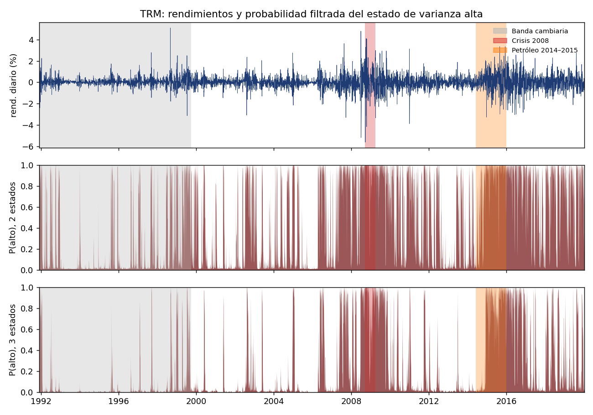

# O2 · Cambio de régimen de Markov: diagnóstico (desarrollo)

Datos: 1991-12-02 a 2019-12-31 (desarrollo; la prueba final no se usa). Modelo: r·100 = σ_S·ε, ε normal, media cero, varianza por estado; estados ordenados por varianza (el último es «alto»). Parámetros estimados con todo el desarrollo (diagnóstico dentro de muestra); la probabilidad filtrada solo usa datos hasta cada día.

## Parámetros

| estados | estado | σ² (%²/día) | desvío anual | permanencia P(s→s) | duración media (días) | prob. ergódica |
|---|---|---|---|---|---|---|
| 2 | 0 | 0,0697 | 4,2 % | 0,9733 | 37 | 55% |
| 2 | 1 | 0,7729 | 14,0 % | 0,9671 | 30 | 45% |
| 3 | 0 | 0,0279 | 2,7 % | 0,9573 | 23 | 28% |
| 3 | 1 | 0,2193 | 7,4 % | 0,9641 | 28 | 51% |
| 3 | 2 | 1,2602 | 17,8 % | 0,9703 | 34 | 21% |

## Probabilidad filtrada del estado alto por periodo

| periodo | días | 2 estados: media | 2 estados: % días > 0,5 | 3 estados: media | 3 estados: % días > 0,5 |
|---|---|---|---|---|---|
| Banda (1991-12 a 1999-09) | 1928 | 0,22 | 21% | 0,07 | 6% |
|   de ella, 1997-07 a 1999-09 | 545 | 0,41 | 41% | 0,15 | 14% |
| Flotación sin estrés | 4330 | 0,48 | 49% | 0,22 | 21% |
| Crisis 2008 | 128 | 0,93 | 97% | 0,83 | 88% |
| Petróleo 2014–2015 | 374 | 0,81 | 84% | 0,61 | 66% |
| Todo el desarrollo | 6760 | 0,44 | 44% | 0,21 | 20% |

**Lectura.** El estado alto domina en 2008 y 2014-2015, como pide el diagnóstico de B2. Con 2 estados, sin embargo, «alto» también ocupa cerca de la mitad de los días normales de la flotación: el modelo separa sobre todo la banda (volatilidad baja) de la flotación, más que el estrés de la calma. Con 3 estados el estado alto se concentra en los episodios y cae a una quinta parte de los días normales. La cola de 1997-1999 (banda) apenas activa el estado alto: sus saltos son pocos y aislados. Esto es diagnóstico, no una conclusión sobre el pronóstico: eso lo decide el backtest (O3) y el MCS (F2).

## Tiempo por estimación

| estados | hasta 2005-01 (primer reajuste) | todo el desarrollo, frío | todo el desarrollo, caliente |
|---|---|---|---|
| 2 | 1,7 s | 4,7 s | 1,9 s |
| 3 | 39,0 s | 6918,6 s | 40533,8 s |

Regla de B2: reajuste cada 63 orígenes si la estimación tarda más de 2 s. Con 2 estados se queda en 21; con 3 estados pasa a 63.
