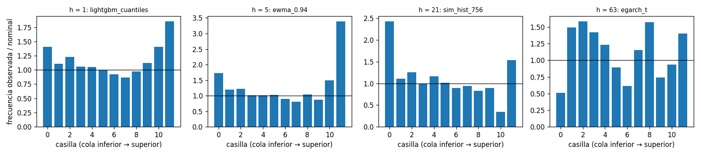

# Prueba final (una sola corrida, prerregistrada)

Distribuciones de pronóstico del rendimiento logarítmico de la TRM. Los rangos describen incertidumbre estadística; no son recomendaciones financieras.

## Declaraciones

- Orígenes: 2020-01-03 a 2026-08-12 (1564 por horizonte en la corrida corta). Cada modelo se estimó solo con datos anteriores a cada origen.
- Estos datos **no se usaron para elegir ni ajustar ningún modelo**, pero **no son datos nunca vistos**: el análisis exploratorio (reports/fase0.md) y el caso «compra de dólares» los mostraron antes del prerregistro.
- Este reporte contiene exactamente lo fijado en docs/prerregistro.md. Cualquier cálculo posterior es «análisis posterior (no confirmatorio)».
- Hash del código: 3eb375386a72beb1365ab12bbc9060697464c83fa2a22c292189ff6920806336. Hash de trm.csv: 641393c5df0c869b.

## Pruebas confirmatorias

Una hipótesis por horizonte, fijada antes de abrir los datos: el campeón de desarrollo tiene menor CRPS que la línea base de referencia de desarrollo. Diebold-Mariano unilateral (HAC, corrección HLN); las cuatro forman una familia y se ajustan por Holm. **Éxito** = CRPS menor y p de Holm < 0,05.

| h | campeón | línea base | CRPS | CRPS base | CRPS/base | t (HLN) | p | p (Holm) | n | resultado |
|---|---|---|---|---|---|---|---|---|---|---|
| 1 | lightgbm_cuantiles | sim_hist_pond | 0.4436 | 0.4538 | 0.977 | -3.55 | <0,001 | <0,001 | 1564 | **ÉXITO** |
| 5 | ewma_0.94 | sim_hist_pond | 1.1123 | 1.1190 | 0.994 | -0.98 | 0.164 | 0.493 | 1564 | **no confirmado** |
| 21 | ewma_0.94 | sim_hist_pond | 2.3083 | 2.3494 | 0.983 | -0.96 | 0.169 | 0.493 | 1564 | **no confirmado** |
| 63 | ewma_0.94 | caminata_aleatoria | 3.7695 | 3.7866 | 0.995 | -0.25 | 0.401 | 0.493 | 1564 | **no confirmado** |

Sensibilidad prerregistrada (descriptiva; **no cambia el resultado** de la tabla): a h = 1, sin los 225 orígenes de covid_2020 ni de estres_2022, CRPS/base de `lightgbm_cuantiles` contra `sim_hist_pond` = 0.987, p de Diebold-Mariano sin Holm = 0.011, n = 1339. La serie queda con saltos: el p-valor es aproximado.

## Motor del caso por horizonte

Regla prerregistrada: el caso usa `bootstrap_est_filtrado` en todos sus horizontes (necesita trayectorias) y `bootstrap_est` como sensibilidad. Donde la prueba confirmatoria tuvo éxito, el campeón se cita como pronóstico de referencia de ese horizonte; donde no, no se cita ningún modelo. El motor no se cambia a la vista de estos resultados. Advertencia de cobertura en el caso: a 63, 126 y 252 días va **siempre**, con su n efectivo, salga como salga la cobertura; en los demás horizontes, solo si 0,95 queda fuera del intervalo.

| h | motor | modelo de referencia | cobertura 95 % del motor | n | n efectivo | IC 95 % (n ef.) | compatible con 0,95 | advertencia en el caso |
|---|---|---|---|---|---|---|---|---|
| 1 | `bootstrap_est_filtrado` | `lightgbm_cuantiles` | 0.950 | 1564 | 1564 | 0.94 – 0.96 | sí | no hace falta |
| 5 | `bootstrap_est_filtrado` | ninguno | 0.961 | 1564 | 313 | 0.93 – 0.98 | sí | no hace falta |
| 21 | `bootstrap_est_filtrado` | ninguno | 0.968 | 1564 | 74 | 0.91 – 1.00 | sí | no hace falta |
| 63 | `bootstrap_est_filtrado` | ninguno | 0.960 | 1564 | 25 | 0.80 – 1.00 | sí | **siempre** (n ef. = 25) |
| 126 | `bootstrap_est_filtrado` | ninguno (descriptivo) | 0.992 | 1375 | 11 | 0.72 – 1.00 | sí | **siempre** (n ef. = 11) |
| 252 | `bootstrap_est_filtrado` | ninguno (descriptivo) | 0.932 | 1375 | 5 | 0.48 – 1.00 | sí | **siempre** (n ef. = 5) |

A 63, 126 y 252 días «compatible» dice poco: con tan pocas ventanas independientes casi cualquier cobertura lo es. A 126 y 252 días la fila es además **descriptiva** (R5): no hay aprobado ni rechazado.

Con los supuestos vigentes al prerregistrar, el caso «compra de dólares» reparte 12 compras mensuales: la última cae a unos 230 días hábiles y su cifra es el costo total, una suma sobre toda la trayectoria. Esta prueba no evalúa ni ese horizonte ni esa suma: evalúa el rendimiento acumulado a cada horizonte por separado. El respaldo al caso es **indirecto**.

## Horizonte h = 1 (descriptivo)

| modelo | CRPS | CRPS/sim_hist_pond | cob90 | cob95 | cob98 |
|---|---|---|---|---|---|
| lightgbm_cuantiles | 0.4436 | 0.977 | 0.871 | 0.930 | 0.967 |
| reg_cuantiles | 0.4458 | 0.982 | 0.877 | 0.942 | 0.977 |
| ewma_0.94 | 0.4500 | 0.992 | 0.893 | 0.941 | 0.967 |
| egarch_skewt | 0.4501 | 0.992 | 0.880 | 0.940 | 0.978 |
| egarch_t | 0.4503 | 0.992 | 0.885 | 0.942 | 0.976 |
| gjr_skewt | 0.4504 | 0.992 | 0.873 | 0.931 | 0.970 |
| fhs_ewma | 0.4506 | 0.993 | 0.889 | 0.954 | 0.985 |
| gjr_t | 0.4507 | 0.993 | 0.871 | 0.930 | 0.971 |
| garch_t | 0.4508 | 0.993 | 0.870 | 0.932 | 0.971 |
| bootstrap_est_filtrado | 0.4510 | 0.994 | 0.891 | 0.950 | 0.983 |
| fhs_gjr | 0.4513 | 0.994 | 0.879 | 0.945 | 0.978 |
| markov_3 | 0.4530 | 0.998 | 0.872 | 0.939 | 0.973 |
| markov_2 | 0.4534 | 0.999 | 0.882 | 0.935 | 0.967 |
| sim_hist_pond | 0.4538 | 1.000 | 0.893 | 0.948 | 0.978 |
| sim_hist_756 | 0.4552 | 1.003 | 0.887 | 0.940 | 0.973 |
| caminata_aleatoria | 0.4578 | 1.009 | 0.827 | 0.879 | 0.925 |
| bootstrap_est | 0.4706 | 1.037 | 0.795 | 0.893 | 0.958 |

Por episodio (covid 2020 y estrés 2022 aparte):

| modelo | CRPS normal | cob95 normal | CRPS covid_2020 | cob95 covid_2020 | CRPS estres_2022 | cob95 estres_2022 |
|---|---|---|---|---|---|---|
| bootstrap_est | 0.4295 | 0.921 | 0.7838 | 0.709 | 0.6726 | 0.741 |
| bootstrap_est_filtrado | 0.4175 | 0.949 | 0.7153 | 0.942 | 0.6097 | 0.964 |
| caminata_aleatoria | 0.4188 | 0.907 | 0.7553 | 0.698 | 0.6503 | 0.719 |
| egarch_skewt | 0.4173 | 0.941 | 0.7027 | 0.930 | 0.6094 | 0.935 |
| egarch_t | 0.4175 | 0.942 | 0.7027 | 0.930 | 0.6104 | 0.942 |
| ewma_0.94 | 0.4160 | 0.939 | 0.7170 | 0.942 | 0.6126 | 0.957 |
| fhs_ewma | 0.4172 | 0.952 | 0.7154 | 0.942 | 0.6088 | 0.978 |
| fhs_gjr | 0.4190 | 0.943 | 0.7032 | 0.942 | 0.6065 | 0.964 |
| garch_t | 0.4179 | 0.932 | 0.7032 | 0.919 | 0.6107 | 0.942 |
| gjr_skewt | 0.4175 | 0.930 | 0.7025 | 0.919 | 0.6109 | 0.950 |
| gjr_t | 0.4179 | 0.930 | 0.7033 | 0.919 | 0.6104 | 0.942 |
| lightgbm_cuantiles | 0.4117 | 0.927 | 0.7137 | 0.930 | 0.5835 | 0.957 |
| markov_2 | 0.4179 | 0.948 | 0.7268 | 0.826 | 0.6262 | 0.878 |
| markov_3 | 0.4200 | 0.943 | 0.7133 | 0.919 | 0.6098 | 0.914 |
| reg_cuantiles | 0.4117 | 0.940 | 0.7478 | 0.942 | 0.5875 | 0.964 |
| sim_hist_756 | 0.4174 | 0.961 | 0.7535 | 0.709 | 0.6349 | 0.878 |
| sim_hist_pond | 0.4170 | 0.960 | 0.7429 | 0.802 | 0.6301 | 0.921 |

n por grupo: normal = 1339, covid_2020 = 86, estres_2022 = 139

## Horizonte h = 5 (descriptivo)

| modelo | CRPS | CRPS/sim_hist_pond | cob90 | cob95 | cob98 |
|---|---|---|---|---|---|
| ewma_0.94 | 1.1123 | 0.994 | 0.856 | 0.909 | 0.949 |
| sim_hist_756 | 1.1180 | 0.999 | 0.887 | 0.942 | 0.974 |
| sim_hist_pond | 1.1190 | 1.000 | 0.896 | 0.944 | 0.967 |
| bootstrap_est_filtrado | 1.1207 | 1.002 | 0.911 | 0.961 | 0.982 |
| egarch_skewt | 1.1221 | 1.003 | 0.841 | 0.914 | 0.961 |
| lightgbm_cuantiles | 1.1225 | 1.003 | 0.876 | 0.934 | 0.971 |
| egarch_t | 1.1227 | 1.003 | 0.842 | 0.911 | 0.960 |
| reg_cuantiles | 1.1235 | 1.004 | 0.902 | 0.949 | 0.979 |
| gjr_t | 1.1243 | 1.005 | 0.826 | 0.897 | 0.952 |
| garch_t | 1.1244 | 1.005 | 0.822 | 0.896 | 0.952 |
| fhs_ewma | 1.1245 | 1.005 | 0.863 | 0.928 | 0.968 |
| gjr_skewt | 1.1247 | 1.005 | 0.826 | 0.895 | 0.956 |
| markov_2 | 1.1255 | 1.006 | 0.848 | 0.910 | 0.950 |
| markov_3 | 1.1292 | 1.009 | 0.834 | 0.909 | 0.957 |
| fhs_gjr | 1.1308 | 1.011 | 0.840 | 0.909 | 0.967 |
| caminata_aleatoria | 1.1361 | 1.015 | 0.779 | 0.845 | 0.902 |
| bootstrap_est | 1.1522 | 1.030 | 0.813 | 0.901 | 0.964 |

Por episodio (covid 2020 y estrés 2022 aparte):

| modelo | CRPS normal | cob95 normal | CRPS covid_2020 | cob95 covid_2020 | CRPS estres_2022 | cob95 estres_2022 |
|---|---|---|---|---|---|---|
| bootstrap_est | 1.0300 | 0.928 | 2.1472 | 0.698 | 1.7138 | 0.770 |
| bootstrap_est_filtrado | 1.0212 | 0.962 | 1.9868 | 0.930 | 1.5434 | 0.971 |
| caminata_aleatoria | 1.0126 | 0.878 | 2.1146 | 0.628 | 1.7206 | 0.669 |
| egarch_skewt | 1.0172 | 0.916 | 1.9757 | 0.884 | 1.6038 | 0.921 |
| egarch_t | 1.0181 | 0.913 | 1.9761 | 0.884 | 1.6018 | 0.906 |
| ewma_0.94 | 1.0073 | 0.912 | 1.9751 | 0.895 | 1.5895 | 0.885 |
| fhs_ewma | 1.0252 | 0.927 | 1.9904 | 0.930 | 1.5453 | 0.935 |
| fhs_gjr | 1.0326 | 0.908 | 1.9788 | 0.872 | 1.5531 | 0.935 |
| garch_t | 1.0204 | 0.898 | 1.9774 | 0.860 | 1.5985 | 0.899 |
| gjr_skewt | 1.0201 | 0.897 | 1.9808 | 0.837 | 1.6033 | 0.906 |
| gjr_t | 1.0201 | 0.900 | 1.9821 | 0.849 | 1.5979 | 0.899 |
| lightgbm_cuantiles | 1.0210 | 0.934 | 1.8881 | 0.930 | 1.6270 | 0.942 |
| markov_2 | 1.0113 | 0.931 | 2.0275 | 0.779 | 1.6678 | 0.791 |
| markov_3 | 1.0237 | 0.920 | 1.9806 | 0.837 | 1.6193 | 0.842 |
| reg_cuantiles | 1.0163 | 0.951 | 1.9742 | 0.872 | 1.6294 | 0.971 |
| sim_hist_756 | 1.0056 | 0.966 | 2.0740 | 0.674 | 1.6094 | 0.871 |
| sim_hist_pond | 1.0086 | 0.960 | 2.0407 | 0.779 | 1.6122 | 0.892 |

n por grupo: normal = 1339, covid_2020 = 86, estres_2022 = 139

## Horizonte h = 21 (descriptivo)

| modelo | CRPS | CRPS/sim_hist_pond | cob90 | cob95 | cob98 |
|---|---|---|---|---|---|
| sim_hist_756 | 2.2958 | 0.977 | 0.885 | 0.939 | 0.960 |
| ewma_0.94 | 2.3083 | 0.983 | 0.854 | 0.914 | 0.948 |
| egarch_t | 2.3207 | 0.988 | 0.847 | 0.928 | 0.970 |
| egarch_skewt | 2.3208 | 0.988 | 0.845 | 0.926 | 0.967 |
| markov_2 | 2.3209 | 0.988 | 0.837 | 0.905 | 0.949 |
| markov_3 | 2.3210 | 0.988 | 0.838 | 0.916 | 0.963 |
| caminata_aleatoria | 2.3280 | 0.991 | 0.797 | 0.854 | 0.908 |
| gjr_skewt | 2.3380 | 0.995 | 0.810 | 0.898 | 0.957 |
| garch_t | 2.3385 | 0.995 | 0.813 | 0.898 | 0.958 |
| gjr_t | 2.3395 | 0.996 | 0.806 | 0.895 | 0.958 |
| sim_hist_pond | 2.3494 | 1.000 | 0.867 | 0.911 | 0.934 |
| bootstrap_est | 2.3540 | 1.002 | 0.839 | 0.916 | 0.951 |
| reg_cuantiles | 2.3586 | 1.004 | 0.887 | 0.935 | 0.972 |
| lightgbm_cuantiles | 2.3665 | 1.007 | 0.850 | 0.903 | 0.962 |
| fhs_gjr | 2.4032 | 1.023 | 0.830 | 0.920 | 0.975 |
| bootstrap_est_filtrado | 2.4146 | 1.028 | 0.932 | 0.968 | 0.979 |
| fhs_ewma | 2.4208 | 1.030 | 0.853 | 0.926 | 0.971 |

Por episodio (covid 2020 y estrés 2022 aparte):

| modelo | CRPS normal | cob95 normal | CRPS covid_2020 | cob95 covid_2020 | CRPS estres_2022 | cob95 estres_2022 |
|---|---|---|---|---|---|---|
| bootstrap_est | 2.1202 | 0.942 | 4.0092 | 0.686 | 3.5821 | 0.806 |
| bootstrap_est_filtrado | 2.1834 | 0.975 | 4.4704 | 0.860 | 3.3701 | 0.964 |
| caminata_aleatoria | 2.0811 | 0.879 | 3.9388 | 0.686 | 3.7097 | 0.712 |
| egarch_skewt | 2.0857 | 0.937 | 3.9727 | 0.826 | 3.5642 | 0.885 |
| egarch_t | 2.0868 | 0.938 | 3.9686 | 0.814 | 3.5544 | 0.899 |
| ewma_0.94 | 2.0666 | 0.923 | 4.0781 | 0.860 | 3.5415 | 0.856 |
| fhs_ewma | 2.1940 | 0.931 | 4.4686 | 0.849 | 3.3385 | 0.935 |
| fhs_gjr | 2.1829 | 0.928 | 4.2912 | 0.826 | 3.3580 | 0.899 |
| garch_t | 2.1017 | 0.910 | 4.0428 | 0.826 | 3.5644 | 0.835 |
| gjr_skewt | 2.1006 | 0.907 | 4.0349 | 0.814 | 3.5750 | 0.856 |
| gjr_t | 2.1028 | 0.904 | 4.0345 | 0.814 | 3.5706 | 0.856 |
| lightgbm_cuantiles | 2.1504 | 0.901 | 3.4407 | 0.860 | 3.7831 | 0.950 |
| markov_2 | 2.0825 | 0.931 | 3.8851 | 0.733 | 3.6497 | 0.755 |
| markov_3 | 2.0896 | 0.932 | 3.8684 | 0.826 | 3.5925 | 0.820 |
| reg_cuantiles | 2.1159 | 0.949 | 4.0811 | 0.837 | 3.6309 | 0.863 |
| sim_hist_756 | 2.0610 | 0.958 | 4.0863 | 0.674 | 3.4499 | 0.914 |
| sim_hist_pond | 2.1023 | 0.930 | 4.2599 | 0.686 | 3.5478 | 0.871 |

n por grupo: normal = 1339, covid_2020 = 86, estres_2022 = 139

## Horizonte h = 63 (descriptivo)

| modelo | CRPS | CRPS/caminata_aleatoria | cob90 | cob95 | cob98 |
|---|---|---|---|---|---|
| egarch_t | 3.7644 | 0.994 | 0.886 | 0.944 | 0.981 |
| egarch_skewt | 3.7676 | 0.995 | 0.886 | 0.942 | 0.980 |
| ewma_0.94 | 3.7695 | 0.995 | 0.879 | 0.929 | 0.946 |
| markov_3 | 3.7784 | 0.998 | 0.857 | 0.918 | 0.967 |
| markov_2 | 3.7799 | 0.998 | 0.836 | 0.900 | 0.941 |
| caminata_aleatoria | 3.7866 | 1.000 | 0.808 | 0.868 | 0.914 |
| sim_hist_756 | 3.7940 | 1.002 | 0.842 | 0.892 | 0.923 |
| gjr_skewt | 3.8306 | 1.012 | 0.822 | 0.918 | 0.964 |
| gjr_t | 3.8337 | 1.012 | 0.826 | 0.916 | 0.965 |
| garch_t | 3.8359 | 1.013 | 0.826 | 0.919 | 0.969 |
| bootstrap_est | 3.9105 | 1.033 | 0.849 | 0.907 | 0.966 |
| reg_cuantiles | 4.0575 | 1.072 | 0.889 | 0.932 | 0.978 |
| fhs_gjr | 4.1051 | 1.084 | 0.848 | 0.931 | 0.986 |
| sim_hist_pond | 4.1230 | 1.089 | 0.799 | 0.839 | 0.881 |
| lightgbm_cuantiles | 4.1765 | 1.103 | 0.839 | 0.910 | 0.964 |
| bootstrap_est_filtrado | 4.2038 | 1.110 | 0.922 | 0.960 | 0.980 |
| fhs_ewma | 4.2838 | 1.131 | 0.836 | 0.915 | 0.965 |

Por episodio (covid 2020 y estrés 2022 aparte):

| modelo | CRPS normal | cob95 normal | CRPS covid_2020 | cob95 covid_2020 | CRPS estres_2022 | cob95 estres_2022 |
|---|---|---|---|---|---|---|
| bootstrap_est | 3.8487 | 0.904 | 3.9391 | 0.919 | 4.4879 | 0.935 |
| bootstrap_est_filtrado | 4.1559 | 0.953 | 5.1263 | 1.000 | 4.0951 | 1.000 |
| caminata_aleatoria | 3.6687 | 0.882 | 3.5311 | 0.884 | 5.0803 | 0.727 |
| egarch_skewt | 3.6785 | 0.934 | 3.4713 | 1.000 | 4.8087 | 0.986 |
| egarch_t | 3.6770 | 0.936 | 3.4641 | 1.000 | 4.7922 | 0.993 |
| ewma_0.94 | 3.6826 | 0.919 | 3.6763 | 0.977 | 4.6643 | 0.993 |
| fhs_ewma | 4.2562 | 0.901 | 5.4333 | 1.000 | 3.8384 | 1.000 |
| fhs_gjr | 4.0787 | 0.919 | 4.6989 | 1.000 | 3.9916 | 1.000 |
| garch_t | 3.7567 | 0.909 | 3.5081 | 0.977 | 4.8019 | 0.986 |
| gjr_skewt | 3.7476 | 0.905 | 3.4820 | 0.988 | 4.8453 | 0.993 |
| gjr_t | 3.7524 | 0.906 | 3.4875 | 0.977 | 4.8319 | 0.978 |
| lightgbm_cuantiles | 3.8708 | 0.895 | 4.1819 | 1.000 | 7.1176 | 1.000 |
| markov_2 | 3.6686 | 0.907 | 3.5164 | 0.965 | 5.0148 | 0.799 |
| markov_3 | 3.6777 | 0.918 | 3.5105 | 0.977 | 4.9150 | 0.878 |
| reg_cuantiles | 3.7594 | 0.949 | 6.7790 | 0.651 | 5.2457 | 0.942 |
| sim_hist_756 | 3.7016 | 0.898 | 4.0585 | 0.628 | 4.5204 | 1.000 |
| sim_hist_pond | 3.9803 | 0.852 | 4.8687 | 0.616 | 5.0369 | 0.849 |

n por grupo: normal = 1339, covid_2020 = 86, estres_2022 = 139

## Pruebas de VaR al 95 % y 99 % en ambas colas, h = 1 (Kupiec y Christoffersen)

Cola inf = caída del dólar; sup = alza. p < 0,05 rechaza la calibración de esa cola.

| modelo | cola | tasa | p_uc | p_ind | p_cc |
|---|---|---|---|---|---|
| bootstrap_est | inf 1 % | 0.0185 | 0.002 | 0.016 | <0,001 |
| bootstrap_est | inf 5 % | 0.1087 | <0,001 | <0,001 | <0,001 |
| bootstrap_est | sup 5 % | 0.0959 | <0,001 | <0,001 | <0,001 |
| bootstrap_est | sup 1 % | 0.0230 | <0,001 | 0.001 | <0,001 |
| bootstrap_est_filtrado | inf 1 % | 0.0083 | 0.490 | 0.641 | 0.706 |
| bootstrap_est_filtrado | inf 5 % | 0.0550 | 0.373 | 0.299 | 0.392 |
| bootstrap_est_filtrado | sup 5 % | 0.0543 | 0.436 | <0,001 | <0,001 |
| bootstrap_est_filtrado | sup 1 % | 0.0083 | 0.490 | 0.641 | 0.706 |
| caminata_aleatoria | inf 1 % | 0.0307 | <0,001 | 0.017 | <0,001 |
| caminata_aleatoria | inf 5 % | 0.0818 | <0,001 | 0.020 | <0,001 |
| caminata_aleatoria | sup 5 % | 0.0914 | <0,001 | <0,001 | <0,001 |
| caminata_aleatoria | sup 1 % | 0.0448 | <0,001 | <0,001 | <0,001 |
| egarch_skewt | inf 1 % | 0.0096 | 0.870 | 0.590 | 0.853 |
| egarch_skewt | inf 5 % | 0.0556 | 0.316 | 0.327 | 0.374 |
| egarch_skewt | sup 5 % | 0.0639 | 0.015 | 0.032 | 0.005 |
| egarch_skewt | sup 1 % | 0.0128 | 0.288 | 0.255 | 0.298 |
| egarch_t | inf 1 % | 0.0102 | 0.927 | 0.565 | 0.844 |
| egarch_t | inf 5 % | 0.0518 | 0.747 | 0.380 | 0.646 |
| egarch_t | sup 5 % | 0.0633 | 0.020 | 0.011 | 0.003 |
| egarch_t | sup 1 % | 0.0141 | 0.128 | 0.315 | 0.189 |
| ewma_0.94 | inf 1 % | 0.0121 | 0.409 | 0.494 | 0.563 |
| ewma_0.94 | inf 5 % | 0.0422 | 0.146 | 0.474 | 0.269 |
| ewma_0.94 | sup 5 % | 0.0652 | 0.008 | <0,001 | <0,001 |
| ewma_0.94 | sup 1 % | 0.0211 | <0,001 | 0.034 | <0,001 |
| fhs_ewma | inf 1 % | 0.0077 | 0.335 | 0.667 | 0.572 |
| fhs_ewma | inf 5 % | 0.0556 | 0.316 | 0.327 | 0.374 |
| fhs_ewma | sup 5 % | 0.0550 | 0.373 | <0,001 | <0,001 |
| fhs_ewma | sup 1 % | 0.0077 | 0.335 | 0.667 | 0.572 |
| fhs_gjr | inf 1 % | 0.0128 | 0.288 | 0.471 | 0.439 |
| fhs_gjr | inf 5 % | 0.0646 | 0.011 | 0.845 | 0.039 |
| fhs_gjr | sup 5 % | 0.0569 | 0.220 | 0.014 | 0.023 |
| fhs_gjr | sup 1 % | 0.0096 | 0.870 | 0.132 | 0.318 |
| garch_t | inf 1 % | 0.0121 | 0.409 | 0.494 | 0.563 |
| garch_t | inf 5 % | 0.0588 | 0.119 | 0.793 | 0.286 |
| garch_t | sup 5 % | 0.0710 | <0,001 | 0.013 | <0,001 |
| garch_t | sup 1 % | 0.0166 | 0.016 | 0.074 | 0.011 |
| gjr_skewt | inf 1 % | 0.0134 | 0.196 | 0.449 | 0.325 |
| gjr_skewt | inf 5 % | 0.0595 | 0.095 | 0.835 | 0.243 |
| gjr_skewt | sup 5 % | 0.0678 | 0.002 | 0.034 | <0,001 |
| gjr_skewt | sup 1 % | 0.0166 | 0.016 | 0.074 | 0.011 |
| gjr_t | inf 1 % | 0.0121 | 0.409 | 0.494 | 0.563 |
| gjr_t | inf 5 % | 0.0595 | 0.095 | 0.835 | 0.243 |
| gjr_t | sup 5 % | 0.0697 | <0,001 | 0.023 | <0,001 |
| gjr_t | sup 1 % | 0.0166 | 0.016 | 0.074 | 0.011 |
| lightgbm_cuantiles | inf 1 % | 0.0141 | 0.128 | 0.428 | 0.229 |
| lightgbm_cuantiles | inf 5 % | 0.0614 | 0.046 | 0.687 | 0.125 |
| lightgbm_cuantiles | sup 5 % | 0.0678 | 0.002 | 0.358 | 0.006 |
| lightgbm_cuantiles | sup 1 % | 0.0185 | 0.002 | 0.565 | 0.008 |
| markov_2 | inf 1 % | 0.0115 | 0.558 | 0.517 | 0.683 |
| markov_2 | inf 5 % | 0.0550 | 0.373 | 0.144 | 0.231 |
| markov_2 | sup 5 % | 0.0633 | 0.020 | <0,001 | <0,001 |
| markov_2 | sup 1 % | 0.0217 | <0,001 | 0.006 | <0,001 |
| markov_3 | inf 1 % | 0.0109 | 0.733 | 0.541 | 0.783 |
| markov_3 | inf 5 % | 0.0537 | 0.506 | 0.479 | 0.624 |
| markov_3 | sup 5 % | 0.0742 | <0,001 | 0.002 | <0,001 |
| markov_3 | sup 1 % | 0.0166 | 0.016 | 0.451 | 0.042 |
| reg_cuantiles | inf 1 % | 0.0102 | 0.927 | 0.565 | 0.844 |
| reg_cuantiles | inf 5 % | 0.0569 | 0.220 | 0.974 | 0.471 |
| reg_cuantiles | sup 5 % | 0.0659 | 0.006 | 0.444 | 0.017 |
| reg_cuantiles | sup 1 % | 0.0128 | 0.288 | 0.471 | 0.439 |
| sim_hist_756 | inf 1 % | 0.0141 | 0.128 | 0.037 | 0.036 |
| sim_hist_756 | inf 5 % | 0.0563 | 0.265 | 0.356 | 0.351 |
| sim_hist_756 | sup 5 % | 0.0563 | 0.265 | <0,001 | <0,001 |
| sim_hist_756 | sup 1 % | 0.0128 | 0.288 | 0.001 | 0.004 |
| sim_hist_pond | inf 1 % | 0.0109 | 0.733 | 0.177 | 0.379 |
| sim_hist_pond | inf 5 % | 0.0563 | 0.265 | 0.629 | 0.478 |
| sim_hist_pond | sup 5 % | 0.0512 | 0.835 | <0,001 | <0,001 |
| sim_hist_pond | sup 1 % | 0.0109 | 0.733 | 0.012 | 0.040 |

## Model Confidence Set (α = 0,10)

Conjunto de modelos que, con 90 % de confianza, contiene al de menor CRPS esperado (Hansen, Lunde y Nason). Compara TODOS los modelos a la vez, líneas base incluidas, así que no premia al ganador de muchas pruebas por pares. Bootstrap estacionario, 5000 réplicas, bloque máx(2h, 10), estadístico de rango, semilla fija. p_mcs ≥ 0,10 ⇒ el modelo queda en el conjunto.

### h = 1

| modelo | CRPS | p_mcs | en el MCS |
|---|---|---|---|
| lightgbm_cuantiles | 0.4436 | 1.000 | **sí** |
| reg_cuantiles | 0.4458 | 0.183 | **sí** |
| ewma_0.94 | 0.4500 | 0.038 | no |
| egarch_skewt | 0.4501 | 0.038 | no |
| egarch_t | 0.4503 | 0.038 | no |
| gjr_skewt | 0.4504 | 0.038 | no |
| fhs_ewma | 0.4506 | 0.030 | no |
| gjr_t | 0.4507 | 0.035 | no |
| garch_t | 0.4508 | 0.035 | no |
| bootstrap_est_filtrado | 0.4510 | 0.025 | no |
| fhs_gjr | 0.4513 | 0.025 | no |
| markov_3 | 0.4530 | 0.005 | no |
| markov_2 | 0.4534 | 0.017 | no |
| sim_hist_pond | 0.4538 | 0.024 | no |
| sim_hist_756 | 0.4552 | 0.018 | no |
| caminata_aleatoria | 0.4578 | 0.015 | no |
| bootstrap_est | 0.4706 | <0,001 | no |

Conjunto superior en h=1 (2 de 17, n = 1564, bloque 10): `lightgbm_cuantiles`, `reg_cuantiles`.

### h = 5

| modelo | CRPS | p_mcs | en el MCS |
|---|---|---|---|
| ewma_0.94 | 1.1123 | 1.000 | **sí** |
| sim_hist_756 | 1.1180 | 0.633 | **sí** |
| sim_hist_pond | 1.1190 | 0.633 | **sí** |
| bootstrap_est_filtrado | 1.1207 | 0.633 | **sí** |
| egarch_skewt | 1.1221 | 0.045 | no |
| lightgbm_cuantiles | 1.1225 | 0.580 | **sí** |
| egarch_t | 1.1227 | 0.026 | no |
| reg_cuantiles | 1.1235 | 0.580 | **sí** |
| gjr_t | 1.1243 | 0.017 | no |
| garch_t | 1.1244 | 0.013 | no |
| fhs_ewma | 1.1245 | 0.536 | **sí** |
| gjr_skewt | 1.1247 | 0.012 | no |
| markov_2 | 1.1255 | 0.252 | **sí** |
| markov_3 | 1.1292 | 0.001 | no |
| fhs_gjr | 1.1308 | 0.149 | **sí** |
| caminata_aleatoria | 1.1361 | 0.126 | **sí** |
| bootstrap_est | 1.1522 | 0.003 | no |

Conjunto superior en h=5 (10 de 17, n = 1564, bloque 10): `ewma_0.94`, `sim_hist_756`, `sim_hist_pond`, `bootstrap_est_filtrado`, `lightgbm_cuantiles`, `reg_cuantiles`, `fhs_ewma`, `markov_2`, `fhs_gjr`, `caminata_aleatoria`.

### h = 21

| modelo | CRPS | p_mcs | en el MCS |
|---|---|---|---|
| sim_hist_756 | 2.2958 | 1.000 | **sí** |
| ewma_0.94 | 2.3083 | 0.859 | **sí** |
| egarch_t | 2.3207 | 0.859 | **sí** |
| egarch_skewt | 2.3208 | 0.859 | **sí** |
| markov_2 | 2.3209 | 0.859 | **sí** |
| markov_3 | 2.3210 | 0.859 | **sí** |
| caminata_aleatoria | 2.3280 | 0.859 | **sí** |
| gjr_skewt | 2.3380 | 0.217 | **sí** |
| garch_t | 2.3385 | 0.235 | **sí** |
| gjr_t | 2.3395 | 0.183 | **sí** |
| sim_hist_pond | 2.3494 | 0.308 | **sí** |
| bootstrap_est | 2.3540 | 0.622 | **sí** |
| reg_cuantiles | 2.3586 | 0.396 | **sí** |
| lightgbm_cuantiles | 2.3665 | 0.838 | **sí** |
| fhs_gjr | 2.4032 | 0.228 | **sí** |
| bootstrap_est_filtrado | 2.4146 | 0.133 | **sí** |
| fhs_ewma | 2.4208 | 0.235 | **sí** |

Conjunto superior en h=21 (17 de 17, n = 1564, bloque 42): `sim_hist_756`, `ewma_0.94`, `egarch_t`, `egarch_skewt`, `markov_2`, `markov_3`, `caminata_aleatoria`, `gjr_skewt`, `garch_t`, `gjr_t`, `sim_hist_pond`, `bootstrap_est`, `reg_cuantiles`, `lightgbm_cuantiles`, `fhs_gjr`, `bootstrap_est_filtrado`, `fhs_ewma`.

### h = 63

| modelo | CRPS | p_mcs | en el MCS |
|---|---|---|---|
| egarch_t | 3.7644 | 1.000 | **sí** |
| egarch_skewt | 3.7676 | 0.825 | **sí** |
| ewma_0.94 | 3.7695 | 0.978 | **sí** |
| markov_3 | 3.7784 | 0.825 | **sí** |
| markov_2 | 3.7799 | 0.923 | **sí** |
| caminata_aleatoria | 3.7866 | 0.923 | **sí** |
| sim_hist_756 | 3.7940 | 0.978 | **sí** |
| gjr_skewt | 3.8306 | 0.051 | no |
| gjr_t | 3.8337 | 0.039 | no |
| garch_t | 3.8359 | 0.040 | no |
| bootstrap_est | 3.9105 | 0.825 | **sí** |
| reg_cuantiles | 4.0575 | 0.182 | **sí** |
| fhs_gjr | 4.1051 | 0.333 | **sí** |
| sim_hist_pond | 4.1230 | 0.159 | **sí** |
| lightgbm_cuantiles | 4.1765 | 0.671 | **sí** |
| bootstrap_est_filtrado | 4.2038 | 0.186 | **sí** |
| fhs_ewma | 4.2838 | 0.224 | **sí** |

Conjunto superior en h=63 (14 de 17, n = 1564, bloque 126): `egarch_t`, `egarch_skewt`, `ewma_0.94`, `markov_3`, `markov_2`, `caminata_aleatoria`, `sim_hist_756`, `bootstrap_est`, `reg_cuantiles`, `fhs_gjr`, `sim_hist_pond`, `lightgbm_cuantiles`, `bootstrap_est_filtrado`, `fhs_ewma`.

## Semáforo de Basilea (VaR al 99 %, h = 1)

Excepciones en ventanas móviles de 250 observaciones: verde 0-4, amarillo 5-9, rojo 10 o más (esperadas 2,5). Porcentaje de ventanas en cada zona. Cola inferior = caída del dólar; superior = alza.

| modelo | cola | verde | amarillo | rojo | máx. excepciones | media por ventana |
|---|---|---|---|---|---|---|
| bootstrap_est | inferior | 55.1 % | 41.1 % | 3.8 % | 10 | 3.93 |
| bootstrap_est | superior | 54.8 % | 22.7 % | 22.4 % | 16 | 5.48 |
| bootstrap_est_filtrado | inferior | 100.0 % | 0.0 % | 0.0 % | 4 | 1.83 |
| bootstrap_est_filtrado | superior | 100.0 % | 0.0 % | 0.0 % | 4 | 1.67 |
| caminata_aleatoria | inferior | 42.2 % | 26.4 % | 31.4 % | 15 | 6.67 |
| caminata_aleatoria | superior | 11.0 % | 44.6 % | 44.5 % | 29 | 11.27 |
| egarch_skewt | inferior | 95.6 % | 4.4 % | 0.0 % | 5 | 2.24 |
| egarch_skewt | superior | 80.6 % | 19.4 % | 0.0 % | 6 | 2.99 |
| egarch_t | inferior | 95.6 % | 4.4 % | 0.0 % | 5 | 2.32 |
| egarch_t | superior | 78.4 % | 21.6 % | 0.0 % | 6 | 3.37 |
| ewma_0.94 | inferior | 93.8 % | 6.2 % | 0.0 % | 5 | 2.89 |
| ewma_0.94 | superior | 33.0 % | 67.0 % | 0.0 % | 8 | 5.10 |
| fhs_ewma | inferior | 100.0 % | 0.0 % | 0.0 % | 4 | 1.64 |
| fhs_ewma | superior | 100.0 % | 0.0 % | 0.0 % | 3 | 1.48 |
| fhs_gjr | inferior | 83.0 % | 17.0 % | 0.0 % | 6 | 2.74 |
| fhs_gjr | superior | 99.0 % | 1.0 % | 0.0 % | 5 | 2.28 |
| garch_t | inferior | 90.3 % | 9.7 % | 0.0 % | 6 | 2.76 |
| garch_t | superior | 64.6 % | 35.4 % | 0.0 % | 7 | 3.99 |
| gjr_skewt | inferior | 83.0 % | 17.0 % | 0.0 % | 6 | 2.93 |
| gjr_skewt | superior | 60.8 % | 39.2 % | 0.0 % | 7 | 3.99 |
| gjr_t | inferior | 86.4 % | 13.6 % | 0.0 % | 6 | 2.65 |
| gjr_t | superior | 64.6 % | 35.4 % | 0.0 % | 7 | 3.99 |
| lightgbm_cuantiles | inferior | 84.2 % | 15.8 % | 0.0 % | 6 | 3.17 |
| lightgbm_cuantiles | superior | 51.9 % | 48.1 % | 0.0 % | 7 | 4.38 |
| markov_2 | inferior | 95.6 % | 4.4 % | 0.0 % | 5 | 2.44 |
| markov_2 | superior | 57.3 % | 15.1 % | 27.7 % | 17 | 5.56 |
| markov_3 | inferior | 96.0 % | 4.0 % | 0.0 % | 5 | 2.54 |
| markov_3 | superior | 67.3 % | 32.7 % | 0.0 % | 9 | 3.88 |
| reg_cuantiles | inferior | 100.0 % | 0.0 % | 0.0 % | 4 | 2.33 |
| reg_cuantiles | superior | 76.7 % | 23.3 % | 0.0 % | 6 | 2.96 |
| sim_hist_756 | inferior | 79.1 % | 17.9 % | 3.0 % | 10 | 2.58 |
| sim_hist_756 | superior | 80.4 % | 19.6 % | 0.0 % | 9 | 2.28 |
| sim_hist_pond | inferior | 89.0 % | 11.0 % | 0.0 % | 6 | 2.05 |
| sim_hist_pond | superior | 89.6 % | 10.4 % | 0.0 % | 5 | 2.21 |

## Expected Shortfall al 97,5 % y prueba Z2 de Acerbi-Székely (h = 1)

ES = promedio de la cola de probabilidad 2,5 % de cada pronóstico (rejilla de 25 cuantiles pedida en la misma corrida). Z2 = 1 − Σ y·I/(T·α·ES): vale 0 si VaR y ES son correctos y es negativo si el riesgo de cola está subestimado. «exceso» = promedio de y/ES en los días de violación (1 = el ES acierta la magnitud). Umbral de referencia del artículo: Z2 < −0,70 rechaza al 5 %. No hay p-valor exacto (no se guardan las simulaciones completas).

| modelo | cola | violaciones | esperadas | exceso | Z2 | al 5 % |
|---|---|---|---|---|---|---|
| bootstrap_est | inferior | 81 | 39.1 | 0.950 | -0.969 | **rechaza** |
| bootstrap_est | superior | 86 | 39.1 | 1.019 | -1.241 | **rechaza** |
| bootstrap_est_filtrado | inferior | 39 | 39.1 | 0.992 | 0.011 | no rechaza |
| bootstrap_est_filtrado | superior | 39 | 39.1 | 0.969 | 0.034 | no rechaza |
| caminata_aleatoria | inferior | 87 | 39.1 | 1.122 | -1.496 | **rechaza** |
| caminata_aleatoria | superior | 102 | 39.1 | 1.261 | -2.290 | **rechaza** |
| egarch_skewt | inferior | 37 | 39.1 | 1.024 | 0.031 | no rechaza |
| egarch_skewt | superior | 57 | 39.1 | 0.998 | -0.455 | no rechaza |
| egarch_t | inferior | 36 | 39.1 | 1.015 | 0.065 | no rechaza |
| egarch_t | superior | 55 | 39.1 | 1.011 | -0.422 | no rechaza |
| ewma_0.94 | inferior | 35 | 39.1 | 1.110 | 0.007 | no rechaza |
| ewma_0.94 | superior | 58 | 39.1 | 1.117 | -0.657 | no rechaza |
| fhs_ewma | inferior | 35 | 39.1 | 1.014 | 0.092 | no rechaza |
| fhs_ewma | superior | 37 | 39.1 | 0.964 | 0.088 | no rechaza |
| fhs_gjr | inferior | 42 | 39.1 | 1.043 | -0.120 | no rechaza |
| fhs_gjr | superior | 44 | 39.1 | 1.001 | -0.127 | no rechaza |
| garch_t | inferior | 42 | 39.1 | 1.049 | -0.127 | no rechaza |
| garch_t | superior | 64 | 39.1 | 1.025 | -0.678 | no rechaza |
| gjr_skewt | inferior | 46 | 39.1 | 1.043 | -0.227 | no rechaza |
| gjr_skewt | superior | 62 | 39.1 | 1.018 | -0.614 | no rechaza |
| gjr_t | inferior | 45 | 39.1 | 1.033 | -0.189 | no rechaza |
| gjr_t | superior | 64 | 39.1 | 1.024 | -0.676 | no rechaza |
| markov_2 | inferior | 41 | 39.1 | 1.014 | -0.063 | no rechaza |
| markov_2 | superior | 60 | 39.1 | 1.131 | -0.736 | **rechaza** |
| markov_3 | inferior | 37 | 39.1 | 1.026 | 0.029 | no rechaza |
| markov_3 | superior | 58 | 39.1 | 1.046 | -0.551 | no rechaza |
| sim_hist_756 | inferior | 46 | 39.1 | 1.066 | -0.254 | no rechaza |
| sim_hist_756 | superior | 48 | 39.1 | 1.012 | -0.242 | no rechaza |
| sim_hist_pond | inferior | 46 | 39.1 | 1.020 | -0.200 | no rechaza |
| sim_hist_pond | superior | 36 | 39.1 | 1.066 | 0.019 | no rechaza |

ES «no aplica»:
- `lightgbm_cuantiles`: no aplica: entrena un modelo por nivel solo para los 11 niveles del protocolo; un cuantil del 0,25 % se apoyaría en muy pocas observaciones por nivel.
- `reg_cuantiles`: no aplica: entrena un modelo por nivel solo para los 11 niveles del protocolo; un cuantil del 0,25 % se apoyaría en muy pocas observaciones por nivel.

## Uniformidad del PIT

Ji-cuadrado sobre las 12 casillas que definen los 11 cuantiles (si el pronóstico está calibrado, cada casilla recibe su probabilidad nominal). A h = 1 es exacta; a h > 1 las observaciones se traslapan: se usa n efectivo = n/h, se fusionan casillas extremas con menos de 5 esperadas y el p-valor es **aproximado**. p < 0,05 rechaza la calibración.

| modelo | p (h=1) | p (h=5), aprox. | p (h=21), aprox. | p (h=63), aprox. |
|---|---|---|---|---|
| bootstrap_est | <0,001 | <0,001 | 0.044 | 0.301 |
| bootstrap_est_filtrado | 0.061 | 0.603 | 0.276 | 0.216 |
| caminata_aleatoria | <0,001 | <0,001 | 0.180 | 0.641 |
| egarch_skewt | 0.010 | 0.019 | 0.567 | 0.683 |
| egarch_t | 0.003 | 0.014 | 0.596 | 0.625 |
| ewma_0.94 | <0,001 | 0.050 | 0.942 | 0.938 |
| fhs_ewma | 0.024 | 0.123 | 0.137 | 0.101 |
| fhs_gjr | 0.002 | 0.003 | 0.078 | 0.136 |
| garch_t | <0,001 | <0,001 | 0.155 | 0.326 |
| gjr_skewt | <0,001 | <0,001 | 0.185 | 0.368 |
| gjr_t | <0,001 | <0,001 | 0.154 | 0.353 |
| lightgbm_cuantiles | 0.003 | 0.948 | 0.913 | 0.728 |
| markov_2 | <0,001 | 0.008 | 0.519 | 0.597 |
| markov_3 | <0,001 | 0.002 | 0.480 | 0.619 |
| reg_cuantiles | 0.031 | 0.984 | 0.992 | 0.907 |
| sim_hist_756 | 0.761 | 0.980 | 0.957 | 0.723 |
| sim_hist_pond | 0.964 | 1.000 | 0.917 | 0.766 |



Figura: frecuencia observada sobre nominal por casilla, para el modelo de menor CRPS en cada horizonte. 1 = calibrado; barras extremas > 1 = colas subcubiertas.

## Acierto direccional (h = 1, diagnóstico)

Signo de la mediana pronosticada contra el signo del rendimiento observado (se descartan los ceros). Binomial: H0 acierto = 50 %. Pesaran-Timmermann (PT): descuenta el acierto que se logra por predecir siempre el signo más frecuente. Se reporta, no se optimiza. En los modelos de media cero que simulan, la mediana es ruido de simulación: su acierto ronda el 50 % por construcción. «no aplica» = mediana siempre cero o de un solo signo.

| modelo | acierto | n | p binomial | PT S | p PT |
|---|---|---|---|---|---|
| bootstrap_est | 47.5 % | 1519 | 0.051 | 1.72 | 0.043 |
| bootstrap_est_filtrado | 47.5 % | 1519 | 0.051 | 1.72 | 0.043 |
| caminata_aleatoria | no aplica | 0 | — | — | — |
| egarch_skewt | 53.1 % | 1564 | 0.014 | 1.65 | 0.050 |
| egarch_t | 51.1 % | 1564 | 0.404 | 0.82 | 0.207 |
| ewma_0.94 | no aplica | 0 | — | — | — |
| fhs_ewma | 46.9 % | 1564 | 0.014 | no aplica | — |
| fhs_gjr | 46.9 % | 1564 | 0.014 | no aplica | — |
| garch_t | 51.6 % | 1564 | 0.215 | 1.27 | 0.103 |
| gjr_skewt | 51.9 % | 1564 | 0.136 | 0.48 | 0.316 |
| gjr_t | 51.8 % | 1564 | 0.164 | 1.42 | 0.078 |
| lightgbm_cuantiles | 55.7 % | 1564 | <0,001 | 4.23 | <0,001 |
| markov_2 | 52.0 % | 1564 | 0.111 | 0.14 | 0.446 |
| markov_3 | 51.3 % | 1564 | 0.324 | -0.44 | 0.671 |
| reg_cuantiles | 54.5 % | 1564 | <0,001 | 3.21 | <0,001 |
| sim_hist_756 | 52.1 % | 1564 | 0.100 | 0.72 | 0.236 |
| sim_hist_pond | 51.8 % | 1564 | 0.164 | -0.23 | 0.592 |

## Horizontes largos (h = 126 y 252): cobertura con n efectivo

Corrida aparte (runs/backtest_largo/). Los orígenes diarios se traslapan casi por completo: la evidencia equivale a n/h ventanas independientes. Se reporta la cobertura observada y el intervalo binomial exacto del 95 % con n efectivo. Es **descriptivo**: «compatible» solo dice que el nominal cae en un intervalo muy ancho. Sin MCS ni Diebold-Mariano a estos horizontes (N1).

| modelo | h | intervalo | cobertura | n | n efectivo | IC 95 % (n ef.) | compatible | CRPS (descr.) |
|---|---|---|---|---|---|---|---|---|
| bootstrap_est | 126 | 90 % | 0.881 | 1375 | 11 | 0.59 – 1.00 | sí | 5.330 |
| bootstrap_est | 126 | 95 % | 0.938 | 1375 | 11 | 0.59 – 1.00 | sí | 5.330 |
| bootstrap_est | 252 | 90 % | 0.788 | 1375 | 5 | 0.28 – 0.99 | sí | 8.331 |
| bootstrap_est | 252 | 95 % | 0.872 | 1375 | 5 | 0.28 – 0.99 | sí | 8.331 |
| bootstrap_est_filtrado | 126 | 90 % | 0.961 | 1375 | 11 | 0.72 – 1.00 | sí | 5.948 |
| bootstrap_est_filtrado | 126 | 95 % | 0.992 | 1375 | 11 | 0.72 – 1.00 | sí | 5.948 |
| bootstrap_est_filtrado | 252 | 90 % | 0.814 | 1375 | 5 | 0.28 – 0.99 | sí | 9.885 |
| bootstrap_est_filtrado | 252 | 95 % | 0.932 | 1375 | 5 | 0.48 – 1.00 | sí | 9.885 |
| caminata_aleatoria | 126 | 90 % | 0.838 | 1375 | 11 | 0.48 – 0.98 | sí | 5.071 |
| caminata_aleatoria | 126 | 95 % | 0.901 | 1375 | 11 | 0.59 – 1.00 | sí | 5.071 |
| caminata_aleatoria | 252 | 90 % | 0.747 | 1375 | 5 | 0.28 – 0.99 | sí | 7.577 |
| caminata_aleatoria | 252 | 95 % | 0.871 | 1375 | 5 | 0.28 – 0.99 | sí | 7.577 |
| egarch_skewt | 126 | 90 % | 0.908 | 1375 | 11 | 0.59 – 1.00 | sí | 5.051 |
| egarch_skewt | 126 | 95 % | 0.969 | 1375 | 11 | 0.72 – 1.00 | sí | 5.051 |
| egarch_skewt | 252 | 90 % | 0.831 | 1375 | 5 | 0.28 – 0.99 | sí | 7.593 |
| egarch_skewt | 252 | 95 % | 0.968 | 1375 | 5 | 0.48 – 1.00 | sí | 7.593 |
| egarch_t | 126 | 90 % | 0.905 | 1375 | 11 | 0.59 – 1.00 | sí | 5.055 |
| egarch_t | 126 | 95 % | 0.969 | 1375 | 11 | 0.72 – 1.00 | sí | 5.055 |
| egarch_t | 252 | 90 % | 0.831 | 1375 | 5 | 0.28 – 0.99 | sí | 7.589 |
| egarch_t | 252 | 95 % | 0.969 | 1375 | 5 | 0.48 – 1.00 | sí | 7.589 |
| ewma_0.94 | 126 | 90 % | 0.884 | 1375 | 11 | 0.59 – 1.00 | sí | 5.075 |
| ewma_0.94 | 126 | 95 % | 0.951 | 1375 | 11 | 0.59 – 1.00 | sí | 5.075 |
| ewma_0.94 | 252 | 90 % | 0.824 | 1375 | 5 | 0.28 – 0.99 | sí | 7.795 |
| ewma_0.94 | 252 | 95 % | 0.886 | 1375 | 5 | 0.28 – 0.99 | sí | 7.795 |
| fhs_ewma | 126 | 90 % | 0.861 | 1375 | 11 | 0.48 – 0.98 | sí | 6.330 |
| fhs_ewma | 126 | 95 % | 0.966 | 1375 | 11 | 0.72 – 1.00 | sí | 6.330 |
| fhs_ewma | 252 | 90 % | 0.735 | 1375 | 5 | 0.28 – 0.99 | sí | 11.352 |
| fhs_ewma | 252 | 95 % | 0.852 | 1375 | 5 | 0.28 – 0.99 | sí | 11.352 |
| fhs_gjr | 126 | 90 % | 0.875 | 1375 | 11 | 0.59 – 1.00 | sí | 5.739 |
| fhs_gjr | 126 | 95 % | 0.979 | 1375 | 11 | 0.72 – 1.00 | sí | 5.739 |
| fhs_gjr | 252 | 90 % | 0.756 | 1375 | 5 | 0.28 – 0.99 | sí | 9.371 |
| fhs_gjr | 252 | 95 % | 0.889 | 1375 | 5 | 0.28 – 0.99 | sí | 9.371 |
| garch_t | 126 | 90 % | 0.788 | 1375 | 11 | 0.48 – 0.98 | sí | 5.218 |
| garch_t | 126 | 95 % | 0.930 | 1375 | 11 | 0.59 – 1.00 | sí | 5.218 |
| garch_t | 252 | 90 % | 0.687 | 1375 | 5 | 0.15 – 0.95 | sí | 8.001 |
| garch_t | 252 | 95 % | 0.837 | 1375 | 5 | 0.28 – 0.99 | sí | 8.001 |
| gjr_skewt | 126 | 90 % | 0.792 | 1375 | 11 | 0.48 – 0.98 | sí | 5.212 |
| gjr_skewt | 126 | 95 % | 0.932 | 1375 | 11 | 0.59 – 1.00 | sí | 5.212 |
| gjr_skewt | 252 | 90 % | 0.685 | 1375 | 5 | 0.15 – 0.95 | sí | 8.012 |
| gjr_skewt | 252 | 95 % | 0.832 | 1375 | 5 | 0.28 – 0.99 | sí | 8.012 |
| gjr_t | 126 | 90 % | 0.791 | 1375 | 11 | 0.48 – 0.98 | sí | 5.215 |
| gjr_t | 126 | 95 % | 0.933 | 1375 | 11 | 0.59 – 1.00 | sí | 5.215 |
| gjr_t | 252 | 90 % | 0.684 | 1375 | 5 | 0.15 – 0.95 | sí | 8.012 |
| gjr_t | 252 | 95 % | 0.835 | 1375 | 5 | 0.28 – 0.99 | sí | 8.012 |
| markov_2 | 126 | 90 % | 0.849 | 1375 | 11 | 0.48 – 0.98 | sí | 5.068 |
| markov_2 | 126 | 95 % | 0.916 | 1375 | 11 | 0.59 – 1.00 | sí | 5.068 |
| markov_2 | 252 | 90 % | 0.759 | 1375 | 5 | 0.28 – 0.99 | sí | 7.581 |
| markov_2 | 252 | 95 % | 0.889 | 1375 | 5 | 0.28 – 0.99 | sí | 7.581 |
| markov_3 | 126 | 90 % | 0.855 | 1375 | 11 | 0.48 – 0.98 | sí | 5.063 |
| markov_3 | 126 | 95 % | 0.932 | 1375 | 11 | 0.59 – 1.00 | sí | 5.063 |
| markov_3 | 252 | 90 % | 0.763 | 1375 | 5 | 0.28 – 0.99 | sí | 7.602 |
| markov_3 | 252 | 95 % | 0.906 | 1375 | 5 | 0.48 – 1.00 | sí | 7.602 |
| sim_hist_756 | 126 | 90 % | 0.783 | 1375 | 11 | 0.48 – 0.98 | sí | 5.518 |
| sim_hist_756 | 126 | 95 % | 0.835 | 1375 | 11 | 0.48 – 0.98 | sí | 5.518 |
| sim_hist_756 | 252 | 90 % | 0.758 | 1375 | 5 | 0.28 – 0.99 | sí | 8.239 |
| sim_hist_756 | 252 | 95 % | 0.835 | 1375 | 5 | 0.28 – 0.99 | sí | 8.239 |
| sim_hist_pond | 126 | 90 % | 0.698 | 1375 | 11 | 0.39 – 0.94 | sí | 6.827 |
| sim_hist_pond | 126 | 95 % | 0.748 | 1375 | 11 | 0.39 – 0.94 | **no** | 6.827 |
| sim_hist_pond | 252 | 90 % | 0.609 | 1375 | 5 | 0.15 – 0.95 | sí | 9.950 |
| sim_hist_pond | 252 | 95 % | 0.697 | 1375 | 5 | 0.15 – 0.95 | **no** | 9.950 |

## Reproducir

```
PYTHONPATH=src python -m laboratorio.backtest final --verificar
```

La corrida no se repite: `runs/prueba_final/HECHO.json` lo impide mientras exista (borrarlo es una puerta declarada en el prerregistro) y guarda el SHA-256 de cada archivo de resultados. `runs/prueba_final/INICIADA.json` guarda cuándo se abrió la prueba y cada reanudación.
